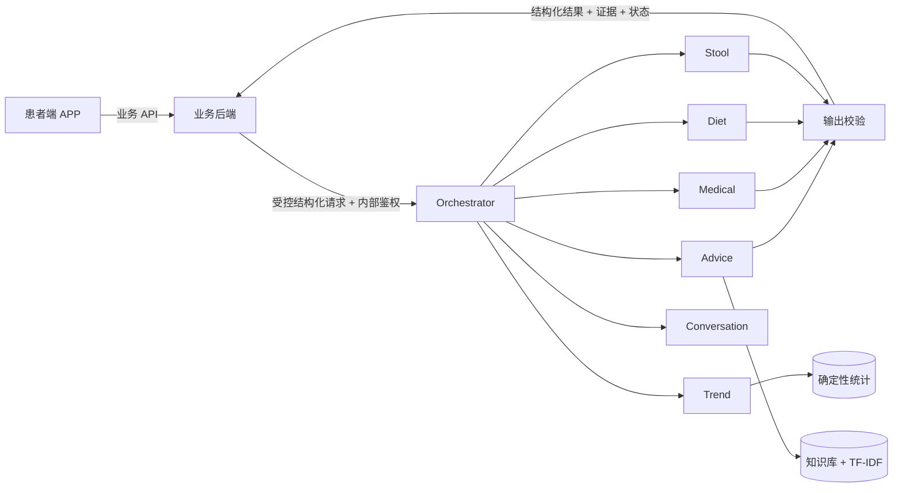
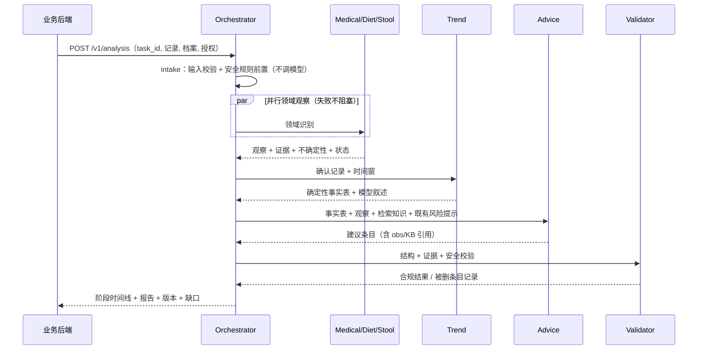

# 系统设计文档 · 智能体子系统章节（可直接并入综合系统赛道提交材料）

> 章节定位：说明 GutCare 中“多智能体分析引擎”的架构、数据契约、失败处理与安全约束。
> 版本 0.2.0 · 2026-10-17。
> 本文是比赛写作草稿。提交前须与 `docs/智能体详细开发文档.md` 和当时的代码、后端契约逐项核对。

## 1. 定位与边界

智能体子系统负责**推理侧**：多模态理解、跨来源时序分析、知识检索、建议生成与输出校验。

不负责（由业务后端承担）：账户与鉴权、数据归属校验、患者确认落库、业务任务状态与通知、
即时危险征象规则的**线上工程执行**、文件存储与访问控制。

设计原则：**围绕结构化患者数据协作，而不是让多个 Agent 互相聊天**。
Agent 之间只传契约对象（观察、证据、不确定性、状态），不传自由文本。

## 2. 组件与职责

| 组件 | 职责 | 是否用模型 | 关键实现 |
|---|---|---|---|
| Orchestrator | 阶段编排、依赖、超时、重试、幂等、结果复用、部分成功汇总 | 否（固定工作流） | `orchestrator.py` |
| Medical | 报告字段抽取 / 可见文字转写 / 医嘱文书抽取 | 是（视觉） | `agents/medical.py`，三套输出契约 |
| Diet | 单餐识菜、候选食物与不确定项 | 是（视觉） | `agents/diet.py`，禁止热量估算 |
| Stool | 排便记录结构化校验；图片质量评估与 Bristol 候选 | 记录否、图片是 | `agents/stool.py` |
| Trend | 计数/分布/缺失/时间对齐 + 趋势叙述 | 统计否，叙述是 | `stats.py` + `agents/trend.py` |
| Advice | 检索知识 + 观察 → 带证据的建议 | 是 | `agents/advice.py` |
| Conversation | 解释已有结果、整理随访问题；决策类问题不调模型 | 是（可选） | `agents/conversation.py` |
| Validator | 结构 → 证据 → 安全/数值落地三层校验 | **否** | `validation.py` |
| Safety Rules | 即时危险征象规则，同步毫秒级 | **否** | `rules.py` + `knowledge/safety_rules.json` |

“多智能体”在这里不是同一段提示词改名字：Trend 的主要工作在程序（统计），Stool 的记录校验不调模型、图片候选才调视觉模型，
Conversation 有独立的请求拦截，Medical 有三种不同输出契约，Advice 必须做检索与引用。

## 3. 编排流程

阶段状态逐段落库，`GET /v1/tasks/{id}` 可看到真实进度（不伪造百分比）。

## 4. 数据契约

`AgentResult` 统一字段：`task_id / agent / agent_version / prompt_version / model_id / status /
patient_id / input_record_ids / input_versions / input_snapshot_hash / observations /
uncertainties / needs_confirmation / confirmation_fields / data / findings / usage / error`。

- **观察类型必须显式区分**：`fact`（记录里明确存在）、`patient_report`（自述）、
  `derived_stat`（程序计算）、`model_inference`（模型推断）、`knowledge`（审核知识）。
  这样“患者说的”“算出来的”“模型猜的”在后端与 UI 上不会混为一谈。
- **证据可解析**：`source_record_ids` 必须是本次输入的子集；`source_refs` 可指向
  报告页/图像区域/知识条目，解析不了的内容在下一阶段会被删除。
- **输入快照哈希**：由记录 id/version/status 集合与档案版本算出，用于幂等、缓存与
  “依据是否已更新”的判断。

### 4.1 数据来源与适配层

真实联调时数据来自业务后端，不是样例文件。为证明“换数据源不用改 Agent”，适配层提供两条路径
并保证二者结论一致：

| 路径 | 用途 | 只读保证 |
|---|---|---|
| `Fixtures.analysis_request()`（seed JSON） | 开发与评测 | 只读文件 |
| `Fixtures.analysis_request_from_db()`（`fixture.sqlite`） | 模拟“后端数据库接入” | SQLite 以 `mode=ro` 打开，写操作直接失败 |

测试 `tests/test_sqlite_adapter.py` 逐项比对：同一患者的数据库记录与 seed 记录在
`record_id/kind/status/data` 上一致，由两者算出的趋势事实表（`by_kind`、缺失日、Bristol 分布、
症状汇总）完全相等；并显式验证“写入会被数据库拒绝”。正式联调时把这条路径换成
“后端授权接口 → TaskRequest”即可，编排与 Agent 不需要改动。

## 5. 失败与降级矩阵

| 故障 | 系统行为 | 用户可见结果 |
|---|---|---|
| 单个领域 Agent 超时/报错 | 该阶段标失败，其余继续 | `partial` + “某项识别未完成”，不影响其他结论 |
| 模型不可用（无 Key / 网络） | Trend 保留统计事实，Advice 不生成建议 | `partial`/`insufficient_data` + 明确原因 |
| 图像不可识别 | 返回“无法可靠识别”，不强行分类 | 允许手动录入，记录可保存 |
| **视觉模型不可用/不吃图** | 显式报 `unsupported_media_type`；可改走 `report_text_extract`（文本抽取） | 后端/患者提供 OCR 文本后仍能抽取字段与证据 |
| 报告无可用字段 | 不显示“解析完成” | `insufficient_data` + 建议更换文件 |
| 输出结构不合规 | 校验删除该条 + 记录 `finding` | “为什么少了一条建议”可解释 |
| 无已确认诊断 | 只给一般性记录建议 | `insufficient_data` + 原因 |
| 存在紧急风险提示 | 抑制普通饮食/活动建议 | 仅保留就医类建议，风险提示不被覆盖 |
| 重复提交 | 同快照返回同一任务 | 不产生重复报告 |

## 6. 安全设计

**两条路径分离**：

1. 即时危险征象（`/v1/safety/check`）：纯规则、同步、不调用模型；命中即返回分级提示与就医建议，
   按事件去重（1 小时），已读只改状态、不代表风险解除。
2. 生成结果校验（`validation.py`）：每次分析返回前执行，拦截剂量调整、诊断结论、因果断言、
   绝对化表述、精确热量、凭图诊断与延误就医，并做**数值落地**检查（结论里的带单位数字
   必须出现在事实表里）。

规则的阈值与文案标注 `review_status: unverified_demo`，真实用户前必须专业审核。

## 7. 可观测性

- `tasks` / `agent_results` / `findings` / `usage_log` / `safety_alerts` 五张表，
  可回答“这次分析用了哪个模型、哪版提示词、删了什么、为什么”。
- `GET /v1/meta` 汇总缓存命中、用量、校验发现分布、规则与知识版本。
- 演示控制台展示阶段时间线、观察来源、建议引用、被拦截条目——评审可现场核对。

## 8. 关键取舍（为什么这样做）

| 选择 | 理由 | 代价 |
|---|---|---|
| 单进程 + 标准库 HTTP | 评审机零安装即可运行，断网可演示 | 无自动 OpenAPI 生成，需手工维护 |
| 手写 DAG 而非 LangGraph | 阶段/重试/超时/复用完全可控，可逐行解释 | 少量重复代码 |
| SQLite 而非 Postgres | 单文件、可打包、可复现 | 不适合多实例并发（由后端承担生产状态） |
| TF-IDF 而非向量库 | 零依赖、结果可解释、引用稳定 | 召回不如语义检索 |
| 确定性统计在代码里 | 数字可核对、可复现、模型不能改数 | 统计口径需与后端对齐 |
| 校验“删条”而非“提醒模型” | 保证不合规内容不会到达用户 | 可能少给建议（宁缺毋滥） |

## 9. 评测方法与结果

| 指标 | 结果 | 方法 |
|---|---|---|
| 记录筛选/计数一致性 | 90/90 完全一致 | 与测试包 `business_answers.json` 逐条比对 |
| 安全规则阳性召回 | 9/9 | 测试包中患者主动报告便血的记录 |
| 安全规则假阳性 | 0/1017 | 正常排便/症状记录 |
| 结构合规 | 通过 | 所有观察均可解析回输入 |
| 消融（Baseline vs 多智能体） | **不支持结论率 29.1% → 0%**；**违规表述率 4.2% → 0%**；耗时 22.1s → 47.7s；token 6.3k → 8.4k（8 例） | `eval/ablation.py --mode live --cases 8`，同一模型/病例/事实表/知识，只改架构 |

未测项目（诚实声明）：报告字段准确性、食物识别准确性、OCR 字符错误率、排便图像分类、临床有效性。

## 10. 已知限制与后续工作

1. 视觉输入需在真实账号下冒烟确认；未确认前不宣称识图能力。
2. 排便图像识别流程已实现；无真实标注素材，分类准确率仍待验证。
3. 知识库仅 6 条示例，覆盖不足；规则阈值未经专业审核。
4. 助手暂不支持通过对话发起新分析（需在产品入口点击），避免聊天越权触发重任务。
5. 后续可做：语义检索升级、跨任务结果复用策略细化、按 token 预算裁剪上下文。
