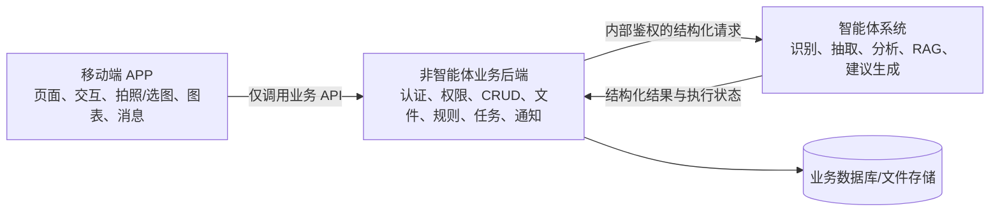

# GutCare Agent APP 及业务后端与智能体系统开发边界

> 文档版本：V1.2
> 编制日期：2026-10-14  
> 适用范围：GutCare Agent 移动端 APP 及其配套后端  
> 参考文档：`设计方案.md`、`详细功能设计.md`、`技术方案.md`、`数据库设计方案.md`、ADR-0022

## 1. 文档目的

本项目开发分为两个责任域，本文统一使用以下名称：

1. **APP 与业务后端开发方**：负责 Android 原生 APP、常规业务逻辑、数据管理和智能体接入。客户端工程与验收边界遵循 ADR-0022。
2. **智能体开发方**：负责模型推理、多智能体协作、医学知识检索及各类智能识别与生成能力。

本文用于明确双方的功能、代码和接口边界，作为开发、联调和验收依据。依据 ADR-0022，患者端现阶段为 **原生 Android APP**，唯一开发与验收环境为 Android Studio；旧 `app/` 只读归档，当前不开发 iOS，也不交付患者 Web 端。

## 2. 总体责任边界

核心原则：

- APP 不直接调用大模型、智能体或知识库，所有请求统一经过业务后端。
- 业务后端是用户身份、数据归属、有效业务数据和任务状态的权威来源。
- 智能体只处理业务后端授权并提供的数据，不自行管理用户账户和访问权限。
- 模型输出默认是“候选结果”，需要确认的内容必须经患者确认后才能成为有效业务数据。
- 确定性的危险征象规则独立于大模型，不能因智能体不可用而失效。

## 3. APP 与业务后端开发方的责任范围

### 3.1 移动端 APP

APP 与业务后端开发方负责患者端 APP 的完整设计与实现，包括：

1. **应用基础框架**
   - APP 启动、登录态恢复、页面路由、底部导航和返回逻辑。
   - 网络请求封装、令牌刷新、统一错误处理、加载状态、空状态和弱网重试。
   - Android 设备适配、安全区域、键盘遮挡、权限申请和基础兼容性处理；开发阶段模拟器验收，发布前完成真机验证。
   - 相机、相册、文件选择等系统能力接入。

2. **账户与个人中心**
   - 注册、登录、退出、忘记/重置密码、修改密码。
   - 可选昵称、头像、登录邮箱和最小必要基本资料（出生年份）的查看与编辑。
   - 隐私说明、敏感图片处理授权、普通提醒偏好、账号注销申请。

3. **首页与业务导航**
   - 今日待办、待确认结果、未读消息、风险提示和近期记录摘要。
   - 医疗档案、健康记录、分析中心、趋势、消息、个人中心等入口。

4. **医疗档案界面**
   - PDF/图片报告的上传、进度、失败重试、预览、列表、详情和删除。
   - 手动录入已确诊疾病、医嘱和用药信息。
   - 展示智能体返回的候选抽取字段，并支持逐项确认、修改和冲突核对。
   - 展示档案版本、来源和“待确认/已确认/解析失败”等状态。

5. **日常健康记录界面**
   - 饮食、排便、症状、服药和运动记录的新增、查看、修改、删除和历史查询。
   - 饮食与排便图片可选上传；无图片时仍可完成手动记录。
   - Bristol 类型、症状严重程度、持续时间、发生时间等结构化输入。
   - 展示饮食/粪便图像候选识别结果，并支持患者修正和确认。
   - 服药计划展示、服药/未服/待确认打卡及提醒设置。

6. **智能分析与建议界面**
   - 分析时间范围选择、发起分析、任务进度、失败原因、重试和取消入口。
   - 综合报告、证据来源、不确定性、缺失数据和历史版本展示。
   - 个性化建议的阅读、已读、归档、反馈及依据跳转。
   - 不在 APP 本地执行模型推理，也不在前端拼装医学结论。

7. **风险提示、消息与趋势**
   - 风险提示卡片、分级样式、触发原因、原记录跳转和“已查看”操作。
   - 站内通知中心、未读数、筛选、去重结果展示和目标页面跳转。
   - 历史时间线、排便分布、症状趋势、服药打卡和饮食—症状时间线。
   - 明确区分“无记录”和“数值为零”，明确区分时间关联与因果关系。

### 3.2 非智能体业务后端

APP 与业务后端开发方负责面向 APP 的统一业务 API 和所有非模型业务能力，包括：

1. **身份认证与账户安全**
   - P0 仅邮箱注册、验证、登录、退出、密码哈希、邮件重置密码、访问令牌和刷新令牌；APP 不展示手机号登录，手机号/SMS 不在当前版本范围内，变更须新增 ADR。
   - 接口鉴权、登录失效、频率限制、基础安全审计和账号注销流程。
   - 系统当前唯一业务角色为患者，但支持多个患者账户。

2. **数据模型与业务 CRUD**
   - Patient、MedicalDocument、MedicalProfile、MedicationPlan。
   - DietRecord、StoolRecord、SymptomRecord、MoodRecord、MedicationCheckin、ActivityRecord。
   - F14 心情数据专项授权、本人 CRUD、记录版本、删除/导出生命周期及含心情快照的授权校验。
   - AnalysisTask、AnalysisResult、HealthAdvice、RiskAlert、Notification 等实体。
   - 分页查询、条件筛选、软删除、时间字段、业务状态和必要的版本记录。

3. **数据归属与权限隔离**
   - 所有记录、文件、任务、建议和消息均以当前登录患者为作用域。
   - 后端逐次验证数据所有权，不能依靠 APP 隐藏按钮实现权限控制。
   - 防止通过记录 ID、文件 ID、任务 ID 或下载地址访问他人数据。

4. **文件与敏感资料管理**
   - 上传校验、文件类型与大小限制、文件元数据、受控访问和删除策略。
   - 报告、饮食图片、粪便图片的私有存储与临时授权访问。
   - 敏感图片授权状态记录；未获授权时不向智能体或第三方模型服务传输。

5. **患者确认与数据版本管理**
   - 分开保存原始输入、智能体候选值和患者确认值。
   - 患者修正记录后生成新版本，并将依赖旧版本的建议标记为“依据已更新”。
   - 历史报告保留生成时所用的数据版本，不进行无痕覆盖。

6. **智能任务接入与生命周期管理**
   - 接收 APP 请求，校验权限、数据完整度和授权状态。
   - 创建业务侧任务，生成幂等键，向智能体服务提交结构化请求。
   - 保存待处理、处理中、待补充、成功、部分成功、失败、已取消等状态。
   - 接收智能体回调或轮询结果，校验响应结构并持久化结果和来源引用。
   - 提供超时、有限重试、重复提交去重和失败后的用户可见状态。
   - 智能体内部如何拆分和调度各 Agent，不属于本部分实现。

7. **确定性安全规则引擎**
   - 实现经医学专业人员审核并交付的危险征象规则、版本和启停配置。
   - 在症状或排便记录提交后同步/优先执行，不等待智能分析任务。
   - 生成、去重、保存风险提示，支持已读、重新评估和历史追溯。
   - APP 与业务后端开发方负责规则执行工程；临床阈值、适用条件和医学文案的制定与专业审核不属于该责任域。

8. **通知、提醒与统计**
   - 站内通知生成、未读计数、已读状态、消息去重和关联跳转信息。
   - 服药提醒等普通任务提醒；如接入系统推送，负责设备令牌和推送业务接入。
   - 基于已确认数据完成确定性统计聚合及图表数据接口。
   - 智能生成的周期总结由智能体提供，后端只负责发起、保存和返回。

9. **工程基础能力**
   - 数据库迁移、配置管理、成功响应 DTO、RFC 9457 错误响应、稳定错误码、日志脱敏和健康检查。
   - API 文档、接口测试、权限测试、幂等性测试和关键业务集成测试。
   - 智能体故障时保证注册登录、资料维护、记录增删改查、历史查看和安全规则仍可用。

## 4. 智能体开发方的责任范围

以下内容由智能体开发方负责；APP 与业务后端开发方仅按照约定接口接入、展示和保存智能体结果：

1. **多智能体框架及内部调度**
   - Orchestrator、Medical Agent、Diet Agent、Stool Agent、Trend Agent、Advice Agent 的实现。
   - Agent 选择、执行顺序、上下文组织、内部状态、冲突处理和 Agent 内部重试。

2. **模型与智能算法**
   - 医疗报告 OCR、版面分析、字段抽取及语义理解。
   - 饮食图片识别、食物类别抽取和置信度计算。
   - 粪便图片质量判断、Bristol 类型辅助识别和视觉特征提取。
   - 自由文本中的候选症状抽取。
   - 多源时间序列关联、趋势发现、综合推理和不确定性判断。
   - 个性化生活建议、智能周期总结及患者可读解释的生成。

3. **医学知识与生成质量**
   - RAG 检索流程、独立知识库、知识切分、召回与引用选择；生产知识库使用独立数据库与独立角色，其 schema/迁移由智能体开发方负责。
   - 提示词、模型选择、微调、推理参数、模型降级和模型成本优化。
   - 智能输出的事实性、证据完整率、幻觉率和模型效果评测。
   - 医学知识材料、危险征象规则和临床文案的专业制定与审核。

4. **超出当前产品范围的系统**
   - 医生端、家属端和运营管理端的业务产品开发。
   - 医院 HIS/EMR、医保、真实处方开立、在线问诊和可穿戴设备对接。
   - 疾病诊断、处方调整、用药剂量推荐和紧急救援调度。
   - 患者 Web 端、桌面端或微信小程序；若后续新增，需单独评估范围。
   - APP 商店上架、软著/医疗合规认证等非研发事项，除非另行约定。

## 5. 按功能模块划分责任

| 功能模块 | APP 与业务后端开发方负责 | 智能体开发方负责 |
|---|---|---|
| F01 账户与基本资料 | APP 页面、注册登录、账号安全、资料 CRUD、数据隔离 | 无 |
| F02 医疗档案 | 上传/预览/删除、手动填写、确认纠错、版本和状态 | OCR、报告理解、候选字段抽取 |
| F03 饮食记录 | 记录 CRUD、图片上传、确认交互、历史查询 | 食物图像识别、候选类别和单餐智能分析 |
| F04 排便记录 | 记录 CRUD、手动 Bristol 类型、图片上传、确认交互 | 图像质量判断及单一 Bristol 1–7 候选；不输出外观标签或分组 key |
| F05 症状记录 | 表单、存储、修改、查询、确定性风险规则触发 | 自由文本候选症状抽取（如启用） |
| F06 服药管理 | 计划 CRUD、来源记录、打卡、提醒和统计 | 不生成或调整处方；如参与综合分析则只读取确认数据 |
| F07 运动记录 | 记录 CRUD、统计与趋势数据 | 跨来源趋势分析中的活动因素解释 |
| F14 心情记录 | APP 心情录入/历史、本人访问和删除、两项心情专项同意、受控 F08 快照投影 | 仅处理业务后端提供的逐任务冻结快照；不得按患者自行查询，不得使用自由备注或作心理诊断/危机判断 |
| F08 智能分析中心 | 发起入口、前置校验、业务任务、状态、重试、结果落库与展示 | Agent 内部编排、分析执行和结构化结果生成 |
| F09 个性化建议 | 建议保存、查询、已读、归档、反馈和证据跳转 | 建议内容、依据、不确定性和适用条件生成 |
| F10 风险提示 | 已审核规则的工程实现、即时触发、卡片、去重、已读与追溯 | 模型辅助解释；不得替代确定性规则 |
| F11 趋势与历史 | 时间线、确定性统计、图表、原记录跳转 | 智能趋势摘要和跨来源关联发现 |
| F12 消息与提醒 | 通知中心、未读、去重、任务/打卡提醒、推送接入 | 提供需要通知的智能任务事件和结果摘要 |
| F13 隐私与设置 | 授权、偏好、删除、注销、敏感文件访问控制 | 遵守授权范围并限制智能处理的数据使用 |

## 6. 关键接口边界

### 6.1 APP 与业务后端

- APP 只传递当前操作所需的业务数据，不自行传入可信的 `patient_id` 作为权限依据。
- 业务后端从登录态解析患者身份，并对每个资源执行所有权校验。
- 成功响应直接返回资源/分页 DTO 或 `204`；错误统一使用 `application/problem+json`（RFC 9457）并携带稳定 `code` 与 `request_id`。APP 不根据模型原始响应猜测状态。
- APP 不持有模型密钥、对象存储永久密钥或数据库凭据。

### 6.2 业务后端与智能体服务

实现状态补充（2026-10-21）：Agent 是独立服务进程；本机 `phone-demo` 的可选 profile 不属于正式部署拓扑。业务 Worker/dispatcher 经业务 API 唯一 claim，Agent 仅按任务读取冻结快照并回调结构化结果，不能获得业务数据库凭据或直接写业务表。F08→F09 mock Compose 路径已有患者 advice 读回证据，F03/F04 mock 合成图片任务已有候选回调与患者确认证据；这些不等于生产验收。视觉层 live 冒烟单次调用等待后中断，结果不确定且未重试。默认 Compose 恢复 mock，测试候选 fixture 关闭。真实模型接入与效果验证仍未形成证据。来源、导入 commit 和许可状态见 `../agent/PROVENANCE.md`。

智能体接口至少应接收：

- `task_id`、`patient_id`（内部受控标识）、分析类型和时间范围。
- 实际允许使用的输入记录、记录 ID、记录版本及确认状态。
- 敏感数据授权范围、请求时间和幂等标识。

智能体接口至少应返回：

- `task_id`、`agent_name`、`status`、错误码和模型/流程版本。
- `input_record_ids`、`input_versions` 和实际使用的数据范围。
- `observations`、`source_references`、`uncertainties`、`needs_confirmation`。
- 结构化结果，不以只有自然语言的一段文本作为唯一返回值。

### 6.3 “任务编排”的拆分

- **APP 与业务后端开发方负责业务任务编排**：谁可以发起、输入是否有效、任务是否重复、任务状态如何保存、失败如何反馈、结果如何入库和通知用户。
- **智能体开发方负责推理任务编排**：本次调用哪些 Agent、Agent 的先后/并行关系、中间结果如何合并，以及智能体内部错误如何降级。

### 6.4 “患者确认”的拆分

- 智能体返回候选值及置信/不确定信息。
- APP 与业务后端开发方负责候选值的展示、编辑、确认操作、确认记录和版本更新。
- 业务后端只把已确认值作为后续个性化分析中的确定事实；未确认值必须带明确标识。

F03/F04 图片识别遵循 ADR-0021：图片使用既有 F02 file upload/gateway 和 `file_object`，绝不创建 `medical_document`；附件集合分别由 diet/stool 表管理，饮食每餐最多10张、排便每条最多1张。request 附件冻结以 `analysis.record_image_request_attachment` 类型化关系表为 canonical，XOR、患者复合 FK、record-type trigger、同 request 内 position/附件唯一性由数据库强制；不同 request/retry 可各自引用同一附件并冻结独立 file_version，不使用 JSONB snapshot。手动 CRUD 不等待 Agent；业务 Worker 唯一 claim，Agent 只读 request-scoped 短时单图能力并提交候选。患者只可对 failed/cancelled/invalidated 且来源仍存在的请求显式 retry；重验三授权、用途告知、当前版本和附件并创建新 request/attempt，旧 request 不可变，不复用 capability/candidates/group。Diet 候选须按 request-local opaque UUID `candidate_group_key` 显式分组；仅名称确认创建非空 DietItem，类别和份量之后仍逐字段确认，不按相似值合并；Stool 仅有 Bristol 候选。患者逐项 accept/edit/reject 后业务端才写患者确认事实。图像候选不估算精确营养，不作诊断/出血/风险推断，不改 F10/F08；GET/export/F08/F11 仅使用确认字段。授权、purpose-specific disclosure、撤回、删除与幂等/version 规则以 ADR-0021 和机器契约为准。

## 7. 非功能责任

### 7.1 APP 与业务后端开发方负责

- APP 可用性、移动端适配、基础无障碍和交互一致性。
- 业务 API 的稳定性、鉴权、数据隔离、日志脱敏和常规性能。
- 文件访问安全、数据备份恢复方案、任务幂等和状态可追溯。
- 自己负责模块的单元测试、接口测试、集成测试与缺陷修复。
- 提供联调环境、接口文档和模拟智能体响应，以便双方并行开发。

### 7.2 智能体开发方负责

- 智能接口的可用性、响应格式稳定性、模型超时控制和内部错误处理。
- 模型准确性、召回质量、生成安全性、结果可解释性和评测报告。
- 模型及知识库版本可追踪，并保证同一任务的输出能够定位到对应版本。
- 不访问请求范围外的数据，不长期保存不必要的患者敏感原文或图片。

## 8. 联调交付条件

智能体开发方向 APP 与业务后端开发方提供以下内容后，视为具备正式联调条件：

1. OpenAPI 或等价的接口说明，包括请求、响应、枚举、错误码和超时约定。
2. 报告抽取、饮食识别、排便识别、综合分析和建议生成的样例请求/响应。
3. 成功、部分成功、无法识别、数据不足、超时和服务异常等完整状态样例。
4. 服务地址、内部鉴权方式、文件传递方式、最大文件限制和回调/查询机制。
5. 模型/流程版本字段、幂等处理方式及测试环境可用性说明。

APP 与业务后端开发方向智能体开发方提供：

1. 经权限校验的结构化业务数据和受控文件访问方式。
2. 稳定的 `task_id`、内部患者标识、记录 ID、记录版本和确认状态。
3. 任务提交、状态回调/查询和结果接收的接口约定。
4. 不含真实患者隐私的模拟联调数据及预期业务流程。

## 9. 验收口径

APP 与业务后端部分完成需至少满足：

1. 患者可在 APP 完成注册、登录、退出、密码处理和个人资料编辑。
2. 多患者数据严格隔离，越权访问记录、文件、任务和建议均被拒绝。
3. 患者可完整管理医疗档案及饮食、排便、症状、服药和运动记录。
4. 智能体不可用时，基础记录、历史查询和确定性风险规则仍可运行。
5. 智能候选结果可被患者确认或纠正，且新分析使用最新确认版本。
6. 分析任务有真实、可恢复、可追踪的状态，重复提交不会产生大量重复任务或通知。
7. 智能结果、建议、证据和风险提示能在 APP 中正确展示并回溯到原记录。
8. 注册登录、核心 CRUD、权限隔离、文件访问、任务状态和异常路径均有测试覆盖。

以下情况不作为 APP 与业务后端部分的缺陷：

- 智能体返回了符合接口结构但医学内容不准确、识别错误或建议质量不达标。
- 智能体超时、不可用、知识召回不足或模型版本行为变化。
- 未经医学专业人员审核的规则内容、临床阈值或医疗文案无法投入真实使用。

但若业务后端未正确校验、保存、隔离、展示或标记上述结果，仍属于 APP 与业务后端开发方的责任范围。

## 10. 范围变更原则

新增医生/家属角色、Web 端或小程序、手机号/SMS 登录、第三方设备/医院系统、在线问诊、复杂运营后台等能力，均不自动包含在本开发边界内。P0 所需的标准 SMTP 邮件发送适配器属于 APP 与业务后端开发方范围。新增需求应先明确所属方、接口影响、数据权限、验收标准和工期，再进入开发。

本边界文档与 `docs/README.md` 的主题权威矩阵共同生效；业务目标、数据安全原则和医疗安全限制继续有效。
