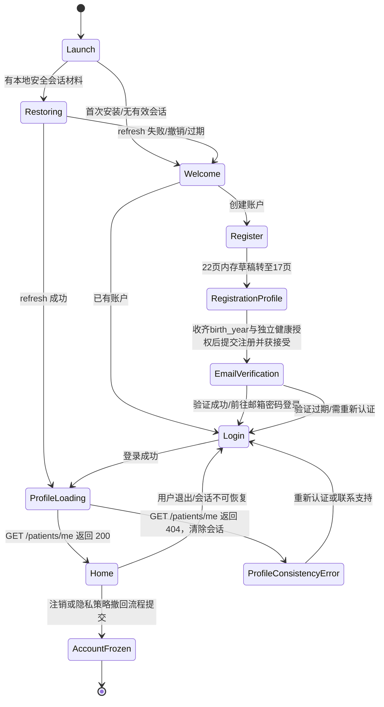

# GutCare APP UI 原型审查与页面导航规范

> 版本：V1.2 · 2026-10-18（补充 F11 历史时间线与趋势 APP 路由契约）
> 范围：22 页 UI 原型内容审查、APP 页面路由与状态导航、功能责任边界、视觉还原和验收证据。
> 证据边界：已通过浏览器完整读取 22 页的页面内容与结构；未实际点击验证原型跳转。本规范中的路由是工程建议，所有跳转必须在实现期通过自动化测试及 Android/iOS 设备验证。

本规范依赖 `docs/前端开发与前后端联调计划.md`、F14 ADR-0019 和当前 OpenAPI；原型事实不覆盖已冻结的数据、认证和授权契约。

## 1. 原型事实与正式实现修订

### 1.1 已读取的页面清单

| 序号 | 原型页面 | 页面主要内容/事实 | 建议路由 |
|---:|---|---|---|
| 01 | 欢迎 | 产品欢迎、进入应用 | `/welcome` |
| 02 | 首页 | 今日摘要与功能入口 | `/tabs/today` |
| 03 | 饮食 | 饮食记录与回顾 | `/records/diet` |
| 04 | 综合分析报告 | 分析结果和依据展示 | `/analysis/tasks/:taskId` |
| 05 | 个性化建议 | 建议列表/详情入口 | `/advice`、`/advice/:adviceId` |
| 06 | 健康趋势 | 趋势图及分类切换，含心情 tab | `/trends` |
| 07 | 风险提示 | 风险提示列表/详情 | `/risk-alerts`、`/risk-alerts/:alertId` |
| 08 | 健康档案 | 患者资料与医疗档案入口 | `/records/health-archive` |
| 09 | AI 助手 | Agent 对话/智能交互原型入口 | `/assistant`（能力未冻结前隐藏或仅展示受限入口） |
| 10 | 个人中心 | 账户与个人功能入口 | `/tabs/me` |
| 11 | 检查报告详情 | 检查报告、解析结果或档案详情 | `/records/medical-documents/:documentId` |
| 12 | 排便 | 排便记录与回顾 | `/records/bowel` |
| 13 | 症状 | 症状记录与回顾 | `/records/symptoms` |
| 14 | 发起综合分析 | 输入范围/记录计数与发起操作 | `/analysis/new` |
| 15 | 用药计划 | 计划、日程与打卡 | `/medications` |
| 16 | 心情 | 心情等级、日期、时间、备注和保存 | `/records/mood/new`、`/records/mood/:recordId/edit` |
| 17 | 开始建档 | 注册流程中的出生年份与独立健康数据授权引导 | `/auth/register/profile` |
| 18 | 历史报告 | 分析任务历史及心情次数 | `/analysis/history` |
| 19 | 运动 | 活动记录与回顾 | `/records/activity` |
| 20 | 设置 | 设置、授权、隐私和账户操作 | “我的”→设置 hub `/pages/settings/index`；隐私中心 `/pages/privacy/center` 从 hub 单独进入 |
| 21 | 登录 | 原型占位符为“手机号 / 邮箱” | `/auth/login` |
| 22 | 注册 | 原型使用手机号 | `/auth/register` |

必要但不单独计入 22 个原型页面的流程状态只有 `/auth/email-verification`（邮箱验证）、会话恢复、登录后 `GET /patients/me` 资料加载和资料 404 安全错误态。P0 注册已必填出生年份并同事务创建 profile，服务端没有“资料未完成”状态或补全接口，因此不得实现 `/onboarding/profile` 分支或虚构新的患者功能页面。

以上只记录已读取的内容，不代表页面之间现有跳转已验证，也不证明原型未列出的交互已经存在。

### 1.2 实施时必须修正/确认的差异

| 原型事实 | 正式实现规则 |
|---|---|
| 登录占位“手机号 / 邮箱”，注册使用手机号 | 按 ADR-0007/0019 与认证契约，注册、登录、找回密码统一使用邮箱 + 密码。删除手机号输入、短信验证码及 SMS 分支；不采集非必需手机号。 |
| 心情页五档：愉快、平静、一般、低落、烦躁；日期、时间、选填备注、保存 | 保存到 F14：等级映射 `愉快=5`、`平静=4`、`一般=3`、`低落=2`、`烦躁=1`；日期时间转为含时区 ISO 8601，并由服务端以 UTC 保存。备注可空且不进入 Agent 快照、日志、趋势、风险规则或通知。 |
| 现有原型未提供情绪标签选择 | `emotion_tags` P0 允许空数组，不从心情等级或备注推断标签。若将来增加标签 chips，须有明确版本化 UI 交付，且只能由患者显式选择受控标签；不阻塞本版 P0。 |
| 综合分析页显示心情记录数量 | 展示值必须区分范围内记录数、具备四项授权后可纳入本次快照数、因授权不满足而未纳入数；不能把“未获授权”误显示成没有记录。 |
| 健康趋势含心情 tab | 趋势只展示已授权的结构化聚合数据，不展示备注或诊断性解释；无授权/无数据使用不同状态。 |
| 历史报告显示心情次数 | 次数必须来自该任务的不可变快照输入清单，不根据当前记录反算历史；撤回授权不得改写已完成任务快照。 |
| 存在 AI 助手页面 | 原型页面本身不等于 Agent 能力契约。未有独立批准的功能、接口和隐私边界时，不开放直接自由对话；智能分析只经业务后端创建的任务和冻结快照访问 Agent。 |
| 注册页仅有手机号、两次密码、用户协议/隐私政策；开始建档页有年龄/健康资料 | 冻结 OpenAPI `RegisterRequest` 要求邮箱、密码、出生年份、隐私政策版本、`health_data_processing_consent=true` 及其版本。正式流程拆为两屏采集、单次提交：22 注册页改为邮箱、密码、确认密码及隐私政策说明/版本；本屏只保存受控内存草稿并转至 17。17 开始建档页先展示健康数据处理的独立、明确同意，再收集必填出生年份；年龄换算会受生日及跨年歧义影响，优先直接输入出生年份。用户同意并完成必填项后，合并草稿一次调用 `POST /auth/register`。后端认证契约不变；不在注册 DTO 中加入昵称、性别或报告上传。昵称如需设置，可在账户验证/登录后经患者资料接口完成；检查报告必须登录后走 F02 上传/档案接口。未同意健康数据处理时不提交注册请求，不采集出生年份/健康资料。确认密码仅作客户端校验，不发送到后端，隐私政策同意与健康数据处理同意必须分开显示和表达。 |

心情授权按 ADR-0019：新增/修改要求 `health_data_processing` 和 `mood_data_processing`；将 mood 纳入 F08 分析还要求 `mood_ai_sharing` 和 `third_party_ai` 全部有效。缺少 mood 授权只排除 mood，不阻断其他本来可分析的健康记录。

## 2. 页面路由与底部导航规范

### 2.1 页面栈和路由参数

- 原生 APP 使用 uni-app 页面路由，不把患者端实现成 H5/Web 应用。
- 页面路径按本文件表格登记；详情/编辑页只用不可猜测的资源 ID 参数，不在 query、日志或分享链接中携带备注、健康字段、Token 或文件 URL。
- 列表到详情使用 `navigateTo`；返回原列表时保留合理的筛选、滚动位置和草稿状态。详情到编辑使用 `navigateTo`，保存后回详情或列表并刷新版本。
- 四个底栏主页面是根级 Tab：今日、记录、分析、我的。Tab 之间切换必须复用根导航，不能叠加同一 Tab 的重复页面栈。
- 一级记录 Tab 页面顶部显示五个记录分类：饮食、排便、症状、心情、运动。切换分类仅切换当前记录子页，不把五个分类再重复放进全局底栏。
- Tab 根页面可见底栏；登录、建档、编辑/详情、分析任务详情、档案详情、风险详情、设置等二级流程页默认隐藏底栏，使用系统返回/显式返回控件。
- 若会话失效，导航到登录页并保存受限的站内 `returnTo`（只允许本 APP 注册路由白名单）。重新认证后恢复原安全目标；注销、账户冻结、删除账户流程不得恢复旧目标。
- F13 注销从受保护设置入口进入高危确认；服务端受理后先持久化独立原生 receipt，再清会话/returnTo/受保护栈并 reLaunch 到无认证注销进度页。进度查询不得把凭证放入导航 query；receipt 仅在首次响应当次显示，receipt:null 不得伪造恢复。
- F13 数据导出从受保护隐私中心进入 `/pages/privacy/exports`；类别必须来自冻结白名单，创建只生成 preview，用户再次明确确认才入队。七种状态只按服务端响应展示；含心情类别提示 S4。下载 capability 仅在当前页面内存并通过同源 gateway 的 header 发送，不进入 URL/query/普通存储/日志/analytics/剪贴板；无可验证的 ZIP 保存/分享能力时 fail-closed，临时下载文件需清理。

### 2.2 建议的底栏职责

| Tab | 负责内容 | 关键入口 |
|---|---|---|
| 今日 | 今日概览、待完成事项、风险卡片、站内通知未读数、快速记录 | 饮食/排便/症状/用药/心情快速记录；分析入口；风险详情；通知中心 |
| 记录 | 记录分类选择、分类列表和新建入口 | 顶部 tabs：饮食/排便/症状/心情/运动；进入对应新建表单与历史详情 |
| 分析 | 开始综合分析、进行中任务、历史报告 | `/analysis/new`、任务详情、报告历史、结果与证据 |
| 我的 | 个人资料、健康档案、建议、用药、趋势、通知、设置 | 个人中心模块入口；通知中心及未读数；隐私授权、导出、账户设置 |

个性化建议和健康趋势可从首页卡片与“我的”区域进入；风险提示可从首页风险卡片和站内通知进入。具体入口不得制造第二套冲突底栏。

F12 通知中心作为四个主 Tab 之外的受保护二级页面，从今日入口和“我的”入口进入；未读数以 `/notifications/unread-count` 服务端响应为准。target 只允许服务端受控类型映射：风险详情、用药页面、分析任务安全占位或已实现的受保护建议详情；建议详情只接受通知页发起的固定路由，来源标记 `from=notification` 必须由内存中的通知 UUID 授权，顶部/系统返回优先恢复原通知详情，缺少受控上下文则回通知列表。未读 target 不可用、为空或未知时不推测目的地、不拼任意深链。普通通知开关和静默时段不得影响风险通知，也不得改变风险业务已读状态。

F11 历史时间线作为记录 Tab 下的受保护二级页面，从记录分类页进入并返回所属 Tab。类别仅限 diet/stool/symptom/mood/medication_checkin/activity/advice；since/until 必须带时区并按 UTC 半开区间 `[since,until)` 解释。列表只显示受控类别、发生时间和 target，不复制正文、心情备注/标签或敏感摘要；target 仅固定映射到记录详情、用药页、建议安全占位，null、未知、ID 无效或目标不可用时不跳转。游标与类别/时间筛选绑定，筛选变化清除旧游标；追加失败保留当前条目和游标。首屏加载和返回列表后的刷新须去重，离页时失效在途响应。

F11 趋势作为受保护二级页面注册在 `/pages/trends/index`，分析与我的入口分别绑定 `owner=analysis` 与 `owner=me`，返回来源栈或所属根 Tab。日期输入基于账户 IANA 时区生成带时区 UTC 半开范围，支持快速范围、自定义日期和日/周粒度；切换范围或粒度重新请求服务端聚合。页面分别呈现 activity、stool、symptom、diet confirmed categories、medication checkins 和 mood 六类结果，不在客户端合并或重算。mood `availability=consent_required` 显示缺少的健康/心情处理授权及隐私中心入口，不得显示成 0；`available` 空 buckets 才表示已授权无记录。标题限定为患者自评/记录统计；不显示 mood note/emotion_tags，不生成诊断、病因、因果、饮食或运动建议。加载、空、授权不可用、接口错误和离线状态必须分开；刷新失败保留旧值并显错，离页请求响应不得回填。

F03/F04 图片操作留在对应记录详情/编辑流程内，不新建独立顶级导航页。上传前说明敏感图片用途；关联后显示私有缩略图/访问状态。发起识别前展示对应 purpose-specific 告知全文/要点及第三方处理披露，需患者当次明确确认；拒绝、撤回、Agent 不可用均回到可手动编辑记录态。识别状态与逐项候选呈现在当前记录详情，候选逐项接受/编辑/拒绝；页面不可把模型候选显示成已确认食物/Bristol。来源图片删除或版本冲突时清除候选细节并重新读取最新记录；授权撤回后关闭任务页面内的图片/候选能力。饮食最多十图，排便最多一图。

F09 建议工作区由分析与“我的”入口分别进入 `/pages/advice/analysis`、`/pages/advice/index`，详情 `/pages/advice/detail` 保留 `ownerTab` 与来源语义；历史 target 进入受保护建议详情并以 `from=history` 返回来源栈。站内通知 target 使用已实现的建议详情，但 `from=notification` 仅在路由器内存持有由通知详情页发出的有效通知 UUID 时生效；顶部和系统返回均 `redirectTo` 该通知详情，若无受控 UUID 则回通知列表。通知 target 不接受任意 URL 或外部 query 指定的返回地址；直接深链仍退回 owner Tab。风险优先上下文若存在，必须在建议前方以图形+文本提示并固定跳转 F10；`read`/`reevaluated` 不得解释为风险解除或安全。建议读、归档、反馈均为显式操作；409 不自动覆盖或重提。证据只显示已验证的受控来源标签，locator 不原样展示；知识 citation 只展示无凭证 HTTPS 域名，不自动打开、不输出原始 URL。建议正文不进入通知、日志或埋点；不得显示 mood note/emotion_tags。

## 3. 入口、返回和不合理跳转修正

### 3.1 标准入口和返回路径

| 目标页面 | 合法入口 | 成功/返回行为 |
|---|---|---|
| `/welcome` | 首次安装或无已完成初始化标记 | 继续到登录/注册；有效会话加载本人资料成功后跳今日，不重复显示欢迎页 |
| `/auth/login` | 欢迎页、注册页已有账户链接、失效会话 | 成功后立即 `GET /patients/me`；200 进入今日，404 清除会话并显示含 request_id 的一致性故障；返回到欢迎/注册，不返回受保护页面 |
| `/auth/register` | 欢迎页、登录页注册链接 | 第 22 页校验后转至 `/auth/register/profile`；合并 DTO 提交后进入邮箱验证，再引导登录；不跳过验证/登录进入受保护页 |
| `/auth/register/profile` | 22 注册页点击继续 | 收集出生年份与健康数据处理独立同意；合并内存草稿调用 `POST /auth/register`，成功进入邮箱验证 |
| 记录新建/编辑 | 记录 Tab、首页快速入口、对应详情 | 保存成功回到来源详情或列表；取消不提交；并发版本冲突提示刷新，不覆盖他人/新版本数据 |
| 分析新建 | 分析 Tab、首页分析卡片、历史报告入口 | 创建成功进入任务详情；用户取消回来源页；失败保留输入范围并允许显式重试 |
| 风险详情 | 今日风险卡片、风险列表、相关通知 | 返回原入口；紧急风险提示须允许直接查看明确就医提示，不要求先经过 Agent 分析 |
| 医疗报告详情 | 健康档案列表 | 返回该档案列表；解析候选须由患者逐字段确认，候选不能直写已确认事实 |
| 设置/隐私 | 我的 Tab | 变更授权后返回设置/发起页，并立即刷新可用状态；不把撤回误处理成仅隐藏 UI |

### 3.2 必须避免的跳转错误

1. 欢迎页不得因单击“开始”绕过注册、邮箱验证、授权或首次建档直接进入已登录首页。
2. 注册/登录成功后，服务端会话状态是身份依据；客户端缓存、原型静态内容或“已登录”按钮状态不能替代后端鉴权。
3. 未登录深链只允许经过白名单的站内目标，在登录后重新校验授权和资源所有权；不能恢复到另一个患者的详情 ID。
4. 心情页“保存”不得把原型备注自动发给 Agent；只有任务创建时满足四项授权，后端才将允许的结构化字段写入冻结快照。
5. 趋势/历史报告的心情统计不得从当前记录推断历史任务输入；报告必须绑定当时快照输入和来源版本。
6. 风险提示不得跳到普通建议或 AI 助手并因此延迟/替代就医提示；紧急危险征象始终显示非 Agent 的确定性安全提示。
7. 服药计划页面不得提供改处方剂量或由 Agent 自动改变用药；未确认计划不得进入已启用状态。
8. 已撤回 mood 授权时，不得把“可查看/删除本人既有数据”误导成“可继续新建/修改”或“仍会纳入分析”。
9. 删除/注销确认后不得用返回导航重新暴露已软删除数据；登录过期或账户冻结后应清除受保护页面栈和敏感内存状态。
10. 22 注册页不能直接调用当前 `POST /auth/register`，因为该契约还必需 `birth_year` 及健康数据处理单独同意；应先到 17 页完成明确同意和出生年份收集，再合并字段一次提交。注册草稿只存在于页面内存；退出、取消或流程重置时清除密码等敏感内容。服务端接受注册后先邮箱验证，再由用户使用邮箱密码登录；验证接口成功不视作已登录。

## 4. 未登录、首次建档和已登录状态机

规范说明：

- `Launch/Restoring/Welcome/Login/Register/RegistrationProfile/EmailVerification/ProfileLoading/ProfileConsistencyError` 属于公开或会话建立流程；注册中的 17 开始建档页是 `/auth/register/profile`，仅在内存中暂存待提交字段。登录或 refresh 成功后必须先读取 `/patients/me`，200 才进入受保护页面；404 清除会话、保留 request_id 并显示不可继续的安全错误，不创建本地假资料。
- 登录方式固定邮箱 + 密码。邮箱验证通过后方可建立正式患者会话；重复注册/凭据错误提示不得泄露账户是否存在。
- 17 页的注册前置采集为邮箱注册 DTO 的必要字段：`birth_year`、`health_data_processing_consent` 和对应告知版本；该页只在本地内存收集，用户未同意前不采集出生年份、不创建患者资料，也不发送注册请求。最终请求一次携带两页字段。
- 注册请求经服务端接受后仍须邮箱验证；验证接口返回成功不自动代表 APP 已持有患者会话，按冻结认证契约再使用邮箱密码登录。首次注册已带出生年份且后端同事务创建 profile；P0 不存在“资料未完成”分支，资料缺失视为服务端数据一致性故障。
- 必填资料与授权要求遵循 F01 和隐私授权契约；未同意健康数据处理时不得采集出生年份或健康档案信息，也不得创建受保护的医疗资料。
- 建档可分步保存非敏感进度，但敏感字段不应在未经授权时本地持久化；中断恢复前重新鉴权。
- `AccountFrozen` 不允许恢复到普通首页，按 F13 注销/冻结状态显示受限处理状态或终态确认。

## 5. Agent 与非 Agent 功能边界

| 页面/能力 | 非 Agent（APP + 业务后端） | Agent 服务 | 禁止边界 |
|---|---|---|---|
| 登录、注册、邮箱验证、建档、资料、隐私授权 | 表单、认证、会话、状态、授权记录、权限和生命周期 | 无 | Agent 不处理密码、验证码、会话或授权数据库 |
| 饮食、排便、症状、运动、心情、用药记录 | 输入/校验/CRUD、本人隔离、版本和幂等、风险规则边界、时间线 | 仅在明确的识别/分析任务契约中消费获准冻结输入 | Agent 不直接读业务表或写改记录；不从心情备注推断标签 |
| 健康档案/检查报告 | 文件上传存储、解析任务编排、候选确认、事实入库、归属和删除 | 受限解析/抽取 | 未经患者确认的候选不是患者事实；Agent 不保存/维护档案状态 |
| 发起综合分析、任务状态、历史记录 | 授权检查、幂等、患者 consent fence、任务与不可变快照、取消/重试、快照计数 | 对冻结快照执行允许的多智能体分析并返回契约化结果 | Agent 不能自行检索患者数据库、修改快照或绕过授权 |
| 综合分析报告、历史报告、建议 | 业务后端校验结构、证据归属、患者可见性、状态和反馈；APP 展示 | 生成受限分析观察/建议内容 | 不把分析观察写回已确认事实；不产生诊断、处方或剂量调整 |
| 趋势、风险提示 | 趋势确定性聚合；风险由经审核规则计算与呈现 | 不控制 F10 风险触发/紧急提示 | 不把心情与疾病描述为因果；紧急风险不等待 Agent |
| AI 助手原型页 | 若未来批准，业务后端须提供独立鉴权、限流、审计和数据最小化契约 | 仅访问明确授权和冻结的数据范围 | 本版不因原型出现“AI 助手”就开放自由聊天、数据库查询或模型直写 |

Agent 是独立服务。APP 只访问业务后端 `/api/v1`；由业务后端的受控任务流程与 Agent 通信。Agent 与业务库隔离，只读逐任务冻结快照。

## 6. 视觉还原与 95% 相似度验收

设置枢纽没有独立的原型页面截图或像素基线，不纳入 95% 像素相似度通过声明；按既有 GutCare 视觉令牌实现并记录功能/触控验收即可。

### 6.1 对照基准

95% 是对原型已交付页面与状态的视觉验收目标，不表示页面功能相似即可通过。实施前应归档原型的同一版本导出图/资产、页面尺寸和字体；对照应在一致设备尺寸、系统缩放、状态栏/安全区和数据内容下执行。

至少对以下维度逐页对齐：

- 页面布局、容器边距、间距、栅格、卡片尺寸、圆角、边框和阴影。
- 字体家族/字号/字重/行高/颜色、图标/插图、图片内容与裁切位置。
- 底栏高度、图标/文字状态、选中态、记录分类 Tab 的尺寸和间距。
- 表单控件状态、按钮尺寸/颜色/禁用态、空态/错误态/加载态。
- Android/iOS 状态栏、刘海/安全区域、键盘弹出和滚动行为。

每页在支持的基准视口上进行原型和实现截图叠加比对；重要区域另做组件级核验。确认系统字体或原生控件造成的可接受差异必须记录，不以主观“看起来接近”代替证据。缺少原始设计资产或基准尺寸时，95% 视觉验收不可宣称通过。

### 6.2 头像框与图片对齐

- 头像容器必须固定宽高、`aspect-ratio: 1 / 1`、`box-sizing: border-box`，与原型的圆角/圆形裁切、描边宽度、描边颜色、内外间距一致。
- 图片使用与容器完全重合的绘制盒，设置 `width: 100%`、`height: 100%`、`object-fit: cover`、`object-position: center`（如原型有偏移，逐页按资产锚点配置），不得因图片固有尺寸撑开容器或压缩边框。
- 描边建议由外层容器绘制、图片裁切在内层完成；如使用 `border`，明确边框占位对内容尺寸的影响，并保证不同密度屏幕下边框视觉宽度稳定。
- 无头像、加载失败和动态更换均保留同一容器几何尺寸；头像与相邻标题/按钮基线对齐，不因 fallback 文字高度造成跳动。
- 验收截图须覆盖默认头像、已加载头像、图片加载失败三种状态，并检查头像框边缘无溢出、锯齿、椭圆拉伸或图片偏心。

## 7. 验收证据矩阵

| 证据编号 | 页面/范围 | 自动化或设备验证 | 必需证据 | 通过条件 |
|---|---|---|---|---|
| UI-01 | 01 欢迎、21 登录、22 注册 | 路由单测 + 邮箱登录/注册 E2E；验证手机号字段不存在 | Android/iOS 截图、测试报告、请求契约记录（脱敏） | 邮箱+密码流正确；未认证不进入受保护页面 |
| UI-02 | 会话与 17 首次建档 | 认证状态机 E2E：首次、已建档、会话失效、邮箱未验证、冻结 | 状态迁移测试和设备录屏/截图 | 每种状态进入唯一合法目标；失效时敏感页栈清理 |
| UI-03 | 02 今日与底部导航 | Tab 点击、系统返回、重复点击、深链恢复测试 | 设备截图/录屏及路由断言 | 四个 Tab 根栈稳定；Tab 不重复压栈 |
| UI-04 | 03/12/13/16/19 记录和顶部分类 Tab | 分类切换、CRUD、取消、版本冲突、空/错误/离线态 | 各状态截图、接口测试证据 | 五类顺序正确；心情等级映射 5..1；tags 可空且不从备注推导 |
| UI-05 | 14 分析发起、04 报告、18 历史 | 授权矩阵、快照计数、创建/取消/历史查询联调 | 四授权组合测试、报告截图 | mood 可纳入数与排除数准确；历史计数来自任务快照 |
| UI-06 | 06 趋势、05 建议 | 聚合与建议详情接口测试；撤回授权前后对照 | 页面截图和来源/状态断言 | 趋势不含备注/因果结论；建议和报告不伪装成确诊事实 |
| UI-07 | 07 风险提示 | 确定性风险规则/风险提示 E2E，Agent 不可用时验证 | 风险规则测试和设备截图 | 紧急安全提示无需 Agent 且优先可达 |
| UI-08 | 08 档案、11 检查报告详情 | 上传、候选确认、删除、跨患者隔离测试 | 脱敏截图、权限/契约测试报告 | 仅患者确认后形成事实；返回来源列表正常 |
| UI-09 | 09 AI 助手 | 按冻结范围验证隐藏/受限；没有获批能力不得测试为可自由聊天 | 页面状态截图、路由访问控制结果 | 不直连 Agent；未获批功能不可用 |
| UI-10 | 10 个人中心、15 用药、20 设置 | 入口/返回、用药状态、授权撤回、隐私操作测试 | 路由覆盖、状态截图、权限审计 | 入口一致；不提供剂量修改；撤回立即刷新能力状态 |
| UI-11 | 22 页视觉 | 每页至少基准视口截图、叠加图和差异记录；Android/iOS 分别验收 | 22 页截图集、叠加比对、问题清单 | 按页面计算视觉对照目标达到 ≥95%，关键组件无明显错位 |
| UI-12 | 头像及图片 | 默认/成功/失败状态截图；多密度屏幕检查 | 头像框局部放大图及设备型号/密度 | 圆形/圆角、容器尺寸、边框、裁切和基线对齐符合设计 |
| UI-13 | 导航完整性 | Playwright/uni-app 页面路由自动化或等价 E2E；Android/iOS 真机/模拟器导航回归 | 页面图、跳转断言、系统返回证据 | 每一合法入口、返回、登录拦截和错误跳转均有覆盖；不把原型阅读当作点击验证 |

## 8. G1：已冻结的原型派生数据契约与实现门禁

OpenAPI 已补齐 F14 CRUD 之外的趋势、分析预览、快照计数和 evidence schema；`MoodDetail` 也已改为独立封闭对象 schema。以下字段名和语义现在是编码契约，真实服务端实现及 UI 联调仍须通过本节验收。契约冻结不代表业务端点已实现。

| G1 项 | 原型需求 | 已冻结字段/语义 | 验收约束 |
|---|---|---|---|
| G1-A 趋势心情 bucket | 健康趋势页面含心情 tab | `GET /trends` 的 `mood` 为 `MoodTrendAvailable` / `MoodTrendUnavailable` 联合结构。已授权时返回 `availability=available` 与按日/周 buckets（可空）；无授权时仅返回 `availability=consent_required`、`reason_code=CONSENT_REQUIRED`、唯一 `missing_consents`，不含 buckets。授权缺失只影响 mood 子结构，其他趋势照常返回。 | 对照原始记录验证边界日期、bucket 时区、删除；缺授权不得将其他统计置错或将 mood 显示为零数据；已授权无数据为空 buckets；原始列表/详情/删除仍可用；不包含备注、情绪因果/诊断结论。 |
| G1-B 综合分析预览计数 | 发起综合分析页显示心情记录数量 | `GET /analysis-tasks/preview` 与 `POST /analysis-tasks` 共用范围语义：`periodic_summary` 必须同时提供 `requested_from/to`；`comprehensive_health_analysis` 可同时提供或同时省略（不限定时间）；单端 422；UTC 半开区间 `[from,to)`；不设隐含默认边界。响应回显规范化范围，并使用 `mood_record_count_in_range`、`mood_record_count_eligible`、`mood_record_count_excluded_by_consent`、`mood_exclusion_reasons`。 | 预览不保证未来任务快照；变更/删除/授权撤回后的预览由后端实时计算；创建事务再次复验；未授权不能误报为无记录。 |
| G1-C 历史任务 mood 计数及证据 | 历史报告展示该任务的心情次数 | `AnalysisTask.input_summary.included_mood_record_count` 是创建时不可变快照实际纳入数；AnalysisResult 与 AdviceEvidence patient evidence 的 `source_type` 均允许 `mood_record`，并沿用来源 ID/version/locator 与删除状态规则。 | 对比当时 InputRecord 清单逐项计数；后续新增/删除不得改变既有报告计数；详情证据受患者归属和来源可见性约束。 |
| G1-D MoodDetail schema 组合合法性 | 心情详情响应同时复用摘要字段并返回本人 note | 已将 `MoodDetail` 修为完整独立 schema：`additionalProperties: false`，并包含摘要属性与必需 `note`。 | 有 note 和 note=null 的 MoodDetail 均通过契约验证；额外未知字段仍拒绝；MoodSummary 列表响应继续不包含 note。 |
| G1-E 情绪趋势边界 | 健康趋势含 mood tab | 技术方案、隐私、数据库与 F11 文档均冻结为：`note` 不参与趋势；仅患者本人结构化 `mood_level` 进入 F11 确定性聚合。 | 文档、OpenAPI、测试与追踪矩阵同义；不聚合自由文本/标签，不产生因果/诊断说明。 |

G1 实现验收标准：OpenAPI 与 Agent contract 通过 schema 检查；后端实现、迁移和前端联调通过 T111–T115；授权、时间范围、空值、删除、并发和历史不可变语义证据齐备。在服务端实现/验收完成前可用冻结 schema 做 Mock，但不得宣称对应真实 API 功能已可用。

## 9. 实施顺序与签收

1. 将本规范路由表与 `docs/前端开发与前后端联调计划.md` 的页面/API 映射保持一致；OpenAPI、ADR-0019、详细功能和数据字典是功能/数据权威来源。
2. 先完成认证和首次建档状态流，再完成四个底栏根页面及记录分类 Tab；每一页面先做静态视觉对照，再接入真实业务状态。
3. 在心情表单实现时，严格执行等级映射、空标签数组、备注保护和独立授权；标签交互不是本版 P0 阻塞项。
4. 在综合分析/趋势/历史页联调冻结快照、授权组合及历史计数，使用真实任务返回值而非页面端自行推算。
5. 按已冻结的 G1-A 至 G1-E 契约实现服务端并通过 T111–T115，再进行趋势/分析预览/报告历史真实联调。
6. 全量执行 UI-01 至 UI-13；真实点击导航和真机证据产生前，不得声称路由跳转已验证、95% 视觉相似度已达成或 APP 全链路完成。

### B09b 首页真实数据摘要

今日首页使用五个既有端点且最多并行五个请求：风险前三条未读、今日用药打卡、站内通知未读数、最近一条建议、趋势聚合。风险提示置于快捷入口/建议卡之前，使用服务端排序和推荐行动；首页不重排风险严重度、不计算风险或生成健康摘要。Advice 标题命名为“最近建议”，显示后端真实状态（new/read/archived）；即使 archived 也不可称作待处理或有效建议。今日趋势按 profile 的 IANA timezone 取当地 `[00:00, 次日00:00)`，由服务端按 day bucket 返回活动、排便、症状、已确认饮食分类、用药打卡、心情六类聚合。每卡独立加载、空、错误和重试；刷新失败保留旧内容，初次失败不显示零或无记录；心情 consent_required 单独呈现隐私授权入口。仅跳转已注册受保护路由，页面 hide/unload 后的迟到响应不得回填。

### F02a 医疗档案基础 APP

记录根页“健康档案”入口进入受保护 `/records/health-archive`；档案条目通过 `/records/medical-documents/:documentId` 打开受保护详情。未认证深链仅在内存保存经 UUID 校验的 document_id，认证恢复后再进入详情；返回档案列表不跨 tab。上传按“选择文件→明确选择仅存储/提交解析及元数据→安全上传并保存”呈现，三步服务端成功后才加入列表。列表、详情、上传、追加分页、预览、删除分别表达加载/空/错误/离线；扫描服务不可用明确允许重试，不伪装完成。删除需要确认并立即从列表/详情/预览隐藏。

文件选择由窄原生 UTS 插件实现 Android SAF 与 iOS UIDocumentPicker，单选 PDF/JPEG/PNG 并复制到 APP cache；不请求广泛媒体权限。上传成功、取消、失败、页面离开清理临时输入文件；download grant 仅内存单次使用，预览临时文件在离页或完成后移除。H5/不支持平台 fail-closed。页面不展示对象 bucket/key/capability URL，不接入 Agent/MinIO、不实现候选确认或临床解释；原生自定义基座、签名包和双端真机视觉/文件提供器行为仍需外部签收。

### F02b 医疗候选逐字段审核

审核内容仅出现在已认证医疗文档详情 `/records/medical-documents/:documentId`，不创建候选详情深链。解析 outcome 使用独立于任务状态的受控提示：`extracted` 表示有候选待本人逐项处理，`no_supported_facts` 表示没有可支持字段，`insufficient_quality` 表示资料质量不足；技术 `failed` 单独表达。候选卡显示字段名、后端候选/已决定值、当前审核状态及受控来源定位标签。excerpt 默认隐藏，只能由患者在该详情内按需展开短显，不进入路由或缓存。

每个 pending 字段各有“按原值确认”“更正后确认”“不采纳”，没有整包/默认确认。诊断候选在更正时保留原 certainty，仅编辑文字；候选 certainty 原样呈现，不通过置信度、交互或文案升格。409 保留页面并尝试读取最新文档/候选，提示用户查看，不自动重发。来源失效候选隐藏 locator 与 excerpt；404 统一到资源不可用并清除候选证据。详情页面隐藏时清空候选/更正输入内存，恢复显示后重新读取。组件继承 430×880、安全区、至少 44×44pt 触控与受控 GcButton/颜色 token。

### B08a F08 分析任务基础页面

新增受保护页面：`/analysis/new`（预览/创建）、`/analysis/history`（任务游标历史）与 `/analysis/task/:id`（任务状态摘要）。统一使用现有 430×880 内容基线、状态栏/底部安全区与至少 44×44pt 触控区域；二级页不显示全局底栏，按 `ownerTab` 返回 analysis 或 me。深链任务详情必须先经过认证恢复，未知或无效任务 ID 进入安全错误态，不渲染任务数据。

创建页使用生成 API DTO；预览文案明确不是最终快照，时间范围规则与后端契约一致，mood eligible/excluded 计数只读服务端返回值。任务历史显示有限状态、创建时间、attempt、受控输入计数及结果存在性；详情不显示结果正文、evidence、prompt 或原始模型输出。请求失败、无数据、加载中、离线分别呈现；分页失败保留已显示任务与 cursor 并提供重试。页面仅使用受审查的本地组件/图标资源，不从隔离 ZIP 原型包复制素材或执行原型脚本；此切片不提供取消/重试按钮或自由 AI 聊天入口。

### B08b F08 任务动作与结构化结果

任务详情仅按服务端状态开放操作：pending/processing 可二次确认取消，failed 可二次确认重试；needs_input 明示为终态并引导补齐后另建任务，其他终态不轮询。非终态仅页面可见时定时刷新，离页停止并使旧响应失效；刷新错误保留最后已知状态。重试成功须通过 202/Location/retry_of 校验后进入新任务。

结果仅渲染生成 AnalysisResult 1.0 白名单；evidence 以固定映射访问已注册记录/用药/风险页。source_deleted 不显示 locator 且不可跳；未知或无效来源不跳。error_code 不直接回显，界面明确结果不是诊断或处方。`analysisReports` 入口映射任务历史，结构化结果通过详情访问；不做假报告页。

### F02c 已确认检验事实冲突（ADR-0018 补充页面）

健康档案提供固定“待核对冲突”入口，列表默认 `open`，状态筛选为 `open/resolved/invalidated/all`，完整遵循后端返回顺序（当前服务端按 `created_at DESC`，无分页），禁止前端排序或风险分级。详情只呈现允许的检验字段/值/单位/采样日、版本和来源文档 ID；来源按钮使用固定 medical-document detail 路由。不显示 excerpt、报告正文、原始 Agent 输出或对象存储地址。

页面唯一动作是二次确认 `keep_both`，仅保留两条独立事实；不得选择正确值、择优、合并、删除或评价严重性。409 读取最新详情并提示患者重新确认。该页面由 ADR-0018 驱动补充，未冻结对应原型页面，沿用 GutCare 页面系统，不声称 95% 原型截图验收。
