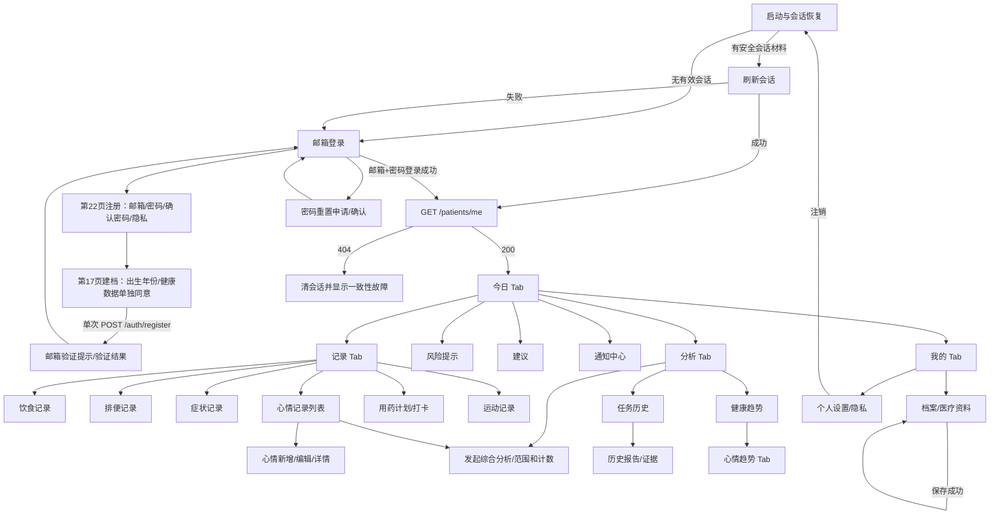

# GutCare APP 前端开发与前后端联调计划

> 版本：V2.0 · 2026-10-18（B03b-2 F07 活动记录 APP 切片）
> 用途：依据已审查的 22 页 UI 原型，统筹患者端 APP 页面实现、业务后端接口联调及验收。
> 约束：本计划不替代 `docs/详细功能设计.md`、`docs/技术方案.md`、OpenAPI 或已接受 ADR；它将设计节点落实到 APP 路由、业务接口、权限、状态和质量门禁。

## 1. 基线与当前实现

患者端固定为 Android/iOS APP，采用 uni-app、Vue 3、TypeScript strict 与 Pinia；患者 APP 只访问业务后端 `/api/v1`，不得直连数据库、对象存储管理端或智能体服务。认证方式沿用已冻结的邮箱 + 密码；登录和注册界面只提供邮箱字段，不提供手机号/SMS 登录入口。登录失败按统一 `401 INVALID_CREDENTIALS` 呈现，不区分邮箱未知、密码错误或邮箱未验证。详细设计、接口和 ADR 的决策优先级按 `docs/README.md` 执行。

`app/` 已具备启动/认证、本人资料及四个受保护 Tab 根页与自定义底栏。B00b（commit `fd7d8b8`）接入唯一 `RequestClient`、RFC 9457 错误映射、401 刷新单飞、`SessionService`、Pinia 内存 Access Token，以及 `gutcare-secure-store` UTS 适配源码；Android 为 Keystore 保护的 AES-GCM 私有密文，iOS 为 `WhenUnlockedThisDeviceOnly` Keychain，非原生平台 fail closed。CLI 导出不能证明原生 UTS 编译、签名、安装或设备行为，仍须 HBuilderX、自定义基座和双端真机验收。

### B01-2 公开认证页面实现基线

当前已实现欢迎、邮箱登录、注册第 22/17 页、邮箱验证、找回密码、重置密码及资料一致性错误页面；所有 auth 页面使用命名公开路由，无 Web 发布目标。通用组件为 `AuthScaffold`、`GcButton`、`GcField`、`NoticeCard`、`InlineProblem`。公开认证视觉采用 430px 基准和安全区滚动；主按钮 48px 高、16px 圆角，登录/注册输入行含邮箱/密码图标，不使用表单大外卡。控件提供关联标签、aria 状态、稳定 `data-testid`、44px 以上交互区、加载/禁用态；通用错误视图覆盖离线/超时、401（不区分账户/密码/验证状态）、422、429、5xx 与 request_id，且不展示服务端 detail 原文。启动恢复和资料加载错误投影保留 status/code/request_id/transport kind。

注册账户页只收邮箱、密码、确认密码和隐私政策说明/选择，不发 API；健康处理告知独立呈现在第 17 页，只有同意后才渲染出生年份字段，最终复用单次六字段 `POST /auth/register`。忘记密码页面调用冻结的重置请求并对所有邮箱给出相同确认，手动输入的一次性重置令牌只在 reset 页面内存中使用，不放 query/持久化；重置成功清页面状态并返回登录。无手机/SMS/姓名/性别/报告注册控件，无原型 JavaScript 或隔离未授权图像进入 APP；视觉装饰仅由 CSS/code-native 图形组成。

欢迎页使用内联 SVG/code-native 健康手册插画、三条特征说明和横排注册/登录主入口；不引入隔离未授权图片。资料一致性错误页提供受控支持说明入口，只提示用户经其获知的官方支持渠道手动联系并提供 request_id，不自动提交账户/健康数据。router 在 route-name 解析前拒绝任意含 token/access_token/refresh_token/password/new_password query 的 URL，并清空完整注册草稿。

本阶段有 92 项 APP 单元测试、类型检查与双端 CLI 导出检查。自动代码/构建检查不是 H5 交付或真机视觉证据；当前未生成/签收 430×880 截图像素基线，尚未完成键盘、安全区、动态字号或 ≥95% 逐页视觉对比。注册告知制品目前是 development/test only，production 仍 fail closed；B01-2 的真机视觉/无障碍签收和正式法律文案批准是发布门禁。

B01-1 已建立精确锁定的 `openapi-typescript` 类型生成与 check-no-diff 门禁；生成筛选由 operationId 驱动，必需 operationId 集合缺失、重复或有差异均失败，覆盖 auth/profile/RFC 9457 Problem 类型。`ProblemDetails` 直接派生自生成的 OpenAPI `Problem` schema。`AuthApi`、`ProfileApi` 使用生成类型，登录/退出复用 B00b SessionService。注册草稿只在内存收集第 22 页邮箱/密码/确认密码/隐私选择；第 17 页先同意健康处理后才允许采集出生年份，最终显式构造契约六字段注册请求，受理后清除密码并进入邮箱验证骨架页。验证令牌只由用户输入且只保存在页面内存，不放 URL/持久化；204 后清注册草稿并返回登录。撤销健康处理同意只清出生年份；顶部/系统返回回第 22 页并保留草稿以供编辑；选择“暂不同意并退出注册”或由路由离开注册流程时清除整个草稿（含密码）。认证状态机启动恢复后读取 `/patients/me`，只有 200 才能渲染今日页；401 清会话返回登录，404 清会话进入不可继续安全错误态且携带 request_id。returnTo 为进程内、严格命名路由白名单；注销用 `reLaunch(login)` 清栈。基础单元测试和 typecheck 当前通过，尚待双端 CLI 门禁与真机验收；页面是认证/导航骨架，不是高保真页面。

F03–F05 接入后，类型生成白名单扩展到记录 CRUD 与症状状态历史 operationId；症状 `status-history` 的 200 schema 已在契约补齐并由响应 DTO、示例和契约测试验证。DELETE 需带 `record_version`，后端按当前版本执行软删除并对冲突返回 RFC 9457 409。

### B01-3 本人资料与会话失效安全

新增受保护命名路由 `/pages/profile/index`，只调用当前 token 作用域的 `GET/PATCH /patients/me`。资料页编辑可空昵称、四位出生年份和 IANA 时区；不提供 `patient_id`/账户标识编辑，也不收集完整生日、性别或其他非契约字段。PATCH 在客户端按真实变更字段构造，只携带这些字段和当前 `profile_version`；清空昵称显式发送 `nickname: null`。出生年份限制 1900–2100，时区在客户端预校验并由服务端权威验证。保存成功以返回 DTO 更新内存资料。

遇到 `409 RECORD_VERSION_CONFLICT` 时保留草稿并停止自动写入；患者先手动重新 GET，界面并列显示最新值和本次拟改值，再显式确认重试。冲突重试仍只发送用户改过的字段，并采用新 `profile_version`，避免把其他设备对未编辑字段的更新覆盖掉。`422` 显示表单校验提示；`429` 提示稍后重试；`5xx`/离线/超时使用通用错误和可用的 `request_id`，不呈现服务端内部 detail。本人资料 GET/PATCH 返回 `404` 时尝试清除安全会话，清空内存资料并转到资料一致性安全态，不构造本地资料或补全路由。

会话无效（`401 AUTHENTICATION_REQUIRED`）统一清除内存 access/profile、尝试删除原生 refresh token、清理 `returnTo` 并 `reLaunch(login)`。服务端对过期、撤销和已冻结账户使用同一认证失败语义；客户端不区分账户状态，亦不恢复冻结/注销账户的旧目标。已认证的 `today` 与 `profile` 可以作为进程内安全 returnTo；登录后再次依据当前身份守卫目标。退出必须二次确认且 UI/SessionService 都防重复调用；退出始终尝试服务端撤销并在 finally 清空内存、清栈。原生 refresh 删除失败时将精确安全错误码保存在内存并在登录页报告；401 清理失败走同一报告路径。没有普通存储降级。

资料与今日基础页沿用 430px 宽度、安全区和可滚动布局、语义令牌、原生控件与 44px 以上触控目标。客户端自动化新增 `profileForm.test.ts`、资料 PATCH 精确字段、T01h 会话/冲突行为，以及路由深链和退出测试。患者甲乙隔离仍由后端 T49 的 `test_profile_reads_and_patches_are_scoped_to_authenticated_user`、PG18 `test_rls_patient_scope_and_transaction_local_context` 和 `test_profile_optimistic_lock_allows_only_one_stale_version_writer` 证明；客户端不构造患者 ID，需在双账户端到端验收中补充截图/请求归属证据。代码测试或 CLI 导出不替代 Android/iOS 真机验证；视觉 ≥95% 签收和原生安全存储操作仍待外部设备证据。

### B01-4 真实认证联调

脚本为本次运行创建系统临时目录下的空工作目录并断言其无 `.env`；迁移通过显式 `GUTCARE_AUTH_E2E_NO_DOTENV=1` 跳过仓库 dotenv 加载，bridge 显式使用 `Settings(_env_file=None)`，源码由绝对 `PYTHONPATH` 和绝对 bridge 路径导入。APP live test 进程也从该临时工作目录启动。脚本 finally 只删除经路径校验的本次唯一临时目录。

`scripts/test-auth-e2e.ps1` 使用唯一 Compose project 和临时端口，启动无持久卷的 PostgreSQL 18、Redis、Mailpit。迁移使用仓库 pinned CPython/uv 执行，并按现有 PG18 集成门禁的方式设置 Alembic `skip_file_config=True`。Windows 原生 Uvicorn 在本环境启动触发 access violation，因此本地 API 入口改用 `backend/tests/auth_e2e_http_bridge.py`：仅显式 test opt-in 时绑定随机 `127.0.0.1` 端口，通过 stdlib `ThreadingHTTPServer` 收发真实 loopback HTTP，再由 `httpx.ASGITransport` 调用同一 FastAPI app；bridge 不写 access/request/body 日志，退出后随任务进程关闭。认证不依赖 MinIO/ClamAV，故不启动它们。脚本随机生成 A/B/不存在邮箱、密码和服务密钥；使用 Mailpit API 在内存提取邮件令牌，不输出/落盘邮件正文、密码或 token。验证注册/邮箱验证/登录/资料读取、刷新轮换和旧 token 拒绝、独立新会话退出、存在/不存在邮箱重置请求形状一致、重置令牌确认与旧 refresh 失效、新密码登录、资料显式字段/null/409、A/B token 作用域，以及伪造 `patient_id` 被拒。刷新旧 token 的 replay 会撤销整个 refresh family；因此旧 token 拒绝检查后单独重新登录再验证 logout，避免把已撤销 successor 当成有效 logout 会话。

同一脚本以 B 合成账户运行 `app/tests/authLiveE2e.test.ts`：真实 loopback HTTP backend 由 `AuthApi`、`ProfileApi`、`SessionService` 调用；仅原生安全存储用显式 `MemorySecureTokenStore` fake，并通过过期 access token 触发 refresh/GET retry。该测试不替代 Android/iOS UTS SecureStore 真机验证。此联调使用仓库 `registration-notices.json` development/test-only 文案，未获法律审核，不可用于真实患者或生产。测试证据只输出阶段与 HTTP 状态；清理仅限定本次 Compose project 容器/卷及本次启动且 PID 经核验的 bridge 进程。bridge 提供真实 TCP/HTTP，但不是生产 Uvicorn 或真机网络栈证据。完整范围见测试用例 T01i。真实运行记录须由每次执行日志中的状态摘要归档；脚本自身不保存任何认证响应或凭据。

### B02 APP 导航壳与四根页

四个受保护命名根路由为 `today`、`records`、`analysis`、`me`，逻辑路径分别为 `/tabs/today`、`/tabs/records`、`/tabs/analysis`、`/tabs/me`，uni-app 页面文件位于 `pages/tabs/*/index`。使用统一 `GcBottomNav` 自定义底栏；底栏点击仅切换根命名路由，当前无 `pages.json.tabBar` 注册时由 router `reLaunch` 至目标根页，避免共享页面栈重复压入。所有 tab 根路由都经全局认证守卫；登录深链 `returnTo` 仅保留已登记命名路由。资料、记录和占位详情等二级页不显示底栏；占位页有显式 route name 与 owner tab，系统返回和页面返回都回到所属根页。

今日根页按 430px 原型基线组织今日摘要、快捷记录、用药、饮食与趋势入口。尚未接入的数据只呈现“未接入”安全占位，不伪造空记录或成功内容；`DashboardDataStatus` 为后续真实 API 映射预置 loading/empty/error/unavailable 四态。快捷记录、记录分类、分析发起/历史/报告/建议/趋势及“我的”资料/档案/用药/建议/趋势/设置入口均可达冻结的命名占位路由。未开放 AI 自由聊天；“我的”页通过无图片的 `GcAvatar` 显示占位头像，不引用隔离目录中来源权利未确认的图像素材。

本工作树未包含用户 ZIP 原件；页面信息仅据已冻结 `UI源码基线与导入规范.md`、`UI原型审查与页面导航规范.md` 静态审查事实实现，未执行原型代码或复制未授权素材。自动化覆盖四路由认证、无压栈 tab 切换、深链/returnTo、placeholder owner 返回、底栏可访问性和数据状态文案。430×880 基线适配、Android/iOS CLI 导出和资产门禁通过后仍不等同于双端真机视觉签收；截图、键盘/安全区/动态字号实测和 ≥95% 视觉对比待外部设备验收。

### B03a F03–F05 饮食、排便与症状记录

记录根页的饮食、排便、症状分类分别进入独立受保护命名路由，均绑定 `ownerTab=records`；登录守卫、returnTo、二级页隐藏底栏及返回记录根页沿用 B02 语义。三个页面共用记录工作区组件，支持真实列表、创建、详情、编辑、确认删除、加载、真实空态、离线/错误和版本冲突状态；症状详情额外读取只读状态历史。无本地演示数据，API 错误不会伪装为空或成功。

请求/响应 DTO 仅由 `contracts/openapi/gutcare-v1.yaml` 生成。共用 `RecordsApi` 复用 RequestClient、RFC 9457 错误映射和既有 refresh 单飞。饮食要求描述或至少一项食物；排便 Bristol 可空或 1–7；症状严重度 1–30，`other` 需要受限说明；时间序列化为带时区 ISO 时间。新增带幂等键，PATCH/DELETE 带当前 `record_version`；409 保留草稿且不覆盖，删除按后端软删除立即从列表隐藏。图片上传不在本切片范围，无图可保存；不构造 patient_id、AI 来源或临床因果判断。

### B03b-1 F14 心情记录与隐私授权

心情页由 `/pages/records/mood/index` 受保护路由承载，ownerTab 为 `records`；支持列表、详情、新建、编辑、确认删除、分页与离线/错误状态。新建/修改先调用 `GET /patients/me/consents` 确认 `health_data_processing` 和 `mood_data_processing` 均有效，再调用心情 API；服务端仍作最终授权栅栏。缺授权或无法核验时不发送写请求，草稿保留，提供前往隐私设置的入口；授权读取/写入故障、版本冲突不得清空表单。本人列表/详情/删除不以写入授权作客户端拦截。

设置页调用 `GET /patients/me/consents` 与 `GET /consent-notices?consent_type=...`；仅展示最新决定，不返回/展示 metadata 或告知 hash；未作决定明确为 `granted=false`。四项告知逐项显示 health_data_processing、mood_data_processing、mood_ai_sharing、third_party_ai；同意/撤回 POST 使用当前服务端 `policy_version`，401/422/网络错误可见且可重试。告知缺失、版本/hash 与服务端配置不匹配或 production 仍使用 test-only 制品时 API 返回 `enabled=false` 且不返回可提交版本，APP 禁用同意操作并 fail closed。记录编辑授权只依赖前两项，智能共享项单独控制分析快照纳入。

`contracts/consent/consent-notices.json` 为明确 development_test_only 制品；心情 notice 文案依据 ADR-0019 与隐私生命周期既有语义整理，不宣称法律批准。生产部署必须替换为法务/医疗签核的同结构告知制品并使每个版本/hash 与服务端配置原子一致；法律/医疗签核仍是外部门禁。服务端在环境类型和当前 version/hash 均匹配时才返回可用告知；生产不加载该测试制品。Mood 五档固定 `愉快=5 / 平静=4 / 一般=3 / 低落=2 / 烦躁=1`；P0 写入始终 `emotion_tags: []`。note 只在本人详情/编辑出现，不进入列表/趋势/日志/埋点/通知/Agent 输入。时间带时区，创建幂等，PATCH/DELETE 以 `record_version` 防覆盖，删除成功后立即从列表移除。

### B03b-2 F07 活动记录 APP 切片

活动记录页面 `/pages/records/activity/index` 已接入 `/activity-records` CRUD；类型 DTO 从权威 OpenAPI 生成并包含 `listActivityRecords/createActivityRecord/getActivityRecord/patchActivityRecord/deleteActivityRecord` 操作集合断言。表单使用冻结字段 `activity_type`、`intensity`、`subjective_feeling`、`duration_minutes`、`occurred_at`；开始时间必须带时区，duration 为 1–1440 分钟，`other` 描述限 1–160 字并只用于 other 类型。创建以页面 busy 单飞防重复点击，不给未定义的 Idempotency-Key；PATCH/DELETE 提交 `record_version`。409 时只读取并并列呈现服务器最新记录与本地草稿；用户明确选择“放弃草稿并载入最新记录”或“保留草稿并使用最新版本继续”后才可继续，保留路径仍需手动确认保存；不自动覆盖或重提，重复冲突继续保留草稿。页面按 F07 route gate 冷启动及每次显示，不展示底栏，返回所属记录 Tab；详情/列表/表单支持真实加载、空、离线/错误、游标追加失败保留原列表并可重试、删除后即时隐藏。布局遵循 430px 基线、安全区和至少 44px 触控。表单/API/导航和组件契约测试覆盖字段边界、版本参数、状态区分、认证深链及不可伪造字段。无患者 ID、设备来源、AI 来源字段；CLI 构建和资产门禁不替代 Android/iOS 真机视觉与设备行为验收。

### 1.1 已审查原型事实与差异

已审查的 UI 原型共 22 页，页面导航骨架为底部四个主入口：**今日、记录、分析、我的**。原型登录页的占位字段为“手机号/邮箱”，注册页使用手机号；这些界面与 ADR-0019 不一致，实施时必须统一为邮箱 + 密码，不保留手机号输入、验证码或 SMS 分支。主代理应将原型审查版本和导出资产归档到项目交付材料，作为 95% 视觉对照基准。

原型包含心情记录页：五档心情选择（愉快、平静、一般、低落、烦躁）、记录日期时间、选填备注和保存；发起综合分析页面显示心情记录计数；健康趋势含心情 tab；历史分析报告显示心情次数。原型没有情绪标签选择控件，因此 P0 不添加 `emotion_tags` chips，以保持原型视觉一致；`emotion_tags` 在 API 中可选，APP 写入时提交空数组，不从等级、备注或其他信息推断标签。页面与跳转以 `docs/UI原型审查与页面导航规范.md` 的 22 页审查结果为准；原型阅读不等同于真实点击验证。

## 2. F14 心情记录与授权规则

F14 的数据契约已由 ADR-0019 冻结，并已进入 OpenAPI：`GET/POST /mood-records`、`GET/PATCH/DELETE /mood-records/{record_id}` 以及当前授权/告知 `GET /patients/me/consents`、`GET /consent-notices`。新增和修改必须同时有当前 `health_data_processing`、`mood_data_processing` 授权；心情记录列表/详情读取和软删除作为患者数据主体权利，账户可用时不因撤回心情处理授权关闭。创建必须发送 `Idempotency-Key`；修改/删除必须带当前 `record_version`。越权统一 404，版本/授权等业务冲突使用 RFC 9457 409，字段校验使用 422。

记录写入字段为带时区的 `occurred_at`、必填 `mood_level` 1–5、可选 0–5 个唯一 `emotion_tags` 和可选 `note`（最多 500 字）。等级是患者主观自评，不是临床量表。22 页原型的五档选择依次映射为 `mood_level`：烦躁=1、低落=2、一般=3、平静=4、愉快=5；该映射只表达原型五档顺序，不作为临床评分。P0 不增加标签 chips；`emotion_tags` 可选，APP 新建/修改请求提交 `emotion_tags: []`，不得从心情等级、备注或其他信息推断标签。若后续版本增加标签交互，须有版本化 UI 决策，且只允许患者显式选择契约枚举 `calm/content/joyful/sad/anxious/irritable/overwhelmed/tired/other`（最多 5 个唯一值）；`other` 不附带自由文本。备注仅本人详情可见，不进入摘要列表、Agent 快照、日志、通知、趋势、风险规则或埋点。

综合分析保留现有 `health_data_processing` 与 `third_party_ai` 的任务授权要求；在此基础上，心情投影还要求 `mood_data_processing`、`mood_ai_sharing` 同时有效。只有四项均有效，才把 `occurred_at`、`mood_level`、受控 `emotion_tags` 和来源引用放入不可变快照。缺少任一 mood 专项授权时只排除 mood 输入，不阻断其他符合原规则的健康分析；分析请求页应区分“范围内心情记录数”“本次可纳入数”和“因心情授权未纳入数”，不能误报为零条记录。若现有健康分析所需的基础授权已撤回，则按既有 F08 规则处理整个任务。授权撤回后，已有心情记录本人读取/删除保持可用；创建分析任务或重试不得绕过授权。Agent 只读任务快照，不能访问数据库或直接改写记录；输出只能陈述可被证据支持的时间关联与不确定性，不得断言情绪导致症状、诊断心理疾病或给出心理治疗/危机判断。

## 3. 页面与业务接口映射

下表将已审查原型和功能拆分映射到 APP、业务 API 与呈现状态。API 路径、DTO、授权和错误以 OpenAPI/ADR 为准；原型中的手机号占位已按 ADR-0019 决议替换为邮箱认证。

| 页面/区域 | 页面职责 | 对应业务 API | APP 状态与权限 | 错误与跳转 |
|---|---|---|---|---|
| 启动/会话恢复 | 通过 B00b 原生安全存储适配器读取 Refresh Token、检查会话并显示启动状态 | `POST /auth/refresh`，成功后 `GET /patients/me` | 未认证公开页；`restoring/authenticated/anonymous`；原生存储错误按稳定错误码处理且不降级普通 Storage | refresh 失败清除本地会话并去登录；设备锁定保留持久令牌但清除内存访问态；资料 404 清除会话并进入不可继续的安全错误态，显示 request_id，不虚构资料或 onboarding；原生行为仍以 HBuilderX/真机门禁为准 |
| 登录 | 邮箱 + 密码、跳转注册/重置 | `POST /auth/login`，成功后 `GET /patients/me` | 公开；提交中禁重复提交 | `INVALID_CREDENTIALS` 使用统一提示；资料成功加载后进首页；资料 404 清除会话并显示一致性故障，不进入首页 |
| 第 22 页注册 | 邮箱、密码、确认密码及隐私政策说明/版本 | 暂不调用注册 API；转至第 17 页注册建档 | 公开；仅以内存草稿保存字段；确认密码客户端校验、不发送 | 校验邮箱、密码策略及隐私政策；取消/退出清除密码草稿 |
| 第 17 页注册建档 | 展示健康数据处理单独同意并收集出生年份 | 两页合并后仅调用一次 `POST /auth/register`；返回受理后使用 `POST /auth/email/verify` 完成邮箱验证 | 公开；不同意则不收集出生年份且不提交；隐私同意和健康数据处理同意分开表达；冻结 DTO 不含 nickname/sex/report；开发测试文案/版本读取 `contracts/consent/registration-notices.json` 的构建产物 | 202 后提示查收邮件；验证完成后进入邮箱+密码登录；昵称仅在登录后资料页维护，报告登录后按 F02 上传；未知注册字段已由运行时与契约拒绝；正式法律告知未签核时禁止生产发布 |
| 忘记/重置密码 | 申请重置、设置新密码 | `POST /auth/password/reset/request`、`POST /auth/password/reset/confirm` | 公开；请求响应不暴露邮箱是否存在 | 统一“如账户符合条件将发送邮件”；一次性令牌失败可重试申请 |
| 首页 | 风险摘要、待打卡、建议、快速记录、未读通知 | `GET /risk-alerts`、`GET /medication-checkins/today`、`GET /advice`、`GET /notifications/unread-count`；快速记录跳对应模块 | 仅当前认证患者；每块数据独立加载/空/失败，风险置顶 | 一个卡片失败不清空其他卡片；点击目标需确认仍属于当前患者 |
| 个人资料/档案 | 查看和编辑本人基本资料及医疗资料 | `GET/PATCH /patients/me`；医疗文件使用 `/files/uploads`、`/medical-documents` 与对应详情/候选接口 | 认证患者；资料 PATCH 带 `profile_version`；授权范围按服务端决定 | 版本冲突重新载入；文件失败可重试；图片及敏感资料需显式授权 |
| 饮食、排便、症状记录列表/编辑 | 记录、历史、详情、修改、删除 | `GET/POST /{record_type}`、`GET/PATCH/DELETE /{record_type}/{record_id}`；症状状态历史 `/symptom-records/{record_id}/status-history` | 认证患者；支持加载/空/离线/失败/删除确认；写入使用幂等键，修改带 `record_version` | 409 提示刷新后确认；删除后列表移除且历史分析来源标记失效 |
| 心情记录列表/新增/编辑/详情 | 记录五档等级、时间、本人备注；P0 无标签 chips，写入空标签数组 | `GET/POST /mood-records`、`GET/PATCH/DELETE /mood-records/{record_id}`；新增带 `Idempotency-Key`，修改/删除带 `record_version` | 认证患者；新增/修改要求 `health_data_processing` + `mood_data_processing`；本人读取/删除不依赖这两项授权（账户仍可用时）；不推断 emotion_tags | `CONSENT_REQUIRED` 409 引导授权，不清空表单；`RECORD_VERSION_CONFLICT` 409 重新载入并让患者确认；越权/不存在 404；校验 422；离线/服务失败与空状态分开；删除成功后立即从列表、时间线和新分析隐藏 |
| 发起综合分析页 | 选范围、展示范围内、可纳入和因授权排除的 mood 计数并提交分析 | 已冻结 `GET /analysis-tasks/preview?analysis_type&requested_from&requested_to`；随后 `POST /analysis-tasks` 带 `Idempotency-Key` 创建 | F08 基础任务授权按现有规则校验；mood 输入需 `health_data_processing`、`third_party_ai`、`mood_data_processing`、`mood_ai_sharing` 四项均有效；缺少 mood 专项授权只排除 mood，不阻断其他合格健康数据分析。`periodic_summary` 必须同时提供两端；`comprehensive_health_analysis` 可同时省略两端（不限定时间）或同时提供；单端均 422；所有显式范围为 UTC 半开区间 `[from,to)`，无隐含默认边界 | 预览字段为 `mood_record_count_in_range`、`mood_record_count_eligible`、`mood_record_count_excluded_by_consent`、`mood_exclusion_reasons`；后端按患者/所选时间范围计算，不由 APP 从分页结果推算。响应回显规范化范围；预览仅供参考，任务创建事务内重新筛选授权与数据 |
| 分析结果/历史报告 | 显示摘要、证据、缺失信息和覆盖的心情次数 | `GET /analysis-tasks/{task_id}` | 只呈现任务快照实际纳入的来源统计；Agent 仅输出结果，不直接回写业务事实 | `AnalysisTask.input_summary.included_mood_record_count` 是创建时不可变快照实际纳入数，历史值不可按当前记录重算。OpenAPI `AnalysisResult.evidence.source_type` 与 Agent 契约均允许 `mood_record` |
| 用药计划/打卡 | 计划、日程和今日打卡 | `/medication-plans`、`/medication-schedules`、`/medication-checkins` 系列 | 认证患者；仅 confirmed 计划可激活；`pending` 不等于未服药 | 操作失败保持原状态并允许重试；重复打卡使用幂等机制 |
| 运动记录 | 新建、查看、编辑、删除运动记录 | `/activity-records`、`/activity-records/{record_id}` | 认证患者；按 P1 交付；自述感受不是临床测量 | API 错误与无记录分开；确认后软删除 |
| 风险列表/详情 | 查看确定性规则产生的风险提示并标记已读 | `/risk-alerts`、`/risk-alerts/{alert_id}`、`/risk-alerts/{alert_id}/read` | 认证患者；高优先级持续可见；已读不表示风险消失 | 404 以资源不可用处理；不得由普通建议覆盖风险入口 |
| 智能分析/任务历史/结果 | 创建综合分析、查看任务和证据、取消/重试 | `POST/GET /analysis-tasks`、`GET /analysis-tasks/{task_id}`、取消/重试子路径 | 认证患者且服务端检查既有健康分析授权和有效确认数据；创建带 `Idempotency-Key`；只有 mood 四项授权齐全才纳入 mood | `pending/processing/needs_input/succeeded/partial/failed/cancelled` 映射；不得伪造进度；缺少 mood 专项授权只排除 mood，不阻断其余合格健康输入 |
| 建议列表/详情/反馈 | 查看建议、证据与依据更新状态 | `/advice`、`/advice/{advice_id}`、`read/archive/feedback` 子路径 | 认证患者；数据不足/一般性范围须标注；F10 风险优先 | 建议目标来源被删时禁用跳转并提示来源不可用 |
| 通知中心/偏好 | 通知列表、单条/批量已读、普通提醒偏好 | `/notifications` 系列及 `/notifications/preferences` | 认证患者；风险通知不受普通偏好抑制 | 分页 cursor 失效时重新从首屏加载；target 已删除显示不可用 |
| 趋势/历史 | 混合时间线；趋势页含 mood tab；历史报告显示各任务快照纳入的心情次数 | 已冻结 `/history/timeline?category=mood` 与 `/trends` 的 `mood` 确定性聚合 | 时间线只返回受控 `mood` 类型、时间及 target，不返回 note；趋势遵守患者时区 | `/trends.mood` 是显式联合结构：`availability=available` 时 buckets（可空，空表示已授权无记录）；`availability=consent_required` 时仅含 `reason_code=CONSENT_REQUIRED`、`missing_consents`，不含 buckets。授权缺失时其他趋势指标仍正常返回。只反映患者自评；note 与 emotion_tags 不进入趋势，不生成因果结论。派生趋势仅要求 `health_data_processing` + `mood_data_processing`，不要求 `mood_ai_sharing`/`third_party_ai`；原始列表/详情/删除仍可用。无数据、授权不可用与接口失败分开呈现。历史报告计数读取对应 task 的快照计数，不从当前趋势接口推算 |
| 隐私设置/导出/注销 | 管理健康处理、心情处理、心情智能共享授权；请求导出、查看注销清理状态、注销 | `POST /patients/me/consents`（包括 `mood_data_processing`、`mood_ai_sharing`）；`/privacy/exports` 系列、`/patients/me/account-deletion`、删除状态接口 | 认证患者；敏感动作二次确认；注销立即冻结会话；每种授权单独展示版本/目的和撤回效果 | 显示后端受理状态，不承诺立即物理清除；receipt 和导出能力不得写日志 |

API 的 DTO、枚举、成功状态、RFC 9457 错误码和权限以 `contracts/openapi/gutcare-v1.yaml` 为准。上传按“授权上传 → 对象直传 → complete → 受控下载 grant”顺序执行，APP 不持有永久对象 URL。G1 原型派生契约现已冻结在 OpenAPI：`GET /analysis-tasks/preview` 范围计数、`AnalysisTask.input_summary.included_mood_record_count`、`/trends.mood.buckets[]`、分析结果和建议证据的 `source_type=mood_record`，以及 `MoodDetail` 封闭 schema。H2 的 preview、mood 快照与不可变摘要已实现并覆盖 PG18；独立验收通过前，APP 可按冻结 schema 准备 Mock/页面，真实联调仍以相应验收门禁为准。F11 trends 继续等待 H3。

F08 的 `periodic_summary` 请求须显式给出 `requested_from` 与 `requested_to`；`comprehensive_health_analysis` 可同时省略二者表示不限定时间，或同时提供。单端输入对 preview/POST 均返回 RFC 9457 422；所有显式范围按 UTC 半开区间 `[from,to)`，不使用隐含 7/30 天或其他默认边界。失败任务 retry 也会按旧冻结快照复核 mood 专项授权。

## 4. 页面跳转与审计要求

已审查原型的底部导航是今日、记录、分析、我的。实现固定使用这四项作为唯一一级主入口；分析和我的下的任务/趋势/隐私等作为二级页面或分区，避免与底部 tab 重复。实现分派时按 22 页原型逐页补齐路由表，并确保二级页返回原所属 tab。所有受保护路由进入时校验认证状态；未登录深链先缓存受限目标，在登录成功后仅当目标仍授权且有效时回跳。

注册路径严格为原型第 22 页到第 17 页：22 页收集邮箱、密码、确认密码和隐私政策信息，不发 API 请求；17 页分别呈现健康数据处理同意并收集出生年份，同意后将两页数据合并为唯一一次 `POST /auth/register`。受理后验证邮箱，验证结束仍由用户以邮箱+密码登录。昵称、性别和报告不进入注册 DTO；昵称登录后通过资料 PATCH 维护，报告登录后按 F02 上传。登录/会话恢复成功后固定请求 `GET /patients/me`，成功才进入今日页；404 进入清会话的安全错误态，P0 不实现 `/onboarding/profile` 分支。两项注册告知由 ADR-0020 的同一版本化制品驱动；仓库文案仅供开发测试，不能作为生产法律正文。底部导航遵循 `docs/UI原型审查与页面导航规范.md`：今日、记录、分析、我的；记录 Tab 内含饮食/排便/症状/心情/运动分类，趋势、报告、隐私等按该规范作为二级入口。原型审查记录只证明读过页面内容，不代表跳转已点击验证；实现期通过路由测试与 Android/iOS 验证入口、返回、保存、取消、错误态和会话失效路径。

## 5. 智能体与非智能体边界

| 用户可见能力 | APP 与业务后端责任 | 智能体责任 | 禁止的跨界行为 |
|---|---|---|---|
| 注册、登录、资料、授权、记录 CRUD、图片上传、通知、风险、趋势、隐私 | APP 提供交互；业务后端负责认证、权限、数据校验、持久化、规则、状态机和审计 | 不参与 | APP 直接请求 Agent；Agent 读写业务表或充当认证/权限服务 |
| F14 心情记录输入与回看 | APP 显示患者自述并调用 `/mood-records` CRUD；业务后端保存、校验归属/版本/删除和授权，按 ADR-0019 将符合条件数据投影至冻结快照 | 只可读授权的 F08 冻结快照内 `occurred_at`、`mood_level`、受控 `emotion_tags` 及来源引用 | Agent 自动补写/改写患者心情；读取 `note`；未授权读取；把相关性输出标为病因、诊断或患者事实 |
| F02 图片/报告识别候选 | APP 展示待确认候选；业务后端管理上传、解析任务、候选、决定和确认事实 | 仅按独立 Agent 内部契约解析授权任务、提交候选 | 候选未确认就进入患者事实或风险规则条件 |
| F08 综合分析/F09 建议 | APP 发起业务任务并展示后端持久化状态和结果；业务后端冻结快照、校验、保存、权限隔离 | 读取任务快照，按 schema 返回结果；建议按 F09 独立回调规则 | APP 调 Agent 直连；Agent claim 第二次任务、直写 DB、传回原始 prompt/模型输出 |
| F10 风险提示 | APP 读取和呈现业务后端确定性规则结果；后端同步规则不依赖 Agent | 可提供一般性分析上下文但不能决定或弱化规则提示 | 由模型分数触发临床风险等级；Agent 输出覆盖 F10 |

## 6. UI 实现与 95% 视觉相似度验收

### 6.1 资产冻结与对比条件

原型审计完成后，为每个目标设备冻结设计稿截图、视口尺寸、状态栏/安全区处理、字体文件、图片资产、设计令牌、页面状态和截图数据集版本。比较使用同一设备型号/系统版本/分辨率/字体缩放、同一页面状态、同一合成患者数据和同一图片资产；动态时间、任务状态、患者姓名等采用预先记录的遮罩区域，不得在差异出现后临时扩大遮罩。

### 6.2 95% 判定方法

每个 P0 页面至少有一组关键状态截图；视觉验收同时包含：

1. 设计稿和真机截图按安全区对齐后进行 50% 透明度叠图和差异热图复核。
2. 对非动态、非遮罩内容计算 SSIM；页面级 SSIM 不低于 0.95，主要卡片、导航、表单和关键弹层分别不低于 0.95。若图像尺寸和字体渲染差异导致指标不稳定，则在 UI 签收单中说明工具版本并由设计负责人逐项签核，不能只凭主观“看起来接近”。
3. 版面关键锚点（标题、主按钮、卡片边缘、底部导航、浮层）位置误差不超过目标设备截图宽/高的 1%；字号、字重、颜色、圆角、间距和图标按已交付令牌核对。
4. 每个关键路由覆盖正常、加载、空、错误、离线、无权限/待确认及键盘态中适用的设计；状态呈现不得改变 API/数据字典语义。

### 6.3 头像框与图片对齐专项

若原型含头像框/圆形或圆角图片：图片视图和外框使用同一设计宽高、中心点和裁切坐标；uni-app 原生图片采用不拉伸的等比例裁切（通常 `aspectFill`），外框负责圆角和 `overflow: hidden` 裁切。头像主体的焦点位置按原始资产/原型设定，不靠变形拉伸填充。验收截图中图片边界与外框边界偏差不超过 1 个物理像素，中心偏差不超过 1 个物理像素，圆角轮廓无溢出；对齐同时检查 Android 与 iOS，包含高 DPI 和安全区变化。图片缺失、加载失败使用原型定义的占位资产，禁止随机头像替代。

每次签收保存原型截图、设备信息、APP 构建号、实际截图、overlay、差异图、SSIM 结果及设计负责人结论；动态区遮罩和例外必须有逐项依据。视觉达标不替代可用性、无障碍或业务正确性验收。

## 7. 前后端联调环境

联调使用仓库 Compose 基础服务和真实 API；工作区已有环境配置、集成 Compose 和 Mock Agent，应按根 README 与部署手册的命令启动。APP 设备/模拟器通过可达的 HTTPS 开发网关调用唯一 `VITE_API_BASE_URL`（含 `/api/v1`）；禁止把 `localhost` 当作物理设备可访问地址。邮件验证使用 Mailpit；对象上传通过后端签发能力访问 MinIO 兼容网关；智能分析使用可重复的 Mock Agent 响应，不用真实患者数据或模型输出进行 UI 验收。

联调数据仅为患者 A/B 合成账户、合成档案/记录/图片和固定任务响应。每个测试任务固定 `X-Request-ID` 采集方式并记录 API、APP 构建号、环境、合成数据集版本及结果；日志/截图不得包含密码、验证码、Token、报告正文、图片永久 URL、prompt 或模型原始输出。Android/iOS 采用同一后端环境和合成数据，账号互相隔离。

## 8. 分阶段实施和门禁

| 阶段 | 工作内容 | 通过门禁 | 阻断条件 |
|---|---|---|---|
| 0. 输入冻结 | 已审查 22 页原型与 ADR-0019/OpenAPI 对照；落实邮箱登录、四个底部 tab、F14 记录字段/授权和 F08 快照边界；G1 计数、趋势、快照证据契约已冻结；注册按第22页→第17页、单次提交执行 | 22 页逐项映射路由/资产/交互；G1 OpenAPI schema 校验通过；五档数值映射可复现；注册 DTO 与单请求流程符合冻结契约 | 原型缺关键资产/状态；schema 校验失败或授权/历史语义未对齐 |
| 1. APP 基础设施 | 注册路由、导航、设计令牌、基础组件、认证守卫、表单校验、原生安全存储、API 生成类型 | `vue-tsc`、lint/格式、单元测试通过；Android/iOS 可启动；安全存储拒绝降级 | Refresh Token 不能进 Keychain/Keystore；API 客户端与 OpenAPI 不一致 |
| 2. 认证闭环 | 第22页收集邮箱/密码/确认密码/隐私；第17页收集出生年份和健康数据单独同意；合并单次注册请求；邮箱验证后邮箱+密码登录；忘记/重置密码、登出、刷新和资料加载 | T01/T01a/T01c–T01g/T49 等适用场景端到端通过；账户状态错误统一；注册 DTO 无昵称/性别/报告；告知版本/摘要同源；资料 404 fail closed | 未验证账户枚举、登出后敏感页闪现、两项同意混同、出生年份在同意前采集或重复发注册请求、虚构 onboarding 或吞掉资料 404 |
| 3. 非智能体记录垂直切片 | 首页、饮食/排便/症状/F14 心情/用药/运动表单与历史页面逐模块接 CRUD | 每一切片契约、权限、乐观锁、幂等、空/错误/弱网/删除状态通过；A46/A49、T105/T109、T115 对应检查完成；A/B 越权验证通过；P0 emotion_tags 提交空数组 | mood 写入权限/版本/日志隐私不符 ADR-0019；错误显示为空数据或客户端推断标签 |
| 4. Agent 读路径联调 | 有授权输入经后端冻结快照、Mock Agent、结果与证据回显；分析申请数和历史报告心情计数与快照一致 | 四项授权及撤回 fence、缺 mood 授权时只排除 mood、备注排除、快照不可变、证据来源、超时/重试/迟到回调通过；Agent 无业务库写入能力 | Agent 直接请求业务表或使用未经授权/已删除/mood 不满足四项授权的输入 |
| 5. 其他业务页面 | F02 档案/图片、F09 建议、F10 风险、F11 趋势（含 mood tab）、F12 通知、F13 隐私 | API 权限、状态机、对象授权、危险操作确认和数据删除行为通过；心情趋势由后端确定性聚合且仅要求 health_data_processing + mood_data_processing | 永久 URL/敏感数据进入日志；风险提示被普通内容弱化；趋势授权状态被伪装成零数据 |
| 6. 视觉与双端验收 | 逐页截图、SSIM/overlay、头像图片对齐、键盘/返回手势/系统权限测试 | P0 目标设备页面 SSIM ≥0.95；关键锚点和头像图片对齐达第 6 节；Android/iOS 真机证据归档 | 只提供模拟器截图或静态效果，无真实机型与构建号 |
| 7. 全链路签收 | 从邮箱注册到记录、心情、分析结果/建议、注销或退出完整流程；所有阶段产物可复现 | 功能/契约/权限/安全/视觉/真机门禁全通过，追踪矩阵与报告更新 | 存在开放的 P0 缺陷、无 API 与 UI 对应关系或无恢复/隐私证据 |

各阶段必须先由负责人验收并记录证据，再解锁下一阶段。业务后端 F14/H1-H3b 与 G1 后端子范围已独立验收，不自动代表 APP 或跨层完整闭环通过。完整 APP 认证生命周期、Agent 服务侧和双端真机证据尚未交付。

### F14 页面联调验收映射

| 验收项 | APP 验证内容 | 后端/Agent 证据 |
|---|---|---|
| A46 / T105 | 缺 `mood_data_processing` 时新增/修改显示明确授权引导并保留输入；撤回授权后仍能读取/删除本人历史记录；重复提交不重复创建 | RFC 9457 `CONSENT_REQUIRED`、幂等、版本、RLS 与跨患者隔离 |
| 五档与标签映射 | 五档准确提交 `mood_level=1..5`；P0 不显示标签 chips，新建/修改始终提交 `emotion_tags: []`，不得从等级或备注推断标签；备注在详情可回看但不出现在摘要/Agent/日志 | 严格 DTO/数据库约束拒绝未知、重复、超量字段；合法空数组可保存 |
| A47 / T106 | 撤回 mood AI sharing 后说明心情不会加入本次 AI 分析，但其他授权健康记录仍可分析；不得把已有 mood 记录显示成不存在 | consent fence、仅 mood 排除、含 mood 任务撤回/取消竞态 |
| A48 / T107 / T108 | 分析输入摘要与历史结果只显示后端快照计数；UI/日志/通知/埋点及错误附件不出现 `note` | 快照白名单和证据校验；敏感备注副作用扫描 |
| 趋势 mood tab / T113 | 有记录时按日期范围显示确定性 mood_level 汇总；授权有效但无数据、mood 授权不可用和接口失败分别显示不同状态；mood 子结构遵循 `MoodTrendAvailable` / `MoodTrendUnavailable` 联合 schema；其他趋势指标不受 mood 授权影响；趋势派生处理只要求 `health_data_processing` + `mood_data_processing`，缺任一时只切换 mood 子结构至受控不可用而非零数据；不要求 `mood_ai_sharing`/`third_party_ai`；原始列表/详情/删除仍可用；无因果文案 | PostgreSQL 聚合、患者时区/UTC 半开区间、签名时间线 cursor；G1 mood bucket contract 已冻结 |
| 报告次数 / T107 | 报告显示创建时快照 mood 计数；源记录后续新增、修改、删除不重算旧报告 | 任务响应持久化/返回快照计数，Agent evidence 可指向 mood_record |
| A50 / T110 | 删除后列表、时间线、新分析立即反映；导出按明确选择呈现；注销状态说明数据清理进度 | 七天物理清理、导出、注销、备份恢复重放 |

F14 页面自动化测试同时覆盖：邮箱专属注册/登录、四底部 tab 路由、记录列表到详情编辑、心情保存/重复提交/版本冲突/删除、授权缺失/撤回、综合分析 mood 计数与继续非 mood 分析、心情趋势空态/失败态、历史报告快照计数稳定性，以及备注不进入截图日志和交互埋点。原生键盘、安全区、返回手势和头像图片对齐另按 Android/iOS 真机矩阵取证。

## 9. Android/iOS 真机证据

真机签收分别记录设备型号、OS 版本、屏幕尺寸/分辨率、APP commit/build ID、API 环境、合成数据集版本、网络条件和测试用例编号。必测场景包括：启动/登录/刷新/登出、键盘遮挡与表单滚动、系统返回手势、安全区域、相册/相机权限拒绝及替代路径、头像/图片裁切、弱网/断网和重试、上载中断与恢复、后台切换/进程重启、通知跳转、会话过期、深链/受保护路由、注销冻结及错误状态。每个关键场景留截图或短录屏；安全/权限场景记录操作结果，附件使用合成数据。

Android 和 iOS 都必须提供原生构建安装运行的证据。浏览器/H5 预览、uni-app Web 目标和单元测试不能替代系统能力真机证据。iOS 构建需可用 macOS/Xcode 环境；若当前团队没有该环境，阶段 1 前由主代理安排具备 iOS 构建和真机能力的执行环境。

## 10. 本地缺口及需要主代理协调的事项

### 已确认的实现缺口

- APP 已有邮箱认证、本人资料编辑和四根 Tab 导航壳；记录录入、分析、档案、用药等模块目前只有受保护的“功能建设中”路由占位，不读取真实数据，也不呈现演示成功。
- B00b 已提交原生安全令牌 UTS 插件源码、生产适配器、会话轮换/退出策略、自动化测试和 CLI 导出诊断门禁；尚缺 HBuilderX 原生编译、自定义基座、签名安装及 Android/iOS 真机行为证据，因此只能标记“源码/自动化已通过、原生发布门禁待验”，不能宣称生产安全存储已验收。
- F14 后端 H1–H3b、G1 契约与 T105–T115 已在 2026-10-17 独立验收；代码、迁移与验证报告在后端范围对齐。APP 仍需按本计划完成页面接入、交互/异常态和 Agent 跨层联调。
- F14 使用的 G1 接口与快照计数契约已冻结并由后端实现验证：`GET /analysis-tasks/preview`、`AnalysisTask.input_summary.included_mood_record_count`、`GET /trends.mood.buckets[]` 和 evidence `source_type=mood_record`。剩余工作是客户端生成类型、页面映射和 E2E 验证，不是服务端待实现。
- 当前 APP 自动化覆盖 API 基础设施、SessionService、安全存储错误映射、资料编辑和命名 Tab/returnTo/占位路由；其余业务流程 E2E、原生 Security/Keystore 调用或双端真机证据尚无。
- 已静态审查原型共 22 页并明确底部导航和视觉令牌；当前实现工作树不含用户 ZIP 原件或逐页截图，因此本次以冻结文档作为可用参考，不把隔离资产目录素材复制到生产包。可复现截图与 430×880 真机视觉对比仍待外部归档/签收。

### 准备阶段的外部输入依赖

1. **UI 原型素材归档：** 已完成 22 页原型审查；开始视觉实现前需归档完整逐页导出图/资产/交互说明，并注明画布和目标设备尺寸。审查中已确认手机号登录/注册需统一改邮箱；心情页 P0 保持原型现状，不补标签 chips，始终显式提交空 `emotion_tags`。
2. **iOS 真机环境：** 若当前执行机无 macOS/Xcode 与 iOS 真机，需要主代理指定后续可用的构建和签收设备/人员。
3. **G1 服务端验收已完成：** 后端 T111–T115 已在 2026-10-17 通过当前版本验收；APP 联调直接依据 OpenAPI 与追踪矩阵，不需等待服务端实现门禁。UI 视觉基准和 iOS 真机环境仍是外部输入。

除上述三项外，邮箱认证和 F14 记录字段、授权、CRUD 与 Agent 结构化投影已冻结，可继续开展 APP 路由和基础页面实现。计数/趋势接口差异应在对应垂直切片前关闭；正式 95% UI 签收需留存原型导出基准。

## 11. 权威依据

- `AGENTS.md`、`docs/README.md`
- `docs/设计方案.md`、`docs/详细功能设计.md`、`docs/APP及业务后端与智能体系统开发边界.md`
- `docs/技术方案.md`、`docs/数据库设计方案.md`、`docs/数据字典与状态机.md`
- `docs/UI交付与实现规范.md`、`docs/测试方案.md`、`docs/需求追踪矩阵.md`
- `docs/UI原型审查与页面导航规范.md`（22 页原型事实、注册页流、底部导航、G1 契约语义）
- `docs/ADR/0001-移动端采用uni-app.md`、`docs/ADR/0007-认证枚举与健康数据单独同意.md`、`docs/ADR/0012-f08-frozen-analysis-task-workflow.md`、`docs/ADR/0019-f14-mood-records-and-consent.md`
- `contracts/openapi/gutcare-v1.yaml`、`contracts/agent/agent-v1.yaml`
- 当前客户端现状：`app/README.md`、`app/src/pages.json`、`app/src/pages/`、`app/src/api/`、`app/src/stores/`、`app/tests/`
