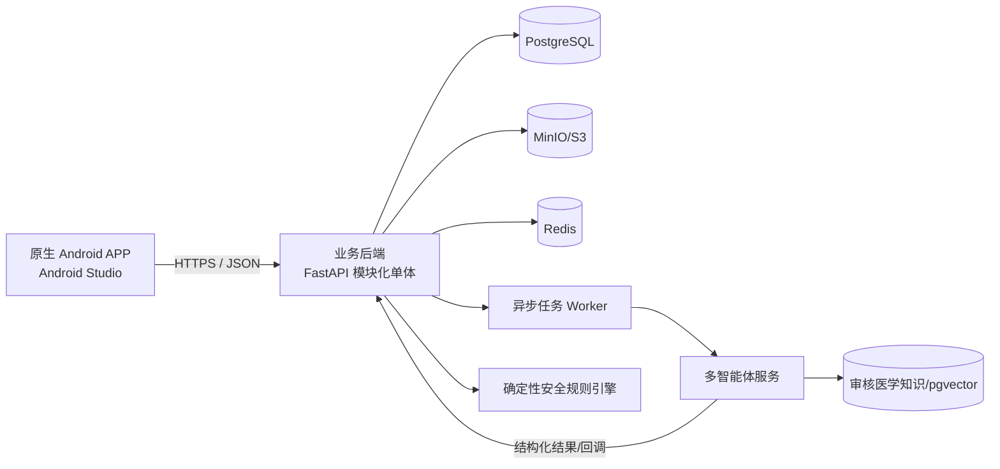

# GutCare Agent 开发实施方案

> 文档版本：V1.1  
> 编制日期：2026-10-14  
> 适用范围：移动端 APP、非智能体业务后端、数据库及智能体集成  
> 当前策略：UI 设计与后端开发并行，后端先行、契约先行  
> 文档状态：项目执行基线

## 1. 文档目的

本文用于指导和统筹 GutCare Agent 从工程初始化、后端建设、智能体联调、UI 接入、前端实现到发布验收的完整开发过程。项目当前处于 UI 独立设计、后端同步启动阶段，因此方案重点解决以下问题：

1. UI 尚未交付时，后端可以独立、连续地完成哪些工作。
2. 如何通过稳定的接口契约和模拟数据，避免前后端相互等待。
3. UI 图交付后，如何快速、准确地转化为 APP 页面和交互。
4. 业务后端与智能体系统如何分工、联调并保证数据安全。
5. 如何以阶段目标、质量门禁和可验收成果统筹项目进度。

本方案与以下文档共同构成项目基线：

- `设计方案.md`
- `详细功能设计.md`
- `APP及业务后端与智能体系统开发边界.md`
- `数据库设计方案.md`
- `技术方案.md`
- `数据字典与状态机.md`
- `../contracts/openapi/gutcare-v1.yaml` 与 `../contracts/agent/agent-v1.yaml`

文档主题权威性与冲突处理规则以 `docs/README.md` 为准；不得使用单一线性优先级覆盖不同主题的专门文档。所有语义变更同时更新契约、数据字典、追踪矩阵和变更记录。

## 2. 项目目标与本期范围

### 2.1 产品目标

依据 ADR-0022，交付原生 Android 患者端（工程目录 `android/`，Android Studio 唯一客户端开发/验收环境），形成以下完整闭环。旧 `app/` 只读归档，当前不开发 iOS：

患者注册登录 → 完善健康资料 → 上传并确认医疗档案 → 记录饮食、排便、症状、服药和运动 → 发起智能分析 → 查看有依据的建议 → 接收确定性风险提示 → 回顾健康历史。

### 2.2 P0 必须交付

- 患者注册、登录、退出、令牌续期、密码重置和资料编辑。
- 多患者账户及严格的数据隔离。
- 医疗报告上传、查看、解析状态、候选字段确认和纠错。
- 饮食、排便、症状、服药、运动记录的新增、修改、查询和删除。
- 确定性危险征象规则、风险提示、已读和历史追溯。
- 智能任务发起、状态查询、失败重试、结果保存和证据引用。
- 个性化建议、站内通知和基础历史趋势。
- 文件访问控制、日志脱敏、错误处理和关键链路测试。

### 2.3 P1 增强范围

- 更丰富的周期统计和图表。
- 建议执行反馈和提醒偏好。
- 个人数据导出。
- 外部系统推送。
- 运动记录的精细统计。

P1 仅在 P0 闭环稳定后进入开发，不得挤占账户安全、患者隔离、智能任务和风险提示的验证时间。

### 2.4 明确不在本期范围

- 医生端、家属端和运营管理端。
- 患者 Web 端、桌面端和微信小程序。
- 在线问诊、疾病诊断、处方开立或药物剂量调整。
- HIS/EMR、医保、真实医疗机构和可穿戴设备正式接入。
- 未经审核的临床规则或对所有消化道疾病有效的效果声明。

## 3. 总体开发原则

1. **契约先行**：页面与后端均以 OpenAPI 和状态模型为准，不以口头约定或临时字段联调。
2. **后端先行**：UI 未定稿期间先完成领域模型、数据库、认证、业务 API、任务状态和测试。
3. **垂直切片**：每个功能按数据库—服务—API—测试—前端接入形成闭环，避免所有模块同时只完成一层。
4. **模块化单体优先**：业务后端采用模块化单体，智能体作为独立服务；本期不拆分大量微服务。
5. **数据真实性分层**：原始输入、模型候选值、患者确认值和智能分析结论必须分开。
6. **安全规则独立**：确定性风险检测不能依赖智能体或大模型可用性。
7. **默认安全**：所有资源查询均校验患者归属，所有文件默认私有，所有日志默认脱敏。
8. **可复现**：分析结果必须绑定输入记录版本、智能体流程版本和证据来源。
9. **可降级**：智能体不可用时，账户、记录、历史和安全规则继续运行。
10. **以验收为完成**：代码提交不等于功能完成，必须通过测试、文档、联调和验收门禁。

## 4. 技术架构与选型

### 4.1 总体架构



### 4.2 固定技术栈

| 层次 | 技术 | 说明 |
|---|---|---|
| 移动端 | 原生 Android 工程 `android/` | 具体技术以工程配置及后续 ADR 为准；Android Studio 唯一开发/验收环境；旧 `app/` 只读归档 |
| UI 样式 | Android 原生 UI 与设计令牌 | UI 图到达后按统一色彩、字号、间距和圆角令牌实现 |
| API 客户端 | Android 工程内按 OpenAPI 契约实现 | 不改变服务端 API 契约，避免字段漂移 |
| 业务后端 | Python 3.13、FastAPI、Pydantic v2 | 适合结构化 API、严格 DTO 校验和智能体 Python 服务集成 |
| ORM/迁移 | SQLAlchemy 2.1、Alembic | 显式模型、事务和可审查迁移 |
| 主数据库 | PostgreSQL 18.x | 权威业务数据、审计元数据和任务快照 |
| 文件存储 | MinIO Community（锁定源码 commit 构建） | 报告和图片不直接存数据库 |
| 缓存/队列 | Redis + Celery | 缓存、限流、任务队列和有限重试；Redis 不作为事实来源 |
| 智能体接口 | HTTP/JSON + 内部鉴权 | 后续可扩展消息队列，不在首期引入额外复杂度 |
| 测试 | pytest、pytest-cov、Testcontainers、Schemathesis | 单元、集成、契约与接口自动化 |
| 质量工具 | Ruff（含格式化）、mypy、ESLint、Prettier、TypeScript strict | 静态检查和格式统一 |
| 部署 | Docker Compose、Caddy 2 | 开发和比赛部署可复现 |
| CI | GitHub Actions | 检查、测试、构建和迁移验证 |

技术栈变更必须先批准 ADR 并同步更新技术方案、锁文件和 CI；同一阶段不得并行维护多套后端框架或 APP 技术方案。

### 4.3 为什么采用模块化单体

业务后端中的账户、患者、记录、文件、通知、风险规则和分析任务具有紧密事务关系。比赛和首期开发阶段采用模块化单体可降低部署、事务和联调成本；智能体因运行方式、依赖和故障模型不同，单独作为服务部署。待真实并发、团队规模或独立扩缩容需求出现后，再按模块边界演进为服务。

## 5. 建议项目目录

```text
D:\GutCare_Agent
├─ android/                    # 原生 Android 患者端，Android Studio 唯一开发/验收环境
├─ app/                         # 旧 uni-app，只读归档
├─ services
│  ├─ api/                     # FastAPI 业务后端
│  ├─ worker/                  # Celery 异步任务入口
│  └─ agent-adapter/           # 智能体客户端、DTO 和适配器
├─ packages
│  ├─ api-client/              # OpenAPI 生成的 TypeScript 客户端
│  ├─ shared-types/            # 受控共享类型，不放业务实现
│  └─ design-tokens/           # UI 设计令牌
├─ contracts
│  ├─ openapi/                 # 对 APP 的 API 契约
│  ├─ agent/                   # 后端与智能体之间的契约及示例
│  └─ schemas/                 # JSON Schema 和事件结构
├─ db
│  ├─ migrations/              # Alembic 迁移
│  ├─ seeds/                   # 仅开发/演示用合成数据
│  └─ policies/                # RLS policy 等审查 SQL
├─ infra
│  ├─ docker/                  # 镜像和 Compose 配置
│  ├─ nginx/                   # 反向代理配置
│  └─ env/                     # 仅示例配置，不提交真实密钥
├─ tests
│  ├─ contract/
│  ├─ integration/
│  └─ e2e/
├─ docs/                       # 设计、接口、决策和验收文档
├─ scripts/                    # 开发、迁移和校验脚本
├─ .env.example
├─ docker-compose.yml
└─ README.md
```

目录建立后，各子项目需提供独立 README，说明依赖、启动、测试、构建和常见故障。真实 `.env`、证书、生产数据和模型密钥不得提交仓库。

## 6. 并行开发组织

### 6.1 工作流 A：后端先行开发

UI 设计期间立即推进，不依赖视觉稿：

1. 项目骨架、配置、容器、数据库迁移和健康检查。
2. 账户认证、患者资料、权限隔离和审计。
3. 文件上传、受控访问和医疗报告状态机。
4. 饮食、排便、症状、服药、运动记录业务。
5. 确定性安全规则和风险提示。
6. 分析任务、输入快照、智能体适配器和回调幂等。
7. 通知、历史时间线和基础统计。
8. OpenAPI、模拟数据、自动化测试和部署配置。

### 6.2 工作流 B：UI 设计

UI 设计应同步输出以下可开发资料，而不仅是静态效果图：

- 页面清单和页面层级。
- 各页面正常、加载、空数据、错误、无权限、离线、待确认等状态。
- 关键操作流程和跳转关系。
- 颜色、字体、字号、间距、圆角、阴影、图标和组件规范。
- 图片比例、裁切方式、图表样式和敏感图片遮挡规则。
- 表单校验、按钮禁用、危险操作确认和风险提示优先级。
- Android 状态栏、安全区域、键盘和系统权限表现；模拟器阶段验收，真机证据归入发布前门禁。

### 6.3 工作流 C：UI 到达后的前端开发

UI 图交付后按以下顺序实现：

1. 完成 UI 清点和歧义标注，不直接猜测缺失交互。
2. 提取设计令牌和基础组件，不逐页复制样式值。
3. 建立页面壳、导航、权限、网络层和全局状态。
4. 使用 OpenAPI 生成客户端接入已完成后端。
5. 按垂直业务切片逐个完成页面和接口联调。
6. 对照 UI 图执行逐页视觉检查，先在 Android Studio 模拟器适配；真机适配作为发布前门禁。
7. 补齐加载、空状态、错误、弱网、重复提交和恢复流程。

### 6.4 并行规则

- 后端不等待 UI 命名字段，以领域模型和需求文档定义 API。
- UI 不直接决定数据库结构；表现层需求通过 API DTO 转换。
- 前端不得绕过 API 契约直接依赖数据库字段或智能体原始输出。
- 所有未定 UI 细节进入问题清单，不能临时写入后端业务规则。
- 字段或流程变化先修改契约和变更记录，再修改实现。

## 7. 后端模块实施计划

### 7.1 B00 工程基础

交付内容：

- FastAPI 应用骨架、模块注册、统一配置和依赖注入。
- PostgreSQL、Redis、MinIO 的 Docker Compose 开发环境。
- Alembic 初始化和基础 schema。
- 成功 DTO、RFC 9457 错误响应、稳定错误码、请求 ID、结构化日志和健康检查。
- Ruff、mypy、pytest、pre-commit 和 CI 基础门禁。
- `.env.example` 与本地启动说明。

完成标准：新成员按 README 可以启动全部基础组件，运行迁移并通过冒烟测试。

### 7.2 B01 账户与患者资料

交付内容：

- 注册、登录、退出、刷新令牌、忘记/重置密码和修改密码。
- 密码安全哈希、失败锁定、会话撤销和基础限流。
- 患者资料、头像、时区和隐私授权。
- F14 心情处理与心情智能共享专项同意入口；注册/登录界面仅支持邮箱+密码。
- 资源归属检查中间件/依赖和审计事件。

完成标准：两个患者账户互相无法读取或修改对方资源；退出及撤销后令牌不可继续使用。

### 7.3 B02 文件与医疗档案

交付内容：

- 文件上传初始化、文件类型/大小校验、上传完成确认。
- MinIO 私有桶、对象元数据和短时访问 URL。
- 医疗报告列表、详情、删除、解析状态和失败重试。
- 手动录入诊断、医嘱、用药信息。
- 智能候选抽取值的确认、纠错和版本记录。

完成标准：未经当前患者授权无法下载文件；解析失败不产生伪造诊断；确认后的内容可追溯到原报告。

### 7.4 B03 日常健康记录

交付内容：

- 饮食记录和食物明细。
- 排便记录、Bristol 类型及可选敏感图片。
- 症状事件和多症状明细。
- 运动记录。
- F14 心情记录 CRUD；其写入和 F08 快照分别按 mood 专项授权门禁控制。
- 通用分页、日期范围、类型筛选、软删除和乐观锁。
- 模型候选结果与患者确认值分离。

完成标准：所有记录支持无图片手动录入；修改产生新版本；删除后不进入新分析。

### 7.5 B04 服药计划与提醒

交付内容：

- 用药计划、计划来源、有效期和确认状态。
- 重复日程、待确认打卡、已服、未服和跳过状态。
- 重复打卡幂等约束和基础依从性统计。
- 提醒事件和普通提醒偏好。

完成标准：没有回应时保持“待确认”，系统不推断为未服；系统不生成或修改处方剂量。

### 7.6 B05 确定性安全规则

交付内容：

- 版本化风险规则、审核状态和生效区间。
- 症状/排便记录提交后的同步优先检测。
- 一般关注、建议及时就医、紧急危险征象三级提示。
- 风险提示去重、已读、重新评估和证据引用。

完成标准：智能体服务关闭时规则仍可触发；“已读”不改变为“已安全”；规则修改不覆盖历史触发版本。

说明：开发团队负责规则执行工程，具体临床条件、阈值和文案必须由具备相应能力的专业人员审核后才能标记为 `approved`。

### 7.7 B06 智能分析任务与智能体适配

交付内容：

- 分析任务、幂等键、状态机、有限重试和取消。
- 输入记录版本冻结及最小必要数据快照。
- F14 心情快照字段投影与四项授权校验；严格排除心情自由备注。
- 后端到智能体的内部鉴权、超时、熔断和错误映射。
- Agent 运行元数据、结构化结果 Schema 校验和回调幂等。
- 结果、证据、模型/流程版本和限制说明入库。
- 智能体未就绪时的 Mock Adapter。

完成标准：同一幂等键只创建一个有效任务；失败可定位、可重试且不丢原始数据；结果引用必须属于本患者和本任务输入快照。

### 7.8 B07 建议、通知与趋势

交付内容：

- 建议列表、详情、已读、归档、反馈和证据跳转。
- 任务完成、失败、待确认和风险提示的站内通知。
- 通知去重和未读计数。
- 历史时间线、排便分布、症状趋势、服药打卡、运动及记录完整度；F14 时间线只返回受控摘要和详情 target，不纳入确定性趋势统计。

完成标准：历史统计只使用指定范围内的有效确认记录；无记录不显示为零；时间关联不表述为因果关系。

### 7.9 B08 隐私、删除与导出

交付内容：

- 敏感图片与第三方智能处理授权。
- 删除后排除新分析、对象文件延迟清理和失败补偿；清理/导出覆盖 F14 心情记录。
- 账号注销流程和会话撤销。
- P1 个人数据导出。

完成标准：授权撤回后不再向对应服务提供新访问地址；删除流程可审计且不会留下可正常访问的孤立文件。

### 7.10 B09 F14 心情记录与受控分析输入

依赖：B01 账户/授权和 B03 健康记录基础完成；契约、实现和真实 PostgreSQL 18 验收已完成（2026-10-17），可进入 APP/Agent 联调阶段。

交付内容：

- Alembic 迁移新增 `health.mood_record`、扩展 `ck_patient_consent_type`，配置 `mood_data_processing` 与 `mood_ai_sharing` 独立告知版本/摘要哈希。
- `/mood-records` 本人列表/创建/详情/修改/删除 API，严格 schema、幂等创建、乐观锁、签名游标、FORCE RLS 与患者复合归属。
- F14 `emotion_tags` 使用 JSONB；Alembic `IMMUTABLE`/`STRICT` 校验函数 + CHECK 与严格 API DTO 同步强制 array、0–5 个唯一受控字符串码；同一迁移完成函数安全 search_path、所有权和最小 EXECUTE 权限。
- `mood_data_processing` 和基础健康数据同意控制新增/修改；读取/删除作为数据主体权利保留。
- F08 输入快照只在健康数据、心情处理、心情智能共享及第三方 AI 四项授权都有效时纳入 mood_level、emotion_tags、occurred_at；永不纳入 note。
- `GET /analysis-tasks/preview` 按 `analysis_type/requested_from/requested_to` 返回范围/eligible/授权排除计数与受控原因；预览只是建议，创建事务在 consent fence 内重新计算。
- `analysis_task.input_summary.included_mood_record_count` 与冻结快照同事务写入、不可变；历史和重试值基于持久快照，不按当前记录重算。
- F11 `/trends.mood.buckets[]` 确定性聚合患者本人 mood_level，按时区日/周返回 `has_data`、`record_count`、五档 counts；不读 note/emotion_tags，不向 Agent 共享。
- OpenAPI/Agent `mood_record` 证据来源、MoodDetail 关闭对象 schema 和 Activity PATCH 422 已冻结；T111–T115 schema、权限、迁移与聚合验收已通过（2026-10-17）。
- F11 时间线增加 `mood` target；F13 导出、7 天删除、注销清理、备份恢复重放覆盖心情数据。
- APP 端需要邮箱-only 认证流程、两项独立心情授权的告知/状态展示、心情记录与详情/历史页面；Agent 端仅需消费版本化 `MoodSnapshotPayload` 并提供其记录级证据引用。

完成标准（后端已验收）：T105–T115 全部通过；PG18 检查 RLS/FORCE、JSONB 受控数组 DB/DTO 双层约束、授权撤回竞态、预览与任务计数、结构化趋势、快照备注排除、跨患者访问、删除/导出及恢复重放。剩余 UI/Agent 跨层工作按联调计划执行；UI 未持有任一 mood 专项授权时仍可继续使用其他功能且其他分析不失败。

## 8. API 契约规范

### 8.1 基础约定

- 基础路径：`/api/v1`；内部智能体接口使用 `/internal/v1`。
- 请求和响应均使用 UTF-8 JSON；文件经同源 HTTPS gateway capability 上传，不使用对象存储预签名直传。
- JSON 字段统一使用 `snake_case`；数据库字段不得直接暴露为不稳定内部结构。
- 时间使用 ISO 8601，携带时区；服务端统一以 UTC 处理。
- 列表接口统一使用游标或明确的分页参数，不允许各模块自行设计。
- 所有写操作支持请求 ID；易重复操作使用 `Idempotency-Key`。
- 错误使用 `application/problem+json` 返回 RFC 9457 字段、稳定机器码和 `request_id`，不返回堆栈或内部 SQL；成功直接返回资源/分页 DTO 或 `204`。

推荐错误结构：

```json
{
  "type": "https://gutcare.example/problems/record-version-conflict",
  "title": "记录版本冲突",
  "status": 409,
  "detail": "记录已被更新，请重新加载后重试",
  "instance": "/api/v1/symptoms/018f...",
  "code": "RECORD_VERSION_CONFLICT",
  "request_id": "uuid",
  "errors": []
}
```

### 8.2 状态机统一

| 对象 | 状态 |
|---|---|
| 文件 | `uploading/available/deleting/deleted/failed` |
| 报告解析 | `pending/processing/needs_confirmation/confirmed/failed` |
| 图像识别 | F03/F04 按 ADR-0021：`pending/processing/candidates_ready/no_candidates/failed/cancelled/invalidated`；逐候选 `pending/accepted/edited/rejected/invalidated`；F02 文档解析状态仅用于 medical_document |
| 分析任务 | `pending/processing/needs_input/succeeded/partial/failed/cancelled` |
| 建议 | `new/read/basis_updated/archived` |
| 风险提示 | `unread/read/reevaluated` |

状态转换由后端控制。APP 仅根据后端返回展示，不得通过本地修改伪造任务完成或风险解除。

### 8.3 契约维护流程

1. 在 `contracts/openapi` 修改 OpenAPI 源文件。
2. 执行契约 lint 和破坏性变更检查。
3. 生成或更新 TypeScript 客户端及 Mock。
4. 后端实现接口并通过契约测试。
5. 前端只使用生成客户端或统一请求适配层。
6. 合并请求同时包含契约、实现、测试和变更说明。

未兼容的字段删除、类型改变和状态语义改变必须升级 API 版本或经过明确迁移期。

## 9. UI 交付与前端实施规范

### 9.1 UI 交付清单

每个页面至少需要：

- 画板尺寸和适配基准。
- 页面名称、入口、返回目标和底部导航状态。
- 正常、加载、空数据、失败、禁用、待确认等页面状态。
- 可点击区域、弹窗、抽屉、选择器、表单和手势说明。
- 字体、图标、图片及其授权来源。
- 对应业务字段、按钮动作和预期结果。

若仅提供静态截图，开发前需补充一份“UI 实现映射表”，逐项记录缺失交互的确认结论。

### 9.2 前端架构

- `pages` 只负责页面编排，不直接编写散落的网络请求。
- `features` 按账户、档案、记录、分析、建议、通知拆分业务。
- `services` 使用生成的 API Client，统一处理令牌和错误映射。
- `stores` 只保存跨页面必要状态，不把所有接口数据长期塞入全局状态。
- `components` 分为基础组件和业务组件，避免把整页封装为不可复用组件。
- `design-tokens` 统一管理色彩、字号、间距、圆角、阴影和层级。
- 敏感图片默认避免在最近任务预览、通知内容或普通日志中暴露。

### 9.3 视觉验收

UI 实现后先在 Android Studio 模拟器上检查；Android 真机检查作为发布前门禁：

- 页面结构、字体层级、间距、颜色、圆角和图标。
- 状态栏、安全区域、底部手势区域和键盘遮挡。
- 长文本、超长药名、较多标签和大字号设置。
- 网络慢、请求失败、图片上传中断和重复点击。
- 风险提示在视觉层级上高于普通通知，但不使用夸张或误导性表达。

## 10. 智能体联调方案

### 10.1 联调前置条件

智能体开发方提供：

- OpenAPI/JSON Schema、内部鉴权方式和测试地址。
- 报告抽取、饮食识别、排便识别、综合分析和建议生成样例。
- 成功、部分成功、无法识别、数据不足、超时和错误响应。
- 模型、提示词和工作流版本字段。
- 文件输入方式、最大文件限制和数据保留说明。

业务后端提供：

- `task_id`、受控 `patient_id`、记录 ID、记录版本和时间范围。
- 经患者授权、完成权限检查的最小必要输入快照。
- 短时文件访问 URL 或文件代理。
- 结果提交、失败回调、幂等和状态查询接口。

### 10.2 Mock 与真实服务切换

定义统一 `AgentGateway` 接口，至少实现：

- `MockAgentGateway`：使用固定样例和可配置延迟/错误，供后端与 APP 开发。
- `HttpAgentGateway`：调用真实智能体服务。

两种适配器返回完全相同的内部 DTO。通过环境配置切换，不允许在业务代码中散布 `if mock` 分支。

### 10.3 联调顺序

1. 健康检查和内部鉴权。
2. 单条医疗报告解析。
3. 单条饮食图片识别。
4. 单条排便图片识别。
5. 综合分析任务及部分成功。
6. 建议、证据引用和限制说明。
7. 超时、重试、迟到回调、重复回调和服务不可用。

## 11. 开发阶段与里程碑

结合当前日期和原方案 2026-10-23 初赛提交目标，采用以下压缩排期。若实际提交日期调整，可保留阶段门禁并顺延日期。

| 阶段 | 日期 | 重点工作 | 阶段交付物 | 退出门禁 |
|---|---|---|---|---|
| M0 范围与工程初始化 | 10月14日 | 文档基线、仓库结构、技术选型、Compose、CI | 可启动工程、ADR、任务看板 | 基础服务启动且 CI 通过 |
| M1 数据与账户基础 | 10月15日 | 数据迁移、认证、患者资料、隔离 | 账户 API、迁移、权限测试 | 双账户隔离测试通过 |
| M2 档案与健康记录 | 10月16–17日 | 文件、报告、饮食、排便、症状、运动 | 核心 CRUD、上传链路、OpenAPI | 核心接口集成测试通过 |
| M3 用药与安全闭环 | 10月18日 | 用药计划/打卡、风险规则、风险提示 | 独立安全规则链路 | 智能体关闭时风险测试通过 |
| M4 智能任务接入 | 10月19–20日 | 任务快照、Mock/真实适配器、结果证据 | 分析任务端到端链路 | 成功/部分/失败/重试均通过 |
| M5 通知、趋势与前端接入 | 10月20–21日 | 通知、统计、UI 清点、APP 页面开发 | 可操作 APP 主流程 | 前后端主链路联调通过 |
| M6 稳定与发布 | 10月22–23日 | E2E、权限、安全、真机、部署和演示 | 发布包、部署文档、验收记录 | P0 全通过，无阻断缺陷 |

### 11.1 UI 时间闸门

- UI 未交付前不等待：M0–M4 全部后端工作、OpenAPI、Mock、测试、APP 基础工程均可推进。
- UI 交付后 0.5 天内完成页面和状态清点，冻结第一批设计令牌。
- UI 到达较晚时，优先实现 P0 主流程页面，P1 图表和动效延后。
- UI 在实现阶段发生视觉调整时，只允许通过设计令牌或组件演进处理；涉及流程、字段和权限的改变必须进入需求变更流程。

## 12. 任务管理与协作机制

### 12.1 任务拆分

每个开发任务需包含：

- 背景和用户价值。
- 明确范围与不做事项。
- 接口、数据表和页面影响。
- 验收条件。
- 测试要求。
- 依赖项和风险。

任务以 0.5–1.5 个工作日可完成为宜。超过两天的任务应拆为可独立验证的子任务。

### 12.2 状态流转

`Backlog → Ready → In Progress → Review → Test → Done`

进入 `Ready` 前必须具备验收条件；进入 `Done` 前必须完成代码审查、自动化测试、必要文档和验收记录。被阻塞的任务要标注阻塞原因、责任方和下一次检查时间。

### 12.3 每日协作

- 每日同步已完成、计划、阻塞和接口变化。
- 接口或数据结构变化当天更新契约，不等到联调阶段集中补文档。
- 后端每日提供可运行环境或版本，前端不长期依赖本地手写假数据。
- UI 设计问题统一进入问题清单，标注截图位置、影响页面和截止决策时间。

### 12.4 决策记录

以下变化需新建 ADR：

- 更换 APP 或后端框架。
- 改变数据库、对象存储、队列或鉴权方式。
- 新增服务拆分。
- 改变智能体读取方式。
- 改变患者数据删除、保留或第三方传输策略。

ADR 至少记录背景、选项、决定、后果和回滚方式。

## 13. Git 与代码审查规范

### 13.1 分支与提交

- 主分支保持可发布，受保护且禁止直接提交。
- 功能分支使用 `feature/<module>-<summary>`，修复使用 `fix/<summary>`。
- 提交保持单一目的，信息使用清晰的 Conventional Commits 风格。
- 数据库迁移、OpenAPI 变更和实现代码尽量在同一合并请求中可追踪。

### 13.2 合并请求要求

- 关联任务和验收标准。
- 说明改动、测试证据、迁移影响和回滚方式。
- 前端视觉改动附目标 UI 与实现截图。
- API 改动附契约差异。
- 禁止提交密钥、令牌、真实患者数据和包含敏感信息的调试日志。
- 至少一名非作者完成审查；认证、权限、删除和安全规则改动需重点审查。

## 14. 测试策略

### 14.1 测试层次

| 层次 | 目标 |
|---|---|
| 单元测试 | 领域规则、状态转换、校验、统计和风险规则执行 |
| 数据库测试 | 迁移、约束、索引、软删除、乐观锁和患者隔离 |
| API 集成测试 | 真实 PostgreSQL/Redis/MinIO 环境下的请求链路 |
| 契约测试 | APP—后端、后端—智能体的 Schema 与兼容性 |
| E2E 测试 | 注册到查看建议、风险提示、纠错后重分析等关键流程 |
| 真机测试 | 权限、相机/相册、上传、键盘、安全区域和弱网表现 |

### 14.2 核心自动化用例

1. 注册、登录、令牌刷新、退出和重置密码。
2. 患者甲无法访问患者乙的记录、文件、任务、建议或通知。
3. 报告上传成功、类型非法、过大、上传中断和删除。
4. 饮食和排便在无图片时仍可保存。
5. 模型候选值未经确认不能作为确定事实进入综合分析。
6. 修改记录后旧分析保留旧版本，新分析使用新版本。
7. 危险征象不等待智能体即可触发规则提示。
8. 同一幂等键不重复创建任务、提示和通知。
9. 智能体超时、部分成功、重复回调和迟到回调。
10. 删除记录后不再进入新任务输入。

### 14.3 覆盖率与质量门禁

- 核心领域模块行覆盖率目标不低于 80%。
- 认证、权限、安全规则和任务状态机的分支覆盖率目标不低于 90%。
- 所有 P0 API 至少有成功、参数错误、未认证、越权和资源不存在测试。
- 覆盖率不能替代关键场景测试；禁止为了数字编写无断言或低价值测试。

## 15. 安全与隐私工程

- 密码采用 Argon2id 或经批准的强密码哈希。
- 访问令牌短期有效，刷新令牌只以摘要形式保存并支持撤销。
- 文件默认私有，通过患者归属校验后签发短时地址。
- 后端查询必须包含当前患者作用域；关键表启用 RLS 作为纵深防御。
- 智能体仅获取任务快照中的最小必要数据，不持有业务主库写权限。
- 第三方模型处理敏感图片前检查有效授权，撤回授权后停止新传输。
- 日志、错误跟踪和指标禁止包含密码、令牌、报告全文和敏感图片 URL。
- 开发和演示使用合成或明确授权的数据，生产数据不复制到测试环境。
- 依赖定期扫描，严重漏洞在发布前处理或形成明确的风险接受记录。

## 16. 可观测性与运维

### 16.1 日志

结构化记录 `timestamp`、`level`、`service`、`request_id`、`task_id`、脱敏的患者作用域标识、事件和结果。异常日志保留堆栈但不得包含请求中的敏感正文。

### 16.2 指标

至少监控：

- API 请求量、延迟、4xx/5xx 比例。
- 数据库连接池、慢查询和事务失败。
- 文件上传失败率和对象清理积压。
- 任务队列长度、等待时间、成功率、重试和超时。
- 智能体各能力的延迟、失败率和部分成功比例。
- 风险规则触发数量及通知投递失败。

### 16.3 健康检查

- `/health/live` 只判断进程存活。
- `/health/ready` 检查数据库等必要依赖。
- 智能体不可用不应使业务后端完全不就绪，但应在依赖状态中标明降级。

### 16.4 备份和恢复

- PostgreSQL 执行自动备份和恢复演练。
- MinIO 启用版本或等价保护及生命周期策略。
- Redis 不作为权威备份对象。
- 发布前确认数据库迁移的前向执行与回滚/前滚方案。

## 17. 环境与发布

| 环境 | 用途 | 数据 |
|---|---|---|
| Local | 单人开发 | 合成种子数据 |
| Dev | 日常联调 | 可重置合成数据 |
| Test | 自动化和验收 | 固定测试数据集 |
| Demo | 比赛演示 | 明确标记的稳定模拟病例 |
| Production | 后续正式运行 | 经授权的真实数据，需完成合规评估 |

配置通过环境变量和密钥管理注入。每个环境使用独立数据库、桶、Redis 命名空间和凭据，禁止测试环境连接生产资源。

发布流程：

1. 静态检查和单元测试。
2. 数据库迁移在临时数据库验证。
3. 构建不可变镜像和 APP 包。
4. 部署测试环境并执行集成/E2E。
5. 生成版本说明、迁移说明和已知问题。
6. 备份后部署目标环境。
7. 执行发布后冒烟测试。
8. 失败时按回滚或前滚方案处理。

## 18. 定义完成（Definition of Done）

一个功能只有同时满足以下条件才算完成：

- 需求和验收条件明确，未夹带未批准范围。
- 数据库迁移和约束已提交并验证。
- OpenAPI/事件 Schema 已更新且通过 lint。
- 后端实现了认证、归属校验、错误处理和幂等要求。
- 前端实现了正常、加载、空数据和错误状态；UI 未到阶段可标记为后端完成而非功能整体完成。
- 单元、集成及必要 E2E 测试通过。
- 日志不泄露敏感信息，可通过 request ID 定位故障。
- 文档、配置示例和启动说明已更新。
- 代码审查完成，无阻断级缺陷。
- 在目标环境完成验收并保留证据。

## 19. 风险与应对

| 风险 | 影响 | 应对措施 |
|---|---|---|
| UI 交付较晚 | 前端工期压缩 | 后端、契约、Mock 和 APP 基础工程先行；按 P0 页面优先接入 |
| UI 只有静态图 | 状态和交互缺失 | 使用 UI 实现映射表，补齐加载/空/错/权限/弱网状态 |
| 智能体接口不稳定 | 联调阻塞、字段反复 | 版本化 Schema、Mock Adapter、契约测试和兼容层 |
| 医学规则未审核 | 风险提示不可正式使用 | 规则分 draft/approved；演示规则明确标记，未审核规则不上生产 |
| 敏感文件泄露 | 严重隐私风险 | 私有桶、短时 URL、归属校验、日志脱敏和授权检查 |
| 开发时间紧 | 核心链路不稳定 | 严格锁定 P0，停止低优先级图表、动效和外部集成 |
| 数据模型频繁变化 | 迁移和前后端返工 | 数据库迁移、DTO 隔离、契约审查和 ADR |
| 演示环境依赖外部模型 | 现场不稳定 | 真实链路预热、有限重试、可说明的降级和固定合成演示数据 |

## 20. 阶段验收清单

### 20.1 后端独立验收

- 开发环境一条命令启动，迁移可重复执行。
- 账户、资料、档案、记录、用药、风险和任务 API 可通过 OpenAPI 调试。
- 双患者越权测试全部拒绝。
- 智能体关闭时 CRUD 和风险规则可用。
- Mock 智能体可走通任务成功、部分成功和失败流程。
- 文件不公开，删除和授权撤回生效。

### 20.2 UI/前端验收

- 页面与 UI 图、设计令牌和交互映射一致。
- 所有 P0 页面具备加载、空数据、错误和恢复操作。
- 表单校验、重复提交、上传进度和失败重试正确。
- Android Studio 模拟器无阻断级布局或权限问题；发布前 Android 真机门禁无阻断问题。
- 敏感图片、风险提示和医学限制说明展示符合产品要求。

### 20.3 端到端验收

- 新患者注册并完成建档。
- 上传报告，获得候选字段并完成纠错确认。
- 录入饮食、排便、症状和服药记录。
- 发起综合分析，查看真实任务状态和证据结果。
- 修改源记录并重新分析，新旧版本关系正确。
- 输入测试危险征象，无需智能体即可得到风险提示。
- 切换第二患者账户，验证全部资源隔离。
- 模拟智能体超时，原始数据不丢失且用户可重试。

## 21. 当前立即执行事项

在 UI 图交付前，按以下顺序开始后端建设：

1. 创建项目目录和 Git 工程规范。
2. 建立 FastAPI、PostgreSQL、Redis、MinIO、Mailpit 和 Celery 的本地环境。
3. 根据数据库设计创建第一批 Alembic 迁移。
4. 冻结邮箱账户、患者资料、文件和 RFC 9457 错误响应的 OpenAPI V1。
5. 完成注册登录、患者资料和数据隔离测试。
6. 实现医疗档案与日常健康记录 CRUD。
7. 实现安全规则引擎和风险提示。
8. 实现分析任务、输入快照和 Mock AgentGateway。
9. 持续生成 API 客户端与模拟响应，为 UI 到达后的 APP 开发做准备。

该顺序可以保证 UI 设计过程不阻塞后端，同时在 UI 到达时已有稳定接口、真实状态和模拟智能结果可直接接入。

## 22. 方案维护

本文是开发执行基线，不是一次性说明。每个里程碑结束后更新实际完成情况、未完成项、风险和下一阶段计划。影响架构、范围、隐私、数据保留或智能体契约的重大变化，必须先更新对应设计文档和 ADR，再进入实现。
