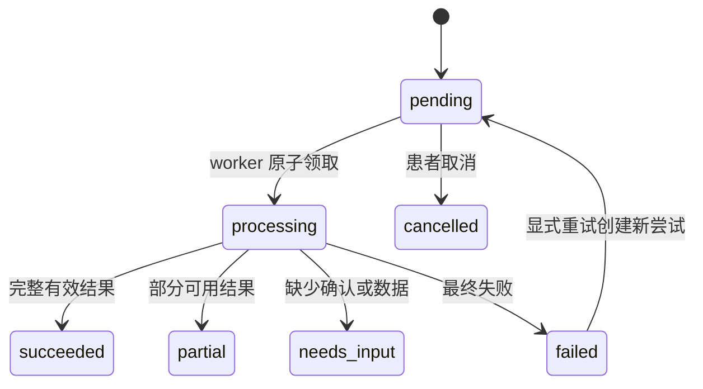

# GutCare Agent 数据字典与状态机

> 版本：V1.3 · 2026-10-18（ADR-0021 Diet 分组候选与逐字段确认增补）
> 作用：统一 APP、API、数据库、智能体和测试中的字段与枚举。

## 1. 通用约定

- JSON/路径参数使用 `snake_case`；数据库同名；TypeScript 生成类型不得手工改名。
- 标识符为 UUID 字符串；时间为 ISO 8601 且带时区；服务端保存 UTC。
- 未知值使用 `null`，不得用 `0`、空串或“未知”文本代替。
- 公开枚举一经发布不得改变既有含义；新增值须保证旧客户端安全降级。
- 中文只用于展示，持久化/API 使用下列英文稳定码。

## 2. 核心字段

| 字段 | 类型 | 语义/约束 |
|---|---|---|
| `patient_id` | uuid | 后端从会话确定；公开写接口不得信任客户端传入值 |
| `record_version` | integer ≥1 | 乐观锁和证据引用版本 |
| `schema_version` | string | 当前为 `1.0`；未知版本拒绝处理 |
| `idempotency_key` | string ≤128 | 同患者、同操作作用域内唯一 |
| `request_id` | uuid | 全链路追踪，不含业务语义 |
| `confirmation_status` | enum | 候选/来源是否经患者确认，不代表生命周期 |
| `source_locator` | object/null | `{page, section, char_start, char_end, bbox}` 的有效子集 |
| `profile_version` | integer ≥1 | `/patients/me` PATCH 必填；仅显式字段参与更新，昵称可用 `null` 清空，版本不匹配返回 `409 RECORD_VERSION_CONFLICT`；无资料字段变化时原样返回且不递增 |
| `consent_type` | enum | `privacy_policy`, `health_data_processing`, `sensitive_image`, `third_party_ai`, `mood_data_processing`, `mood_ai_sharing`, `push_notification`；每次决定追加历史，不覆盖旧决定 |
| `policy_version` | string ≤32 | 授权文本版本；必须匹配服务端该 consent_type 的允许版本，并与独立配置摘要哈希绑定写入 `metadata.notice_summary_hash`，不接受客户端提交摘要 |

## 3. 状态枚举

刷新会话的 `family_id` 等于该登录链保留的根 `refresh_session.id`，根行由自引用外键保护且在族成员存在时不得物理删除；根行同时用于族级 `SELECT FOR UPDATE` 互斥。`parent_session_id`/`replaced_by_session_id` 保存轮换前后继关系。所有 refresh/replay 先锁根、再重新读取 presented token；在 PostgreSQL `READ COMMITTED` 下，等待锁的请求在后续语句可见先行已提交的状态。检测到已撤销 refresh token 重放时撤销该 family 全部有效成员。

| 对象 | 字段 | 允许值 |
|---|---|---|
| 账户 | `status` | `pending_verification`, `active`, `locked`, `deactivated` |
| 注销请求 | `status` | `pending`, `processing`, `overdue`, `completed`, `dead_letter`（ADR-0016 privacy operation） |
| 注销步骤 | `status` | `pending`, `processing`, `completed`, `failed` |
| 导出操作 | `status` | `preview`, `pending`, `processing`, `ready`, `cancelled`, `expired`, `failed` |
| 对象 inventory | `status` | `pending`, `deleting`, `deleted`, `failed` |
| 上传会话 | `status` | `issued`, `uploaded`, `completed`, `failed`, `expired` |
| 文件 | `storage_status` | `uploading`, `available`, `deleting`, `deleted`, `failed`；`available` 必须同时为 `scan_status=clean` |
| 恶意软件扫描 | `scan_status` | `pending`, `clean`, `rejected`, `failed` |
| 报告解析 | `parse_status` | `not_requested`, `pending`, `processing`, `needs_confirmation`, `confirmed`, `failed` |
| 延迟删除/孤儿清理任务 | `status` | `pending`, `processing`；processing 必须带有限 lease，超时后可重领 |
| AI 候选 | `review_status` | `pending`, `accepted`, `corrected`, `rejected` |
| F02 解析请求 | `status` | `pending`, `processing`, `needs_confirmation`, `succeeded`, `failed`, `cancelled`, `invalidated` |
| F02 字段候选 | `value_type` | `string`, `date`, `decimal`, `integer`, `boolean`, `diagnosis`；`review_status` 为 `pending`, `accepted`, `corrected`, `rejected`, `invalidated` |
| F02 确认事实 | `fact_status` | `active`, `rejected`, `superseded`, `source_deleted`；仅患者逐字段决定产生 |
| F02 冲突 | `medical_fact_conflict.status` | `open`, `resolved`, `invalidated`；仅保守比较患者确认的检验项目/结果，resolution 仅 `keep_both`；成员引用确认事实与文档版本，不复制原文 |
| 通用确认 | `confirmation_status` | `pending`, `confirmed`, `needs_review` |
| 诊断候选确认 | `confirmation_status` | `pending`, `confirmed`, `rejected` |
| 用药计划 | `plan_status` | `active`, `ended`, `discontinued` |
| 服药打卡 | `status` | `pending`, `taken`, `not_taken`, `skipped` |
| 分析任务 | `status` | `pending`, `processing`, `needs_input`, `succeeded`, `partial`, `failed`, `cancelled` |
| Agent 运行 | `status` | `pending`, `running`, `succeeded`, `partial`, `failed`, `skipped` |
| 安全校验 | `safety_check_status` | `pending`, `passed`, `blocked`, `needs_review` |
| 建议 | `status` | `new`, `read`, `archived`；依据变化由独立 `basis_updated` 表示 |
| F09 建议反馈 | `feedback_type` | `helpful`, `not_helpful`, `not_applicable` |
| F09 建议类别 | `category` | `diet`, `lifestyle`, `record_management`, `medication_adherence`, `care_consultation` |
| F09 建议优先级 | `priority` | `routine`, `important`；F10 风险优先级独立且不可由建议改写 |
| F09 风险优先上下文 | `risk_priority_context` | 可空受控快照：当前患者最近一条 `seek_care`/`emergency` 的 `alert_id/severity/status/triggered_at`；list 单次查询后供同页项目复用；`read`/`reevaluated` 不是风险解除或安全结论 |
| 风险提示 | `severity` | `attention`, `seek_care`, `emergency` |
| 风险提示 | `status` | `unread`, `read`, `reevaluated`；`read` 不表示解除 |
| F12 通知事件 | `event_type` | `analysis_completed`, `advice_created`, `risk_alert_created`, `checkin_reminder` |
| F12 通知类别 | `category` | `analysis`, `advice`, `risk`, `medication_reminder` |
| F12 通知优先级 | `priority` | `ordinary`, `risk`；risk 不受普通偏好抑制 |
| F12 通知 | `read_at` | null 为未读；非 null 为已读，不改变 F10 风险状态 |
| F12 outbox | `status` | `pending`, `processing`, `dispatched`, `suppressed`, `dead_letter` |
| F12 outbox | `attempts` | 0–8；processing lease 超时后可重领；失败指数退避，最多8次后 dead_letter |
| F14 心情记录 | `mood_level` | integer 1–5；患者主观等级，非临床量表 |
| F14 心情记录 | `emotion_tags` | 0–5 个唯一值；`calm`, `content`, `joyful`, `sad`, `anxious`, `irritable`, `overwhelmed`, `tired`, `other` |
| F14 心情记录 | `note` | 可空 string ≤500；高敏自由文本，仅本人查看，不进入 Agent 快照、日志、通知、趋势或风险规则 |

## 4. 状态机

F07 活动类型为 `walking/jogging/cycling/other`（other 需 bounded description），强度为 `low/moderate/high`，主观感受为 `better/same/worse`，时长为 1–1440 分钟；`occurred_at` 表示开始时间。F11 时间范围统一为 UTC 半开区间 `[from,to)`，本地 bucket 使用患者资料的 IANA 时区。活动列表、历史时间线均使用签名 cursor；历史排序为 `(occurred_at DESC, type ASC, id ASC)`。

F14 心情记录使用 `occurred_at`、`mood_level`、`emotion_tags`、`note` 和 `record_version`；本模块无模型候选状态，写入即为患者自述，不解释为诊断事实。新增/修改要求 `health_data_processing` 与 `mood_data_processing` 有效；本人读取和删除作为数据主体权利保留。心情进入 F08 冻结快照还要求 `mood_ai_sharing` 与 `third_party_ai` 有效。撤回 `mood_data_processing` 后禁止新增/修改；撤回任一心情智能共享授权后，新快照必须排除心情。心情标签和等级不是 F10 风险规则输入。

### 4.1 分析任务

终态 `succeeded/partial/needs_input/failed/cancelled` 不接受迟到回调。仅 `failed` 可由患者显式重试；每个失败任务最多派生一个重试任务，`retry_of` 保留来源关系并复用原不可变快照，不改写失败任务历史。`analysis_task_callback` 以 `callback_id` 记录回调摘要以支持幂等提交。`needs_input` 是终态，患者补齐记录后另建任务。F08 只支持 `comprehensive_health_analysis` 与 `periodic_summary`；F02 文档解析和单记录识别不复用此任务类型。

### 4.1.1 F08 冻结快照

任务创建时仅纳入当前患者授权、未删除且 `confirmed` 的医疗事实及健康记录。快照保存来源类型/ID/版本/受限 locator、最小结构化字段和 SHA-256 摘要；F14 心情字段仅在 `health_data_processing`、`mood_data_processing`、`mood_ai_sharing`、`third_party_ai` 四项授权均有效时允许纳入，且仅含等级、受控标签与发生时间，不含 `note`。Agent inputs 将非 mood `records` 与独立 `mood_records` 分开传输，并携带任务创建时的四项 `consent_scope_snapshot` 布尔快照。任务创建响应及历史任务 DTO 的 `input_summary.included_mood_record_count` 等于该任务冻结快照中实际 `mood_record` 输入数量；与快照在同一事务写入并保持不可变，历史值不得按当前记录/授权重算。升级前任务按持久化快照回填，没有 mood 输入时为 0。不含原报告正文、文件 URL、自由备注、prompt 或模型原始输出。快照不可变。来源后来删除时快照不重写，但该任务输入接口不得暴露已删除来源的原文或对象访问能力；患者 API 仅返回结构化任务结果及来源删除状态。

F11 mood 趋势是需 `health_data_processing` 与 `mood_data_processing` 的派生处理，不调用 Agent，也不要求 `mood_ai_sharing`/`third_party_ai`。只对本人未删除的 `mood_level` 按 IANA 时区日/周 bucket 确定性聚合；每 bucket 返回 `has_data`、`record_count`、1–5 各档 `mood_level_counts`。`note` 与 `emotion_tags` 不进入聚合和响应；趋势不是临床量表、因果或诊断结论。OpenAPI `TrendResponse.mood` 为显式联合结构：`availability=available` 时 `buckets=[]` 表示已授权但范围内无数据；`availability=consent_required` 时仅返回 `reason_code=CONSENT_REQUIRED` 和缺失授权枚举，禁止 `buckets`。其他趋势数据仍正常返回。分析创建前预览通过 `GET /analysis-tasks/preview` 返回当下范围计数；它不是快照保证，任务创建时由授权 fence 内事务重新筛选并冻结。

### 4.2 用药计划

确认维度：`pending → confirmed`；来源冲突时 `pending/confirmed → needs_review`；active 计划必须先 ended/discontinued 才能 review，否则 RFC9457 409。只有 `confirmation_status=confirmed` 才能激活。用药来源为 `manual/medical_document`；后者通过 `medication_source_ref` 患者复合 FK 保留无内容墓碑，F02 删除事务先墓碑再物理删除文档/对象，DTO 仅暴露 `source_deleted`。打卡状态 `pending` 是持久化未回应，永不等价 `not_taken`。日程停用不删除，计划软删停止未来物化但保留历史；打卡历史不可删除。RRULE、IANA 时区及 DST 规则遵循 ADR-0010。F06 幂等重放返回首次状态码和响应快照。

全局 `medication_migration_marker` 仅记录固定迁移键和时间，不含患者/业务数据；墓碑首次写入即同事务落标记，用于非 BYPASSRLS migrator 安全阻止不可逆 downgrade。

### 4.3 文件与报告

上传会话：`issued → uploaded → completed`；校验/扫描错误转 `failed`，超过 TTL 的 issued/uploaded 转 `expired`，reaper 为过期 staged object 创建持久化 cleanup job。文件：`uploading → available → deleting → deleted`；校验/超时为 `failed`，且 DB CHECK 强制 `available` 必须是 ClamAV clean。报告解析仅在文件 `available` 后执行：store_only 为 `not_requested`；analyze 可进入 `pending → processing → needs_confirmation → confirmed`，技术失败为 `failed`。解析结果另外记录三值 `parse_outcome`：`extracted`（至少一候选）、`no_supported_facts`（零候选）或 `insufficient_quality`（零候选）；有限 `parse_reason_code` 不接受自由文本，outcome 不改变既有生命周期状态。旧版非空候选回调推导为 extracted，空候选必须明确提交 outcome。延迟删除和 orphan cleanup worker 采用五分钟 lease；进程崩溃后 lease 到期即可重新领取。

`analyze` 仅在当前同时授予 `health_data_processing` 与 `third_party_ai` 时创建绑定患者、文档、文件及文档版本的 F02 解析请求；`store_only` 仅需健康数据授权且不创建请求。授权撤回与 analyze 创建、worker claim、Agent 输入/候选/失败回调、患者决定及源文档删除先获取事务级 advisory 患者授权栅栏，再按 `medical_parse_request → medical_field_candidate` 锁序；操作路径取共享 advisory 锁，授权变更/源删除取独占 advisory 锁，均在事务内复验授权。栅栏 key 为固定命名空间 `gutcare.patient-consent-fence:` + 患者 UUID 经 `hashtextextended(..., 0)` 生成；Agent 输入持锁至 MinIO 读取完成，不需要 worker 对 patient_profile 的 UPDATE 权限。撤回任一授权时原子失效所有非终态请求并清理关联候选 excerpt/locator，后续输入和回调拒绝。Agent 输入仅限该请求冻结的一个文档。候选的字段代码和值类型必须匹配白名单，来源定位至少含页码、半开字符区间或归一化 bbox；疑似诊断不得成为确诊事实。患者逐字段决定必须带候选版本和幂等键；Alembic 0012 独立幂等账本记录 patient/candidate/key/request_hash/204，相同键和摘要在候选脱敏后仍 204 且不重复新增审计/事实，摘要不同返回 409。确认事实与候选分表保存。删除源文档时请求失效、候选来源 excerpt/locator 清空，历史下游依据标记更新。

F02 diagnosis certainty 原样保留在患者 DTO 与 F08 快照；只有 `explicit` 是用于疾病专属建议门禁的明确诊断，`suspected`、`rule_out`、`history` 均不满足。无明确诊断时仍允许一般摘要及 `applicability.scope=general`，业务服务拒绝 `condition_specific` 建议 callback 并返回 `ADVICE_NOT_APPLICABLE`，事务不产生部分 advice 或 callback 收据。

ADR-0018 的 A07 冲突只比较 active 的患者确认 `test_item`/`test_result`：项目与单位按 NFKC/casefold/空白规范化（不做单位换算），有效采样日为 `sampled_on`，缺失时回退 `document_date`；同日、跨文档、规范化结果不同时标记 open。结果数值按有限 Decimal 规范化；NaN/Infinity 拒绝。缺失单位仅与缺失单位比较。不同日期视作趋势；日期未知不比较。单独修改 `document_date` 时保留确认事实并在患者事务锁内重算 fallback 日期冲突；其他 metadata patch 沿既有流程失效解析证据。`group_hash` 在患者内对非 invalidated 冲突唯一；resolved group 新成员使同一实体递增版本并重开。open 成员由 F08 unresolved envelope 替代普通事实，resolved `keep_both` 成员仍按各来源独立投影并带 reviewed conflict id。删除来源会使 open/resolved 冲突 invalidated、清理 resolution 字段和成员引用。诊断/建议/用药语义及相互作用不自动判断。

### 4.4 账号注销

`active → deactivated` 在注销请求事务内立即生效，不能由客户端恢复；同一事务撤销全部有效 refresh session 并创建唯一 `iam.account_deletion_request`。请求操作状态为 `pending → processing → completed`，清理失败为 `failed`，供后续补偿/告警处理。重复领域请求复用原 operation ID，不生成第二个删除请求。`privacy_policy` 不接受通用授权决定写入；其撤回只能通过注销流程。

### 4.5 F03–F05 记录与风险提示

饮食、排便、症状写入 DTO 使用按 `record_type` 区分的严格 payload；服务端拒绝未知字段、患者 ID、来源类型和确认状态。症状代码限预设枚举；`other` 要求受限描述。症状记录状态为 `ongoing`（仍持续）或 `relieved`（已缓解），状态变化按 record_version 追加到不可变 `symptom_status_event`；专用 history 接口返回变更历史。饮食/排便图片通过 ADR-0021 独立附件表和 API 管理，不在 payload 中传 `image_object_id`；饮食每记录最多10张，排便最多1张。图像候选在患者逐项 accept/edit/reject 前不进入事实表、趋势、F10 或 F08。识别请求创建、claim、读取、回调和确认都需要当前 `health_data_processing`、`sensitive_image`、`third_party_ai`，并绑定每次请求的目的告知确认。记录修改、附件变更、授权撤回或源删除会使待确认候选失效并关闭图片能力。修改和删除必须提交当前 `record_version`；过期版本返回 RFC 9457 409 `RECORD_VERSION_CONFLICT`。删除立即软删除，并从列表/详情隐藏。风险提示状态 `unread → read` 仅表示患者查看；记录修改或删除后的 `reevaluated` 表示规则依据发生变化，不是临床安全结论。

### 4.5.1 F03/F04 图像识别（ADR-0021）

请求状态 `pending → processing → candidates_ready|no_candidates|failed|cancelled|invalidated`，终态拒绝迟到回调。患者可通过 `POST /record-image-recognition-requests/{request_id}/retry` 对 terminal `failed/cancelled/invalidated` 请求显式重试；需当前 record/image-set version、新签发的 purpose disclosure token 和 Idempotency-Key，服务端重新验证三项授权、告知、记录与附件仍存在/可用。成功创建全新 request，`retry_of_request_id` 指向 parent 且 `attempt=parent.attempt+1`；parent 不变，不复用 capability/candidates/group key。相同 key+摘要回放同一新 request，摘要不同 409；父仍非终态、版本冲突、已有 active request 或 retry 已由另一 key 派生均 409，跨患者不可见 parent 404；`UNIQUE(retry_of_request_id)` 约束单 parent 一个直接 child。候选状态 `pending → accepted|edited|rejected|invalidated`。Diet 候选类型严格为 `food_name/food_category/portion_description`；每项必含 request-local opaque UUID `candidate_group_key`，同一 request 内 `(candidate_group_key,candidate_type)` 唯一，允许同组候选显式来自不同冻结附件；不同组或不同 request 不根据值相似度自动合并。`food_category` 值必须是受控 `grain_staple/vegetable/fruit/meat/seafood/dairy/egg/legume/snack/beverage/mixed_dish/other`；`portion_description` 确认后映射 `DietItem.amount_text`。不产生 `cooking_method` 候选。Stool 仅允许 `bristol_type`，不带 group key，不产生 `visible_morphology/visual_tag`。`food_name` accept/edit 才创建 `diet_item`，既有 `name NOT NULL` 不放宽；创建时按事务分配稳定 `item_position` 并写入 `source_recognition_request_id`、`source_candidate_group_key`。Manual item 两来源字段均为 NULL。名称未确认时 category/portion 决定返回无副作用 409 `candidate_dependency_unmet`，候选保持 pending；名称拒绝时同组待决 category/portion 一并 invalidated 并清除 value/locator。候选和未确认字段不进 GET 事实、导出、F08/F11、F10 或建议。

置信仅为 `low/medium/high` 级别，不作为概率或风险。每项决定要求 candidate_version 与 Idempotency-Key，幂等收据不覆盖追加决定历史。候选必须指向该请求 `analysis.record_image_request_attachment` 冻结集中的附件和 record/image-set 版本；附件快照以 diet/stool 两个 nullable ID 列表达，XOR CHECK、患者复合 FK 与 record_type trigger 强制类型/归属一致；`(request_id,position)` 为 PK，`uq_record_image_request_attachment_diet_per_request` 和 `uq_record_image_request_attachment_stool_per_request` 阻止同一 request 内同类型附件重复，但允许不同 request/retry 复用同一附件并冻结各自 file_version；不使用 JSONB 保存 canonical 附件快照。任一版本变化使 pending 候选 invalidated。业务 Worker 独占 claim；Agent 不读数据库、不 claim、不写患者事实。

风险规则 DSL 支持 `all/any/not` 嵌套、白名单字段、`exists/eq/in` 和有限数值比较；无效组合、未知字段、非法值结构显式报配置错误，不按“不匹配”静默处理。

F10 规则事实从记录 payload 显式投影，不合并任意输入。唯一允许字段为枚举记录类型、受约束 Bristol 类型/自述布尔危险征象/数值量表、症状预设枚举及严重度数组；服务端默认的症状状态不作为规则事实。自由文本和自由列表（备注、other 描述、位置、颜色、伴随描述等）不可成为规则条件。DSL 引用被移除字段时按配置错误拒绝。

### 4.6 F14 心情记录

心情记录写入时 `deleted_at=NULL`；患者 DELETE 通过当前 `record_version` 进行一次软删除，设置 `deleted_at` 后不可恢复且立即从本人正常列表/详情、历史时间线和新分析排除，延迟清理在 7 天内物理删除。记录不含 `confirmation_status` 或模型候选状态。新增/修改须当前授予 `health_data_processing` 与 `mood_data_processing`；本人读取/删除作为数据主体权利保留。含心情的 F08 task 创建和 inputs 每次读取均要求 `health_data_processing`、`mood_data_processing`、`mood_ai_sharing`、`third_party_ai` 全部有效；授权撤回先提交时，含心情的非终态 task 转 `cancelled`，拒绝迟到回调，不重写已完成历史结果。其他健康数据 task 不因心情授权缺失而失败。

## 5. HTTP 错误码

账户状态防枚举规则（ADR-0007）：pending verification、未知邮箱和密码错误均返回 `401 INVALID_CREDENTIALS`；`EMAIL_NOT_VERIFIED` 不再是公开错误码。

| code | HTTP | 使用场景 |
|---|---:|---|
| `VALIDATION_ERROR` | 422 | DTO/字段不合法 |
| `AUTHENTICATION_REQUIRED` | 401 | Token 缺失、过期或撤销 |
| `INVALID_CREDENTIALS` | 401 | 登录失败；不区分账号与密码 |
| `RESOURCE_NOT_FOUND` | 404 | 不存在或不属于当前患者 |
| `ADVICE_NOT_APPLICABLE` | 409 | 快照无 certainty=explicit 的确认诊断，不接受疾病专属建议；永久性业务拒绝，Agent 不得自动重试 |
| `RECORD_VERSION_CONFLICT` | 409 | 乐观锁冲突 |
| `RECORD_IMAGE_RETRY_NOT_ALLOWED` | 409 | 图像识别 parent 非终态、已派生 retry 或该记录已有活动 request；不创建新 request |
| `candidate_dependency_unmet` | 409 | Diet 的 `food_category`/`portion_description` 必须等同组 `food_name` 已确认并创建 `diet_item` 后才能决定；本次无副作用，候选仍 pending |
| `IDEMPOTENCY_CONFLICT` | 409 | 同键请求内容不一致 |
| `CONSENT_REQUIRED` | 409 | 缺少对应单独同意 |
| `IDEMPOTENCY_CONFLICT` | 409 | 已停用账户不能启动新的注销操作；重复领域请求返回既有 operation |
| `RATE_LIMITED` | 429 | 频率限制 |
| `AGENT_UNAVAILABLE` | 503 | 智能体暂时不可用 |
| `INTERNAL_ERROR` | 500 | 未预期错误；仅返回安全描述 |

## 6. 证据定位 Schema

`source_locator` 至少包含一种定位方式；页码从 1 开始，字符区间为半开区间，bbox 为归一化 `[x, y, width, height]` 且各值 0–1。删除源记录后清除 `excerpt` 和 locator，仅保留已删除来源标记及不可逆摘要。
