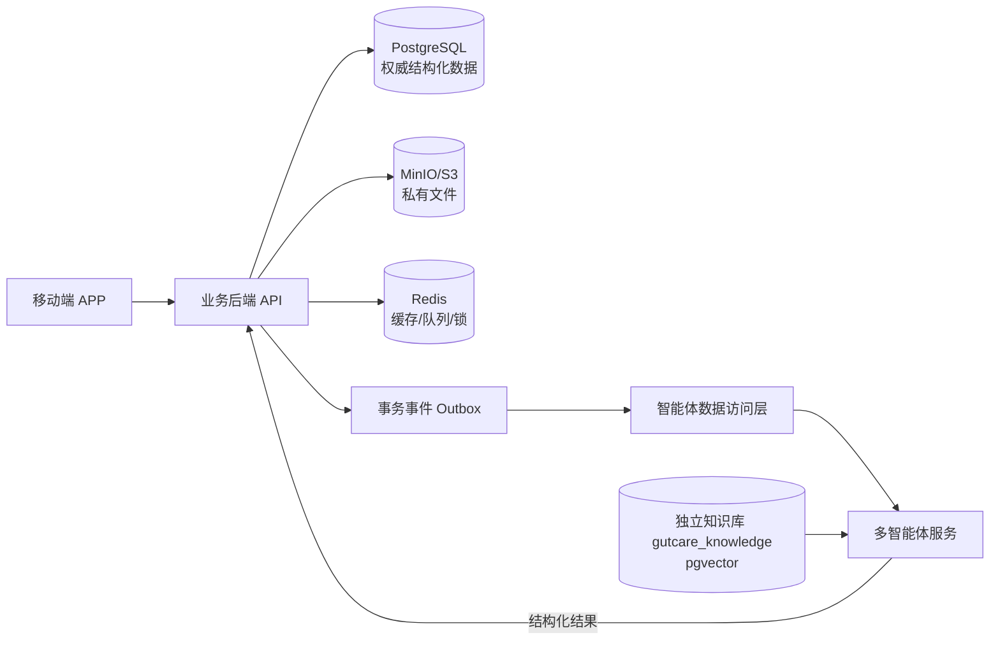
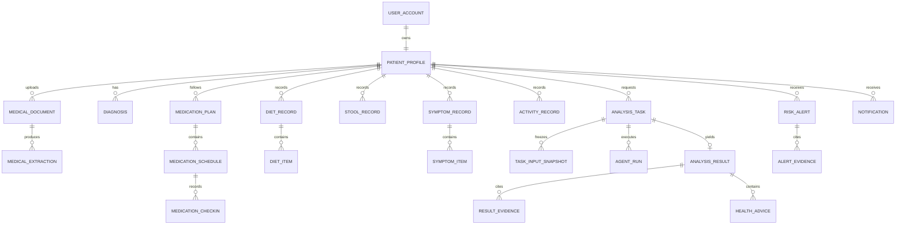

# GutCare Agent 数据库设计方案

> 文档版本：V1.1  
> 编制日期：2026-10-14  
> 适用范围：移动端 APP、业务后端、确定性安全规则及多智能体数据接入  
> 文档状态：开发基线

## 1. 设计目标

GutCare Agent 的数据库既承担患者账户、医疗档案和日常健康记录等常规业务数据的持久化，也需要为多智能体系统提供可追溯、可复现且经过权限控制的输入数据。数据库设计必须同时满足以下目标：

1. 支持多个患者账户，并确保患者之间的数据严格隔离。
2. 保存医疗报告、饮食、排便、症状、服药、运动等纵向健康数据。
3. 区分患者原始输入、模型候选值和患者确认值，避免将模型推断直接当作医疗事实。
4. 保留记录版本、分析输入快照、模型版本和证据引用，使历史结果可以复现。
5. 智能体故障时，注册登录、业务记录、风险规则和历史查询仍能独立运行。
6. 为智能体提供最小必要、稳定、只读的数据接口，不让智能体任意读取业务表。
7. 满足敏感健康数据的访问控制、脱敏、审计、删除和生命周期管理要求。

## 2. 数据存储选型

### 2.1 总体选型

| 数据类别 | 选型 | 定位 |
|---|---|---|
| 权威业务数据 | PostgreSQL 18.x 当前补丁版 | 唯一事实来源，保存账户、结构化健康记录、任务、结果、通知和审计元数据 |
| 报告及图片 | MinIO Community（锁定源码 commit 构建） | 保存 PDF、医疗报告图片、饮食图片和粪便图片；数据库仅保存对象键和元数据 |
| 缓存及异步状态 | Redis | 保存短期缓存、限流计数、分布式锁和任务队列；不得作为业务数据唯一存储 |
| 医学知识向量 | 独立 PostgreSQL `gutcare_knowledge` + pgvector 0.8.7+ | 由智能体团队维护；与业务库分数据库、分角色，患者私有数据不得写入 |
| 日志与监控 | 独立日志系统 | 保存脱敏后的运行日志和指标；不在普通日志中记录报告正文或敏感图片内容 |

### 2.2 选用 PostgreSQL 的原因

- 项目主体是强关系、强约束的业务数据，适合使用关系数据库保证事务一致性。
- `JSONB` 可保存版本快照、智能体结构化输出和扩展字段，但不必牺牲核心字段的类型约束。
- 原生支持 `UUID`、`TIMESTAMPTZ`、部分索引、表达式索引、全文检索和行级安全策略。
- 可通过 pgvector 承载首期医学知识检索，减少比赛阶段的组件数量。
- 数据视图、只读角色和事务机制适合为智能体提供受控输入。

MongoDB 等文档数据库不作为主库。医疗档案、记录版本、任务输入和证据之间存在大量明确关系，使用文档数据库作为主存储会增加跨集合一致性和审计难度。向量数据库也不能替代权威业务库。

## 3. 存储边界与数据流



数据流原则：

- APP 只访问业务后端，不直接连接数据库、对象存储或智能体服务。
- 智能体只通过内部数据访问 API 获取任务冻结输入；生产环境不向智能体发放业务数据库凭据。
- APP 私有文件通过同源 HTTPS gateway 的短期 opaque capability 上传/下载；智能体只能经业务 API 按冻结快照授权读取，不直连 MinIO 管理端或持有永久凭据。
- 智能体结果由业务后端校验后写入数据库，智能体账号不直接修改患者业务表。
- PostgreSQL 是权威来源；Redis 丢失后必须能够由 PostgreSQL 恢复业务状态。

## 4. 数据库逻辑划分

业务数据保存在独立数据库 `gutcare_business`，并使用多个 schema 隔离职责：

| Schema | 内容 | 写入方 |
|---|---|---|
| `iam` | 账户、认证会话、设备 | 业务后端 |
| `health` | 患者资料、医疗档案、健康记录、用药数据 | 业务后端 |
| `analysis` | 分析任务、输入快照、Agent 运行、结果、建议和证据 | 业务后端；智能体通过接口提交结果 |
| `safety` | 经审核规则、风险提示及触发证据 | 业务后端/安全规则引擎 |
| `message` | 站内通知、推送设备和提醒 | 业务后端 |
| `integration` | Outbox、回调去重和服务调用记录 | 业务后端 |
| `audit` | 安全审计事件、数据变更摘要 | 后端审计组件 |

生产环境不得使用 `public` schema 承载业务表。应用角色不应拥有建表或修改 schema 的权限，DDL 只由迁移账号执行。知识库即使复用同一 PostgreSQL 集群，也必须使用独立数据库 `gutcare_knowledge`、独立迁移账号和运行账号；其 schema 由智能体开发方定义。

## 5. 通用建模规范

### 5.1 主键与时间

- 主键统一使用 PostgreSQL `UUID`，默认值使用 PostgreSQL 18 原生 `uuidv7()`；导入数据可携带已校验 UUID。
- 对外 API 使用 UUID，不暴露可枚举的连续整数主键。
- 时间统一使用 `TIMESTAMPTZ` 并以 UTC 存储，APP 按用户时区展示。
- 仅表示自然日期时使用 `DATE`，仅表示本地提醒时刻时使用 `TIME` 并同时保存 IANA 时区。
- 所有业务表至少包含 `created_at`、`updated_at`；可删除数据增加 `deleted_at`。

### 5.2 数据类型

| 场景 | 推荐类型 | 说明 |
|---|---|---|
| 主键/外键 | `UUID` | 跨服务稳定且不可枚举 |
| 短文本/状态码 | `VARCHAR(n)` | 设定明确最大长度并加 `CHECK` 或字典约束 |
| 长文本 | `TEXT` | 症状备注、建议正文、报告文本 |
| 布尔值 | `BOOLEAN` | 不使用 0/1 字符串代替 |
| 严重程度/评分 | `SMALLINT`、`NUMERIC(p,s)` | 避免对需要精确比较的值使用浮点数 |
| 时间 | `TIMESTAMPTZ` | 统一保存时区语义 |
| 业务扩展/快照 | `JSONB` | 用于非核心扩展字段和不可变快照，不替代常用查询列 |
| 向量 | `VECTOR(n)` | 仅用于审核知识库，不将原始患者隐私默认写入向量库 |
| 文件 | 对象存储键 `VARCHAR(512)` | 二进制文件不直接放入 PostgreSQL |

### 5.3 状态字段

状态字段使用小写英文稳定码，例如 `pending`、`processing`、`succeeded`、`failed`。统一采用 `VARCHAR + CHECK`，不使用 PostgreSQL ENUM。面向用户的中文文案由 APP 或后端字典映射，不直接作为状态值。

### 5.4 版本、删除与并发

- 可编辑健康记录设置 `record_version INTEGER NOT NULL DEFAULT 1`。
- 更新时使用乐观锁：`WHERE id = :id AND record_version = :expected_version`。
- 删除默认采用 `deleted_at` 软删除；文件同时进入延迟清理队列。
- 患者确认值不得覆盖模型候选值；二者应分别存储并保留确认人和确认时间。
- 历史分析结果引用确切的 `record_id + record_version`，源记录更新后不重写旧结果。

## 6. 核心实体关系



## 7. 表设计

以下字段为最低工程基线。实现时应通过数据库迁移工具维护，不允许在生产环境手工改表。

### 7.1 账户与患者资料

#### `iam.user_account`

| 字段 | 类型 | 约束/说明 |
|---|---|---|
| `id` | `UUID` | 主键 |
| `email_ciphertext` | `BYTEA` | 非空；应用层加密后的原始邮箱，用于发送邮件 |
| `email_lookup_hash` | `CHAR(64)` | 非空且唯一；规范化邮箱的 HMAC-SHA-256 盲索引，用于登录查找 |
| `password_hash` | `VARCHAR(255)` | 非空；只保存安全哈希，不保存明文密码 |
| `status` | `VARCHAR(24)` | `active/locked/deactivated/pending_verification` |
| `failed_login_count` | `SMALLINT` | 非空，默认 0 |
| `locked_until` | `TIMESTAMPTZ` | 可空 |
| `last_login_at` | `TIMESTAMPTZ` | 可空 |
| `created_at/updated_at/deleted_at` | `TIMESTAMPTZ` | 审计时间 |

对 `email_lookup_hash` 建唯一部分索引并限定 `deleted_at IS NULL`。邮箱先执行 Unicode/域名规范化，再使用独立 pepper 计算盲索引；加密密钥与 pepper 分开管理，日志只输出掩码。手机号字段不进入 P0 schema。

#### `iam.email_verification_token`

保存 `id`、`user_id`、`purpose(register/password_reset)`、`token_hash CHAR(64)`、`expires_at`、`used_at`、`attempt_count` 和 `created_at`。令牌仅保存摘要，默认 10 分钟过期且只能使用一次；对用户与来源摘要同时限流。

#### `iam.refresh_session`

| 字段 | 类型 | 约束/说明 |
|---|---|---|
| `id` | `UUID` | 主键 |
| `user_id` | `UUID` | 外键到 `user_account` |
| `token_hash` | `CHAR(64)` | 唯一；只保存刷新令牌摘要 |
| `device_id` | `UUID` | 可空 |
| `expires_at/revoked_at` | `TIMESTAMPTZ` | 有效期与撤销时间 |
| `created_at` | `TIMESTAMPTZ` | 非空 |

Refresh token rotation 使用 `family_id UUID NOT NULL` 指向该登录链保留的根 `refresh_session.id`（自引用外键，`DEFERRABLE INITIALLY DEFERRED`）；根行不得在存在族成员时物理删除，因为它也是族级互斥锁。初始 session 的 `family_id=id`，后继继承根 ID。`parent_session_id UUID NULL` 指向直接前序，`replaced_by_session_id UUID NULL UNIQUE` 指向直接后继，均为本表自引用外键（删除目标时置空）。`(family_id, revoked_at)` 索引支持整族撤销。所有 refresh/replay 流程先查询 presented token 得到 family，再对根行 `SELECT ... FOR UPDATE`，锁内重新读取 presented token 后判断并轮换/撤销。PostgreSQL `READ COMMITTED` 下等待中的事务取得根锁后，后续重新读取语句可见前一事务已提交的撤销与后继；因此并发重放不能留下有效胜者后继。迁移将现有 opaque family UUID 规范化为每组最早根 session ID，再添加自引用约束。

#### `health.patient_profile`

| 字段 | 类型 | 约束/说明 |
|---|---|---|
| `id` | `UUID` | 主键；内部 `patient_id` |
| `user_id` | `UUID` | 唯一外键到 `user_account` |
| `nickname` | `VARCHAR(64)` | 可空；展示层为空时使用系统占位，不回填真实姓名 |
| `avatar_object_id` | `UUID` | 可空，关联文件对象 |
| `birth_year` | `SMALLINT` | 非空；四位年份与合理范围约束，不保存完整生日 |
| `timezone` | `VARCHAR(64)` | 非空，默认 `Asia/Shanghai` |
| `profile_version` | `INTEGER` | 非空，默认 1 |
| `created_at/updated_at/deleted_at` | `TIMESTAMPTZ` | 审计时间 |

#### `health.patient_consent`

记录隐私说明、敏感图片处理和第三方模型处理等授权。

| 字段 | 类型 | 约束/说明 |
|---|---|---|
| `id` | `UUID` | 主键 |
| `patient_id` | `UUID` | 外键 |
| `consent_type` | `VARCHAR(48)` | 如 `privacy_policy/sensitive_image/third_party_ai` |
| `document_version` | `VARCHAR(32)` | 授权文本版本 |
| `granted` | `BOOLEAN` | 非空 |
| `decided_at` | `TIMESTAMPTZ` | 非空 |
| `revoked_at` | `TIMESTAMPTZ` | 可空 |
| `metadata` | `JSONB` | 客户端版本等非核心信息 |

同一患者和授权类型可以有多条历史，不覆盖原决定。当前授权状态由最新决定计算。`metadata.notice_summary_hash` 保存该授权类型对应的告知摘要 SHA-256；policy version 由服务端允许版本配置绑定到该摘要，客户端不得任意传版本后复用当前摘要。`privacy_policy` 只能在注册时记录，撤回通过账号注销流程，通用授权 API 不接受该类型。

#### `iam.account_deletion_request`

保存 `id UUID`、唯一 `user_id UUID`、`status(pending/processing/completed/failed)`、`requested_at` 和可空 `completed_at`。`user_id` 唯一约束阻止重复请求；状态由 CHECK 约束。请求创建与账户停用、全部刷新会话撤销在同一事务内；初始 `pending` 操作 ID 返回给 APP。表启用并强制 RLS，使用事务级 `app.user_id` 限定本人请求。此表只追踪删除操作，不保存理由、自由文本或其他不必要的患者内容。

### 7.2 文件与医疗档案

#### `health.file_object`

| 字段 | 类型 | 约束/说明 |
|---|---|---|
| `id` | `UUID` | 主键 |
| `patient_id` | `UUID` | 文件所有者 |
| `bucket_name` | `VARCHAR(128)` | 非空 |
| `object_key` | `VARCHAR(512)` | 非空；全局唯一 |
| `original_name` | `VARCHAR(255)` | 非空；展示时进行安全处理 |
| `content_type` | `VARCHAR(128)` | 非空 |
| `size_bytes` | `BIGINT` | 非空且大于 0 |
| `content_sha256` | `CHAR(64)` | 用于完整性和同一患者内去重，不作为隐私安全手段 |
| `sensitivity` | `VARCHAR(24)` | `normal/medical/sensitive_image` |
| `scan_status` | `VARCHAR(24)` | `pending/clean/rejected/failed` |
| `storage_status` | `VARCHAR(24)` | `uploading/available/deleting/deleted/failed` |
| `created_at/deleted_at` | `TIMESTAMPTZ` | 生命周期时间 |

数据库不保存永久访问 URL。上传会话只保存 capability 哈希；创建下载 grant 时业务后端验证 `patient_id` 后签发短期只读 gateway capability URL。Capability 位于 URL path，因此 Uvicorn 原始 access log 必须关闭。

#### `health.upload_session`

| 字段 | 类型 | 约束/说明 |
|---|---|---|
| `id` | `UUID` | 主键；服务端生成 |
| `patient_id` | `UUID` | 患者归属；RLS |
| `idempotency_key` | `VARCHAR(128)` | 与 patient_id 组成唯一约束 |
| `request_hash` / `capability_hash` | `CHAR(64)` | 请求摘要 / capability SHA-256；不保存原始密钥 |
| `bucket_name` / `object_key` | `VARCHAR(128/512)` | 服务端生成；object_key 唯一 |
| `original_name` / `content_type` | `VARCHAR(255/128)` | 文件名和标准化 MIME |
| `expected_size_bytes` | `BIGINT` | >0；根据文件类型限制大小 |
| `purpose` / `status` | `VARCHAR(24)` | 用途枚举；状态 `issued/uploaded/completed/failed/expired` |
| `file_object_id` | `UUID NULL` | 完成后关联，复合 FK `(file_object_id, patient_id)` |
| `expires_at` / `created_at` | `TIMESTAMPTZ` | 上传 capability 15 分钟 TTL |

#### `health.file_download_grant`

仅保存 `(patient_id, file_object_id, token_hash CHAR(64), expires_at, created_at)`；`(file_object_id, patient_id)` 复合外键保证患者归属，grant TTL 五分钟，APP 不接触对象存储地址。

#### `health.medical_document`

| 字段 | 类型 | 约束/说明 |
|---|---|---|
| `id` | `UUID` | 主键 |
| `patient_id` | `UUID` | 外键 |
| `file_object_id` | `UUID` | 外键，非空 |
| `document_type` | `VARCHAR(32)` | 检查报告、出院记录等受控类型 |
| `hospital_name` | `VARCHAR(160)` | 可空 |
| `document_date` | `DATE` | 可空 |
| `notes` | `TEXT` | 可空；API 限制最多 1000 字 |
| `processing_mode` | `VARCHAR(24)` | 非空，`store_only/analyze` |
| `parse_status` | `VARCHAR(24)` | `not_requested/pending/processing/needs_confirmation/confirmed/failed/invalidated` |
| `record_version` | `INTEGER` | 非空，默认 1 |
| `created_at/updated_at/deleted_at` | `TIMESTAMPTZ` | 审计时间 |

ADR-0011 建立 `health.medical_parse_request`（冻结患者/文档/文件/版本、状态、领取时间；来源删除后清空 document/file ID）、`health.medical_field_candidate`（类型化值、单位、置信/不确定性、excerpt/locator、逐项 review 状态和版本）、`health.medical_candidate_decision`（追加审计）与 `health.confirmed_medical_fact`（患者确认决策创建的独立事实）。Alembic 0012 增加 `health.medical_candidate_decision_idempotency`（patient/candidate/key/request_hash/204 响应收据；与审计分离）。这些表 FORCE RLS；解析请求、候选、事实、审计和幂等收据通过患者复合外键关联。worker 以 SKIP LOCKED 领取请求，processing 超过五分钟可重领；撤回/源删除与解析操作先经固定命名空间 `gutcare.patient-consent-fence:` + patient UUID 的 PostgreSQL 事务级 advisory 锁栅栏（shared/exclusive），再按 request → candidate 行锁；Agent 只能通过任务 ID 的内部 HTTP 读取冻结文件并回传候选，不授予 worker patient_profile UPDATE 权限。

ADR-0018 / Alembic 0022 增加 `health.medical_fact_conflict` 与 `medical_fact_conflict_member`；0023 为非 invalidated 冲突增加患者+group_hash 唯一索引：只保存分组/成员指针、来源版本、状态/低敏解决审计，不复制医疗正文。两表 FORCE RLS、患者复合 FK，APP 仅按患者读及显式 `keep_both` 状态更新；隐私 worker 清理顺序为 member → conflict → confirmed fact。`test_result.value` 可携带受控可选 `sampled_on` 与 `unit`，兼容既有外层 unit。

#### `integration.file_deletion_job` 与 `integration.file_orphan_cleanup_job`

文件删除任务记录患者/文件复合归属、对象位置、`due_at`、`status`、`attempts`、`locked_at` 和创建时间。删除任务延迟七天处理；worker 使用五分钟 lease，并可恢复锁超时任务。Orphan cleanup job 不依赖 `file_object` 行，记录对象位置、原因、重试次数、lease 和到期时间，用于写入/校验/扫描失败或过期暂存对象清理。业务角色仅 INSERT，worker 独占读取/更新/删除。

#### `health.medical_extraction`

每次模型抽取单独保存，不能覆盖患者确认数据。

| 字段 | 类型 | 约束/说明 |
|---|---|---|
| `id` | `UUID` | 主键 |
| `document_id` | `UUID` | 外键 |
| `task_id` | `UUID` | 对应分析任务 |
| `model_version` | `VARCHAR(128)` | 非空 |
| `candidate_payload` | `JSONB` | 经 JSON Schema 校验的候选字段 |
| `source_locators` | `JSONB` | 字段级页码、章节、字符区间或 bbox；用于回到原文位置 |
| `uncertainties` | `JSONB` | 不确定项 |
| `status` | `VARCHAR(24)` | `succeeded/partial/failed` |
| `created_at` | `TIMESTAMPTZ` | 非空 |

#### `health.diagnosis`

| 字段 | 类型 | 约束/说明 |
|---|---|---|
| `id` | `UUID` | 主键 |
| `patient_id` | `UUID` | 外键 |
| `document_id` | `UUID` | 可空，来源报告 |
| `name` | `VARCHAR(160)` | 非空 |
| `code_system/code` | `VARCHAR(32/64)` | 可空，预留标准编码 |
| `assertion` | `VARCHAR(24)` | `confirmed/suspected/ruled_out/history` |
| `diagnosed_on` | `DATE` | 可空 |
| `source_type` | `VARCHAR(24)` | `document/patient_manual` |
| `confirmation_status` | `VARCHAR(24)` | `pending/confirmed/rejected` |
| `confirmed_at` | `TIMESTAMPTZ` | 可空 |
| `record_version` | `INTEGER` | 非空 |
| `created_at/updated_at/deleted_at` | `TIMESTAMPTZ` | 审计时间 |

医生医嘱使用 `health.medical_instruction` 独立表，至少保存正文、来源报告、确认状态、适用起止日期和版本，不与诊断混在同一个 JSON 中。

### 7.3 日常健康记录

所有日常记录均包含 `id`、`patient_id`、`occurred_at`、`source_type`、`record_version`、`created_at`、`updated_at` 和 `deleted_at`。`occurred_at` 与 `created_at` 含义必须分开。

#### `health.diet_record`

| 特有字段 | 类型 | 约束/说明 |
|---|---|---|
| `meal_type` | `VARCHAR(24)` | 早餐、午餐、晚餐、加餐等受控码 |
| `text_description` | `TEXT` | 可空；无图片时可作为主要输入 |
| `portion_note` | `VARCHAR(160)` | 可空，不强制精确重量 |
| `image_object_id` | `UUID` | 可空 |
| `confirmation_status` | `VARCHAR(24)` | `pending/confirmed/needs_review`；手工来源由通用 `source_type=patient_manual` 表示 |
| `ai_candidate_id` | `UUID` | 可空，指向候选结果 |

`health.diet_item` 保存一餐中的确认食物项，字段包括 `diet_record_id`、`name`、`category_code`、`amount_text`、`source_type` 和 `confirmed_by_patient`。不在没有依据时保存伪精确营养值。

#### `health.stool_record`

| 特有字段 | 类型 | 约束/说明 |
|---|---|---|
| `bristol_type` | `SMALLINT` | 可空；确认值限制 1–7 |
| `image_object_id` | `UUID` | 可空 |
| `color_code` | `VARCHAR(32)` | 可空，受控码 |
| `blood_reported` | `BOOLEAN` | 可空；表示患者陈述，不表示图像诊断 |
| `urgency_level` | `SMALLINT` | 可空，限定产品量表范围 |
| `confirmation_status` | `VARCHAR(24)` | `pending/confirmed/needs_review`；手工来源由通用 `source_type=patient_manual` 表示 |
| `ai_candidate_id` | `UUID` | 可空 |

#### `health.symptom_record` 与 `health.symptom_item`

一条症状事件可包含多个症状项。主表保存发生时间、持续分钟数、自由备注、`symptom_status`（`ongoing/relieved`）和记录版本；每次状态变化追加到 `health.symptom_status_event`，该表启用 FORCE RLS，业务应用仅有 SELECT/INSERT 权限，不能改写或删除历史事件。症状类别由固定字典约束：`abdominal_pain`、`bloating`、`diarrhea`、`constipation`、`nausea`、`vomiting`、`acid_reflux`、`appetite_change`、`blood_in_stool_concern`、`other`；`other` 必须有 1–160 字受限描述，其他类别禁止该描述。明细表保存：

| 字段 | 类型 | 约束/说明 |
|---|---|---|
| `symptom_record_id` | `UUID` | 外键 |
| `symptom_code` | `VARCHAR(48)` | 腹痛、腹胀、腹泻、便秘、恶心等字典码 |
| `severity` | `SMALLINT` | 采用产品定义的 0–10 量表并加范围约束 |
| `body_location` | `VARCHAR(64)` | 可空 |
| `patient_confirmed` | `BOOLEAN` | 非空；模型候选不得自动设为 true |

#### `health.activity_record`

保存患者手工活动：`activity_type` 为 walking/jogging/cycling/other，other 描述为 1–160 字；`duration_minutes` 为 1–1440；`intensity` 为 low/moderate/high；`subjective_feeling` 为 better/same/worse；`occurred_at` 是活动开始时间。包含 record_version、created_at、updated_at、deleted_at，建 `(patient_id, occurred_at)` 索引，FORCE RLS。

F11 在数据库中使用 SQL 聚合记录；按患者 profile IANA 时区分桶，UTC 半开区间过滤，不物化统计结果。时间线游标签名且全序为发生时间降序、类型升序、ID升序。

F03–F05 当前 API 复用 `/api/v1/{record_type}` 与 `/api/v1/{record_type}/{record_id}`，`record_type` 分别为 `diet-records`、`stool-records`、`symptom-records`。DTO 的 `payload` 按记录类型分别校验且拒绝额外字段；患者归属只由认证上下文解析。饮食食物项与症状明细使用独立子表和 `(child_record_id, patient_id)` 复合外键。饮食/排便记录可无图；可选 `image_object_id` 必须关联同患者、扫描干净且可用的 F02 文件及对应已完成上传用途，并要求当前健康数据处理与敏感图片授权。数据库以复合外键保证图片归属；应用层校验上传用途、扫描状态和授权。

所有 F03–F05 患者表及幂等账本启用并强制 RLS，应用事务设置本地 `app.user_id` 与 `app.patient_id`。创建记录通过 `health.record_idempotency` 保存请求摘要与资源引用，同患者、同 record type 和幂等键重放相同请求返回原资源，请求摘要不同时返回冲突。

### 7.4 用药计划与打卡

#### `health.medication_plan`

| 字段 | 类型 | 约束/说明 |
|---|---|---|
| `id/patient_id` | `UUID` | 主键/患者外键 |
| `medication_name` | `VARCHAR(160)` | 非空 |
| `dosage_text` | `VARCHAR(160)` | 按来源原文保存，不由系统推断 |
| `route_code` | `VARCHAR(32)` | 可空 |
| `start_date/end_date` | `DATE` | 结束日期不得早于开始日期 |
| `source_ref_id` | `UUID` | 可空；与 `patient_id` 组成复合外键引用 `medication_source_ref` |
| `source_type` | `VARCHAR(24)` | `manual/medical_document`；医疗档案由患者复合外键引用稳定墓碑 |
| `confirmation_status` | `VARCHAR(24)` | `pending/confirmed/needs_review` |
| `plan_status` | `VARCHAR(24)` | `active/ended/discontinued`；仅已确认计划可进入 `active` |
| `record_version` | `INTEGER` | 非空 |
| `created_at/updated_at/deleted_at` | `TIMESTAMPTZ` | 审计时间 |

#### `health.medication_schedule`

保存计划内的一次或重复服药安排：`plan_id`、`local_time TIME`、`timezone VARCHAR(64)`、`rrule TEXT`、`valid_from`、`valid_to`、`enabled`、`record_version`、`deleted_at`。唯一来源为 `manual` 或同患者医疗档案；医疗档案软删不级联更改计划。日程停用/软删保留历史；日程编辑采用乐观锁。重复规则只允许 ADR-0010 冻结的 RFC 5545 子集（DAILY/WEEKLY、INTERVAL、WEEKLY BYDAY、COUNT/UNTIL），服务端校验 IANA 时区。DST 缺失时间顺延到首个有效时刻，重复时刻取第一次。改动仅重算未来 pending 实例；已响应历史不可变。

#### `health.medication_source_ref`

只保存稳定引用和删除状态：`id`、`patient_id`、`source_kind`、`original_document_id`、可空 `live_document_id`、`source_deleted_at`。不保存正文、文件定位、医院或其他医疗元数据。`live_document_id + patient_id` 复合 FK 阻止未墓碑文档物理删除；触发器只允许 live→墓碑，不允许伪造墓碑或改写身份。计划 DTO 删除后只返回 `source_deleted=true`，不暴露原 UUID。

`health.medication_idempotency` 持久化患者/路由/键/请求摘要、资源引用、首次响应 JSON 快照和 HTTP 状态；重放不重新读取当前资源。

`health.medication_migration_marker` 是无患者维度的迁移安全标记，仅含固定 marker key 与创建时间。来源首次墓碑化时由受限 SECURITY DEFINER 触发器同事务写入；0010回填发现既有墓碑时初始化。它不含业务/患者数据，不授予应用读取/修改权；downgrade 在首个数据库操作读取它，存在则在任何 DDL/RLS 变更前拒绝。

#### `health.medication_checkin`

| 字段 | 类型 | 约束/说明 |
|---|---|---|
| `schedule_id/patient_id` | `UUID` | 复合外键 |
| `local_date` | `DATE` | 计划本地日期，用于DST审计和物化唯一键 |
| `scheduled_for` | `TIMESTAMPTZ` | 计划时间 |
| `status` | `VARCHAR(24)` | `taken/not_taken/pending/skipped` |
| `record_version` | `INTEGER` | 乐观锁版本；`pending` 永不等同 `not_taken` |
| `taken_at` | `TIMESTAMPTZ` | 可空 |
| `note` | `VARCHAR(500)` | 可空 |
| `created_at/updated_at` | `TIMESTAMPTZ` | 审计时间 |

对 `(schedule_id, local_date)` 建唯一约束，防止DST重复时刻或并发物化产生重复实例。已生成打卡不可删除；计划软删后不再产生新实例。没有回应时持久化保持 `pending`，不得自动记为 `not_taken`。API/worker角色和RLS策略按 ADR-0010 最小授权。

### 7.5 通用智能候选结果

#### `analysis.ai_candidate`

用于保存饮食、排便或自由文本识别的候选结果。

| 字段 | 类型 | 约束/说明 |
|---|---|---|
| `id` | `UUID` | 主键 |
| `patient_id` | `UUID` | 外键 |
| `target_type` | `VARCHAR(32)` | `medical_document/diet_record/stool_record/symptom_record` |
| `target_id` | `UUID` | 目标记录 ID；由服务层校验类型和归属 |
| `target_version` | `INTEGER` | 输入记录版本 |
| `task_id` | `UUID` | 外键 |
| `candidate_payload` | `JSONB` | 经对应版本 Schema 校验 |
| `confidence_payload` | `JSONB` | 可空，逐字段置信信息 |
| `uncertainties` | `JSONB` | 可空 |
| `model_version` | `VARCHAR(128)` | 非空 |
| `review_status` | `VARCHAR(24)` | `pending/accepted/corrected/rejected` |
| `reviewed_at` | `TIMESTAMPTZ` | 可空 |
| `created_at` | `TIMESTAMPTZ` | 非空 |

多态 `target_id` 无法完全依靠普通外键保证完整性，必须由业务服务和数据库触发器二选一进行严格校验。若团队更重视数据库级外键，可分别建立 `diet_ai_candidate`、`stool_ai_candidate` 等专表。

### 7.6 分析任务、运行与结果

ADR-0012 冻结的 F08 最小闭环使用 `analysis.analysis_task`、`analysis.task_input_snapshot`、`analysis.analysis_task_idempotency`、`analysis.analysis_task_callback`。任务与快照患者复合 FK；重试以 `retry_of` 指向原 failed task，唯一约束确保每个失败尝试最多派生一次重试；callback ledger 按 callback_id 幂等。幂等表保存首次 202 DTO 响应。快照以 JSONB + SHA-256 单行保存，只含 F02 已确认事实、F03–F06 已确认结构化事实及 F10 风险状态上下文，不含报告正文、URL、自由备注、prompt 或模型原始输出。数据库触发器拒绝快照 UPDATE；删除仍允许用于患者数据生命周期清理。表均 ENABLE/FORCE RLS；`gutcare_app` 只按患者上下文创建/读取/取消任务，专用 `gutcare_analysis_worker` 连接只可操作分析任务/快照/callback ledger 并只读授权记录，不复用可读 F02 文件/医疗表的通用 `gutcare_worker`。Agent 仅经 Bearer 内部 HTTP，不持有数据库角色。结果结构化 payload 暂存于任务结果字段，F09 advice/evidence 实体不在此范围创建。

#### `analysis.analysis_task`

| 字段 | 类型 | 约束/说明 |
|---|---|---|
| `id` | `UUID` | 主键，即 `task_id` |
| `patient_id` | `UUID` | 外键 |
| `analysis_type` | `VARCHAR(48)` | 报告抽取、单条识别、综合分析、周期总结等 |
| `requested_from/requested_to` | `TIMESTAMPTZ` | 分析范围，可空 |
| `status` | `VARCHAR(24)` | `pending/processing/needs_input/succeeded/partial/failed/cancelled` |
| `idempotency_key` | `VARCHAR(128)` | 非空 |
| `request_payload` | `JSONB` | 已校验请求，不保存无关敏感信息 |
| `attempt_count/max_attempts` | `SMALLINT` | 重试计数 |
| `agent_workflow_version` | `VARCHAR(128)` | 可空，执行后回填 |
| `error_code` | `VARCHAR(64)` | 可空，稳定机器码 |
| `error_message_safe` | `VARCHAR(500)` | 可空，可向用户/运维展示的脱敏信息 |
| `queued_at/started_at/finished_at` | `TIMESTAMPTZ` | 生命周期时间 |
| `created_at/updated_at` | `TIMESTAMPTZ` | 审计时间 |

对 `(patient_id, idempotency_key)` 建唯一约束。任务状态变更使用条件更新，禁止完成状态被延迟回调改回处理中。

#### `analysis.task_input_snapshot`

该表是智能体结果可复现的关键。

| 字段 | 类型 | 约束/说明 |
|---|---|---|
| `id/task_id/patient_id` | `UUID` | 主键及外键 |
| `record_type` | `VARCHAR(48)` | 输入实体类型 |
| `record_id` | `UUID` | 输入记录 ID |
| `record_version` | `INTEGER` | 输入版本 |
| `snapshot_payload` | `JSONB` | 提交给智能体的最小必要不可变快照 |
| `content_hash` | `CHAR(64)` | 检查传输完整性 |
| `included_at` | `TIMESTAMPTZ` | 非空 |

对 `(task_id, record_type, record_id, record_version)` 建唯一约束。快照只包含本次分析实际所需字段；敏感文件本体仍留在对象存储。

#### `analysis.agent_run`

| 字段 | 类型 | 约束/说明 |
|---|---|---|
| `id/task_id` | `UUID` | 主键/任务外键 |
| `agent_name` | `VARCHAR(64)` | Medical、Diet、Stool、Trend、Advice 等 |
| `run_sequence` | `SMALLINT` | 同任务执行序号 |
| `status` | `VARCHAR(24)` | `pending/running/succeeded/partial/failed/skipped` |
| `model_provider/model_name/model_version` | `VARCHAR` | 模型溯源信息 |
| `prompt_version` | `VARCHAR(64)` | 提示词版本，不保存含患者数据的完整 prompt 日志 |
| `input_token_count/output_token_count` | `INTEGER` | 可空 |
| `started_at/finished_at` | `TIMESTAMPTZ` | 可空 |
| `error_code` | `VARCHAR(64)` | 可空 |
| `created_at` | `TIMESTAMPTZ` | 非空 |

#### `analysis.analysis_result`

| 字段 | 类型 | 约束/说明 |
|---|---|---|
| `id/task_id/patient_id` | `UUID` | 主键、任务和患者外键；每任务至多一个当前汇总结果 |
| `result_version` | `INTEGER` | 非空 |
| `summary_text` | `TEXT` | 可空，患者可读摘要 |
| `structured_payload` | `JSONB` | 经版本化 JSON Schema 校验的结构化结果 |
| `schema_version` | `VARCHAR(32)` | 非空 |
| `limitations` | `JSONB` | 数据缺失、不确定性与适用范围 |
| `safety_check_status` | `VARCHAR(24)` | `pending/passed/blocked/needs_review` |
| `generated_at` | `TIMESTAMPTZ` | 非空 |
| `created_at` | `TIMESTAMPTZ` | 非空 |

#### `analysis.result_evidence`

使用受控引用而不是在智能结果中只保存自然语言“来源”。

| 字段 | 类型 | 约束/说明 |
|---|---|---|
| `id/result_id` | `UUID` | 主键/结果外键 |
| `source_kind` | `VARCHAR(32)` | `patient_record/medical_document/knowledge_chunk` |
| `source_id` | `UUID` | 来源 ID |
| `source_version` | `INTEGER` | 患者记录版本；知识来源可空 |
| `evidence_role` | `VARCHAR(32)` | `supports/context/contradicts/limitation` |
| `excerpt` | `TEXT` | 可空且长度受限；避免复制大段敏感原文 |
| `source_locator` | `JSONB` | 可空；经 Schema 校验，保存页码、章节、字符区间或图像 bbox，不保存永久 URL |
| `created_at` | `TIMESTAMPTZ` | 非空 |

### 7.7 建议与反馈

ADR-0013 将建议生命周期与依据更新分离：`status=new/read/archived`，`basis_updated`、`basis_updated_at`、`basis_update_reason` 独立。建议由独立 callback 生成，必须指向 succeeded/partial F08 task；callback ledger 同 task + callback_id 唯一并保存摘要。Advice 与 evidence 同事务写入。patient evidence 只保存 task snapshot 精确 source type/id/version/locator；knowledge evidence 只保存 knowledge_ref/version/title/publisher 和可选 HTTPS citation URL，不访问 `gutcare_knowledge`、不保存原文。反馈当前值有 optimistic version，`advice_feedback_event` 保留幂等变更历史。所有表 ENABLE/FORCE RLS、patient composite FK；分析 worker policy 必须带 `app.patient_id`，只允许更新回调写入且无反馈写权限。账号注销在 patient consent fence 中追加撤回现有健康数据处理/第三方 AI 授权，拒绝迟到的 F09 callback。

#### `analysis.health_advice`

与迁移 `0014_f09_advice` 一致，字段为：`id`、`patient_id`、`task_id`、`category`、`priority`、`title`、`body`、`uncertainty`、`applicability`、`safety_boundary`、`version`、`status`、`basis_updated`、`basis_updated_at`、`basis_update_reason`、`read_at`、`archived_at`、`created_at`。`task_id + patient_id` 复合外键指向 F08 task；`status` 仅允许 `new/read/archived`。依据变更状态独立于生命周期：未变更时 `basis_updated=false` 且时间/原因为空；变更时为 true 并记录时间及 `source_updated/source_deleted/fact_replaced` 原因。不会存在 `basis_updated` lifecycle 状态。

#### `analysis.advice_evidence`

字段为 `id`、`advice_id`、`patient_id`、`evidence_type`、`source_type`、`source_id`、`source_version`、`locator`、`source_deleted`、`knowledge_ref`、`knowledge_version`、`knowledge_title`、`knowledge_publisher`、`citation_url`、`created_at`。patient evidence 精确复制 task snapshot 的 source type/id/version/locator；来源删除后置 `source_deleted=true` 并清除 locator/target。knowledge evidence 只保存版本化引用元数据和可选 HTTPS citation URL，不保存原文或 chunk。证据跳转由 API 返回受控 DTO，不暴露存储 URL 或跨患者能力。

#### `analysis.advice_feedback`

保存每条建议的当前反馈：`advice_id`、`patient_id`、`feedback_type`、`version`、`updated_at`；`feedback_type` 仅为 `helpful/not_helpful/not_applicable`，不接受 comment。

#### `analysis.advice_callback` 与 `analysis.advice_feedback_event`

callback ledger 保存 `task_id`、`patient_id`、`callback_id`、请求摘要和创建时间，以 `(task_id, callback_id)` 唯一。反馈事件历史保存 `advice_id`、`patient_id`、`idempotency_key`、请求摘要、反馈类型、变更后版本和创建时间；以 `(patient_id, idempotency_key)` 唯一。相同幂等键及请求摘要重放当前反馈结果，不新增事件；异摘要冲突。反馈更新通过 `expected_version` 乐观并发控制，当前值更新与事件写入同事务提交。

### 7.8 F12 站内通知（ADR-0014，迁移0015）

`health.notification_outbox` 严格存储 F08 terminal、F09 新 advice、F10 risk 创建、F06 新 pending checkin 事件。JSONB payload 仅接受 `event_type/patient_id/target_type/target_id/occurred_at/priority/deduplication_key`；DB CHECK 拒绝任意额外键。领域触发器在源表事务内生成 payload，不复制正文、药名/剂量/医嘱、报告/建议内容、locator/URL、prompt 或原始模型输出。唯一键 `(patient_id,deduplication_key)`。

outbox 状态为 `pending/processing/dispatched/suppressed/dead_letter`，保存 attempts、available_at、有限 lease 和固定错误码；独立 `gutcare_notification_worker` 使用 SKIP LOCKED 领取，超时 lease 可重领，普通事件按指数退避最多八次，风险不受普通偏好抑制。`health.patient_notification` 仅保存类型、优先级、受控 target、去重键、发生时间与 read_at；`(patient_id,deduplication_key)` 唯一。`health.notification_preference` 保存普通 in-app 开关与成对 quiet hours/时区。三表均 ENABLE/FORCE RLS，通知与 outbox 通过复合患者 FK 关联。API 角色仅访问本人通知/偏好；dispatcher 只拥有 outbox、偏好读取和通知插入权限。通知删除随 F13 账户清理级联。

### 7.9 风险规则与风险提示

#### `safety.risk_rule`

| 字段 | 类型 | 约束/说明 |
|---|---|---|
| `id` | `UUID` | 主键 |
| `rule_code` | `VARCHAR(64)` | 稳定编码 |
| `version` | `INTEGER` | 与规则编码组成唯一键 |
| `name` | `VARCHAR(160)` | 非空 |
| `severity` | `VARCHAR(24)` | `attention/seek_care/emergency` |
| `condition_json` | `JSONB` | 经规则 Schema 校验的确定性条件 |
| `message` | `TEXT` | 经审核提示文案 |
| `recommended_action` | `TEXT` | 经审核行动文案 |
| `review_status` | `VARCHAR(24)` | `draft/approved/retired` |
| `reviewed_by` | `VARCHAR(128)` | 医学审核责任标识，不等同系统患者角色 |
| `reviewed_at` | `TIMESTAMPTZ` | 审核时间；生产规则必填 |
| `source_refs` | `JSONB` | 审核依据引用；生产规则至少一项 |
| `effective_from/effective_to` | `TIMESTAMPTZ` | 生效区间 |
| `expires_at` | `TIMESTAMPTZ` | 审核失效时间；生产规则必填 |
| `created_at/updated_at` | `TIMESTAMPTZ` | 审计时间 |

生产执行只加载 `review_status=approved`、`environment=production`、审核人/日期/来源/失效时间齐全、尚未过期且处于生效区间的规则。`test_only` 规则与合成数据仅供测试，数据库约束也拒绝缺少专业审核元数据的 production 规则。规则修改必须新增版本，不覆盖已经触发历史提示的旧版本。

#### `safety.risk_alert`

| 字段 | 类型 | 约束/说明 |
|---|---|---|
| `id/patient_id` | `UUID` | 主键/患者外键 |
| `rule_id` | `UUID` | 指向实际触发的规则版本 |
| `severity` | `VARCHAR(24)` | 冗余保存触发时等级，便于历史重现 |
| `message/recommended_action` | `TEXT` | 保存触发时文案快照 |
| `deduplication_key` | `VARCHAR(128)` | 非空 |
| `status` | `VARCHAR(24)` | `unread/read/reevaluated`；不使用 `resolved/safe` 暗示医学结论 |
| `triggered_at/read_at/reevaluated_at` | `TIMESTAMPTZ` | 状态时间 |
| `created_at/updated_at` | `TIMESTAMPTZ` | 审计时间 |

#### `safety.alert_evidence`

保存 `alert_id`、`record_type`、`record_id`、`record_version` 和触发字段摘要。患者更正原记录后重新评估，但旧提示及其旧版本证据继续保留。

### 7.10 集成与审计

#### `integration.outbox_event`

业务事务内同时写入领域事件，提交后由工作进程投递给智能体或消息系统。

关键字段：`id`、`aggregate_type`、`aggregate_id`、`patient_id`、`event_type`、`payload JSONB`、`status`、`attempt_count`、`available_at`、`published_at`、`created_at`。F12 通知使用独立 `health.notification_outbox`，不得复用包含其他集成负载的通用事件表。

#### `integration.callback_receipt`

以智能体返回的 `callback_id` 或 `task_id + event_id` 建唯一键，记录接收时间和处理结果，实现回调幂等。

#### `audit.security_event`

保存 `actor_type`、`actor_id`、`patient_scope_id`、`action`、`resource_type`、`resource_id`、`result`、`request_id`、脱敏 IP/设备摘要和发生时间。审计表不保存密码、令牌、报告正文、图片或完整智能体 prompt。

## 8. 智能体数据读取设计

### 8.1 唯一生产方式：内部数据访问 API

Worker 在业务库内以条件更新领取任务，随后调用智能体服务 `POST /internal/v1/tasks`。智能体服务不执行第二次 claim。业务后端提供以下内部数据读取与回调接口：

- `GET /internal/v1/agent/tasks/{task_id}/inputs`
- `POST /internal/v1/agent/tasks/{task_id}/runs`
- `POST /internal/v1/agent/tasks/{task_id}/result`
- `POST /internal/v1/agent/tasks/{task_id}/fail`

`inputs` 接口从 `task_input_snapshot` 返回本任务已经冻结、完成授权检查的最小数据集。智能体不应通过患者 ID 自由查询全部历史。

优点包括：权限和授权逻辑集中、数据库结构可演进、便于限流审计、避免智能体持有主库凭据，也便于为测试环境提供模拟数据。

### 8.2 不采用智能体直连业务数据库

生产、测试和比赛演示均不向智能体发放业务库凭据，也不创建 `agent_read` 视图作为常规接口。调试数据通过内部 API 或脱敏合成快照提供。未来若因性能必须改变，需单独 ADR、安全评审和患者作用域证明。

### 8.3 智能体输入数据契约

推荐统一返回：

```json
{
  "task_id": "uuid",
  "patient_id": "internal-uuid",
  "analysis_type": "comprehensive_health_analysis",
  "time_range": {
    "from": "2026-10-01T00:00:00Z",
    "to": "2026-10-08T00:00:00Z"
  },
  "consent_scope": ["structured_health_data"],
  "records": [
    {
      "record_type": "diet_record",
      "record_id": "uuid",
      "record_version": 3,
      "occurred_at": "2026-10-03T04:30:00Z",
      "confirmation_status": "confirmed",
      "payload": {}
    }
  ],
  "missing_data": [],
  "schema_version": "1.0"
}
```

智能体输出中的每个重要观察应引用输入中的 `record_id + record_version`。业务后端拒绝不存在、属于其他患者或未包含在本任务快照中的证据引用。

### 8.4 文件输入

- 数据库只向智能体提供 `file_object_id` 和冻结快照中的文件元数据。
- 文件服务验证任务、患者归属、授权和文件状态后，经受控 gateway 签发短时只读 capability；Agent 不直连 MinIO 管理端。
- URL 有效期应覆盖单次处理但尽量短，不记录在普通日志中。
- 授权撤回、记录删除或任务取消后，不再为新请求签发访问 URL。
- 智能体处理完成后不得长期保留原始敏感图片，除非另有明确授权和保留策略。

## 9. 索引与查询设计

### 9.1 高频索引

建议至少建立以下组合索引：

- 各健康记录：`(patient_id, occurred_at DESC) WHERE deleted_at IS NULL`。
- 医疗报告：`(patient_id, created_at DESC) WHERE deleted_at IS NULL`。
- 待确认结果：`(patient_id, confirmation_status, created_at DESC)`。
- 分析任务：`(patient_id, created_at DESC)`、`(status, available_at)`（若任务表含调度时间）。
- 风险提示：`(patient_id, status, triggered_at DESC)`。
- 通知：`(patient_id, status, created_at DESC)`。
- 服药打卡：`(patient_id, scheduled_for DESC)`。
- Outbox：`(status, available_at) WHERE status IN ('pending','retry')`。

外键列原则上建立索引。索引是否保留应以 `EXPLAIN (ANALYZE, BUFFERS)` 和真实查询为依据，避免为低选择性字段建立大量单列索引。

### 9.2 分区策略

初赛规模无需提前分区。数据达到以下量级后再评估按月范围分区：

- 单个事件类表超过约 1000 万行；
- 审计/通知/任务表的保留周期和清理明显影响维护窗口；
- 查询和索引膨胀经监控证实成为瓶颈。

适合后续分区的表包括 `audit.security_event`、`integration.outbox_event`、`analysis.agent_run` 和高频健康记录表。不能只为“看起来可扩展”而增加早期运维复杂度。

## 10. 一致性与事务

1. 新建或修改健康记录、写入版本事件和 Outbox 必须在同一数据库事务内完成。
2. 创建分析任务时，任务记录、输入快照和 Outbox 事件在同一事务内提交。
3. 智能体结果入库时，结果、证据、建议、任务终态和站内通知在同一 PostgreSQL 事务内提交。
4. 所有写接口支持幂等键；网络重试不得产生重复记录、任务、风险提示或通知。
5. 不使用跨 PostgreSQL、Redis 和对象存储的伪分布式事务。文件流程采用“上传中—可用—删除中—已删除”状态机和补偿任务。
6. 智能回调必须校验任务当前状态和回调唯一标识；迟到回调不得覆盖更新版本结果。

## 11. 权限与安全

### 11.1 数据库角色

| 角色 | 权限 |
|---|---|
| `gutcare_migrator` | 仅部署时使用，拥有 DDL 权限 |
| `gutcare_app` | 业务表必要的 SELECT/INSERT/UPDATE；原则上不直接 DELETE |
| `gutcare_worker` | 任务、Outbox 和结果处理所需最小权限 |
| `gutcare_audit_ro` | 经授权的审计查询权限 |

Compose 的 `POSTGRES_USER` 仅用于首次初始化的 `gutcare_bootstrap` 管理身份；不得配置为应用连接身份。初始化脚本另建 `gutcare_migrator`、`gutcare_app` 和 `gutcare_worker` 登录角色。迁移只使用 `gutcare_migrator`；API 使用 `gutcare_app`；Worker 使用 `gutcare_worker`。三个运行角色必须为 `NOSUPERUSER NOBYPASSRLS`，不能拥有患者表。应用角色只获必要 DML 权限，迁移账号与运行账号密码必须分开。新表迁移需显式维护运行角色授权。

### 11.2 患者隔离

- 应用层每个查询必须显式包含当前登录患者的 `patient_id`。
- `iam`、`health`、`analysis`、`safety`、`integration`、`privacy` 下所有业务表必须启用并 `FORCE ROW LEVEL SECURITY`；新增表必须在同一迁移中创建策略并授权。例外仅限下表中的明确全局/认证基础表，禁止将含患者归属或对象定位信息的表列为例外。
- RLS 例外白名单：`iam.user_account`、`iam.refresh_session`、`iam.email_verification_token` 是邮箱登录/会话验证所需的认证基础数据，由认证服务按 user/session/token hash 约束访问；`safety.risk_rule` 是全局规则定义，不含患者数据，规则须经审核且不可由运行角色修改；`health.medication_migration_marker` 是固定键和时间戳构成的迁移安全标记，无患者维度。集成门禁按表名核对该白名单，任何新增例外须先经 ADR/数据库文档说明。
- 业务表所有者为部署期 `gutcare_migrator`；运行角色不得拥有表、绕过 RLS、创建角色/数据库或获得不相关业务表权限。Worker 按具体任务表最小授权；分析 Worker 只读取冻结快照，不读取患者原始业务表。
- `health.patient_profile` 使用事务本地 `app.user_id`；`health.patient_consent` 与 `iam.account_deletion_request` 使用事务本地 `app.patient_id`/`app.user_id`。后端以 `set_config(..., true)`（等价于 `SET LOCAL`）设置；事务提交或回滚后上下文必须清除。
- 后台任务设置患者上下文后再访问 RLS 表，事务结束立即清理上下文。
- 返回 404 或统一资源不可用响应，避免向越权用户泄露资源是否存在。

集成门禁以 PostgreSQL catalog 对全业务表矩阵验证 RLS/FORCE、所有权和最小权限，并使用非表所有者实际角色验证跨患者读写拒绝、角色属性与越权表拒绝。Compose 集成数据库使用独立 `gutcare_business_test` 名称及容器临时文件系统，不挂载持久卷。

### 11.3 加密与脱敏

- 数据传输使用 TLS；数据库磁盘、备份和对象存储启用静态加密。
- 密码使用 Argon2id 或项目安全基线认可的强密码哈希。
- 邮箱和推送令牌等需要可恢复使用的字段采用应用层加密，并为检索另存规范化盲索引；P0 不采集手机号。
- 普通日志不得记录诊断正文、药名详情、症状自由文本、图片 URL、访问令牌或完整智能体输入输出。
- 开发和演示优先使用合成数据；生产数据不得直接复制到测试环境。

## 12. 数据保留、删除与备份

### 12.1 删除策略

- 业务删除先写入 `deleted_at`，正常查询和新分析立即排除该记录。
- 对象文件进入延迟物理删除队列，完成后更新 `storage_status`。
- 单条源记录删除后立即对用户查询和新分析不可见，并停止签发新文件 URL；物理行和对象在 7 天补偿窗口后删除。
- 依赖该源记录的历史结果默认保留，但标记 `basis_updated`；证据入口仅显示“来源已删除”，不得保留或展示已删除原文/excerpt。患者可继续单独删除历史结果。
- 账号注销立即冻结登录、撤销会话、取消未执行任务并停止处理；在线数据及对象最迟 30 天内删除或不可逆匿名化，不承诺恢复。加密备份按最长 35 天轮转，到期前仅用于灾难恢复且不得用于日常处理。
- 为安全追责保留的最小审计事件去标识化后保存 180 天；若适用法律或合同要求不同期限，以完成法务评审后的正式隐私政策为准并同步迁移配置。

### 12.2 备份与恢复

- PostgreSQL：每日全量备份并启用 WAL 归档，支持时间点恢复；生产基线目标为 RPO 15 分钟、RTO 4 小时。
- 对象存储：启用版本控制或生命周期保护，防止误删立即永久丢失。
- Redis：不作为权威数据，不以 Redis 备份替代主库备份。
- 至少按发布周期执行恢复演练；备份成功不等于可恢复。
- 备份文件与生产库采用不同权限域并启用加密。

### 12.3 F13 隐私清理与导出账本（ADR-0016，迁移0017）

`privacy.deletion_operation` 不建立账户/患者外键，保存 account hash、receipt hash、状态、30天 `due_at`、lease、尝试次数和受限错误码；receipt 明文只返回一次，错误 receipt 与未知 operation 统一404。活动账户哈希部分唯一索引合并并发注销。`deletion_step` 对清理步骤持久记账；`object_inventory` 记录文件对象、unfinished upload、orphan 与导出对象。对象确认删除后 `object_key` 清空，仅留加密摘要。`export_operation` 用患者 RLS/FORCE 保存类别白名单、产物和一次性能力 hash/到期/使用时间。`security_audit` 仅保存去标识操作哈希、固定事件码和到期时间，180天清理。

独立 `gutcare_privacy_worker` 领取删除/导出并管理 inventory；它先撤回对象访问能力和 callback 接收资格，再按 F12→F09→F08→F02→F03-F07/F10→consent/profile/account 清理，永不删除全局 `safety.risk_rule`。迁移0017建立独立 schema 与 FORCE RLS；初始化角色及运行授权不得复用 API、F02 或分析 worker 凭证。恢复后重放 pending operation 和 inventory，重放成功前 readiness 关闭，墓碑覆盖至少35天。

## 13. 医学知识库设计

患者私有数据与通用医学知识严格分离。独立数据库 `gutcare_knowledge` 由智能体开发方维护，建议包含：

- `knowledge.source_document`：标题、发布机构、版本、发布日期、审核状态、许可信息和原始链接。
- `knowledge.chunk`：来源文档、章节、正文片段、适用疾病、语言、审核状态和内容版本。
- `knowledge.embedding`：`chunk_id`、嵌入模型、模型版本、维度、向量和生成时间。

只允许 `approved` 内容进入正式检索。向量表对 `(embedding_model, content_version)` 建索引/约束；更换嵌入模型时新增版本，不原地混用不同维度或语义空间。

默认不把患者报告、粪便图片说明或个人症状写入通用知识向量库。若未来需要患者级向量检索，应建立独立私有索引、患者作用域过滤和明确授权机制。

## 14. 迁移、测试与质量控制

### 14.1 数据库迁移

- 使用 Alembic 维护全部业务库迁移。
- 每次 schema 变更均提交可审查的迁移文件，不依赖 ORM 自动同步生产表结构。
- 采用向后兼容顺序：先新增可空字段/新表，再部署兼容代码，完成回填，最后增加非空约束或移除旧字段。
- 大表索引在生产环境使用并发创建策略，并评估锁影响。

### 14.2 必测项

1. 患者甲不能读取、修改、删除患者乙的任何记录和文件。
2. 模型候选值在患者确认前不会进入“已确认事实”视图。
3. 修改源记录后，新任务引用新版本，旧报告仍引用旧版本快照。
4. 删除记录后，其内容不再进入新分析输入。
5. 同一幂等键不会创建重复任务、回调结果、风险提示或通知。
6. 智能体服务凭据不能连接业务数据库；内部 API 拒绝任务范围外读取。
7. 智能体结果引用其他患者或任务快照外记录时被拒绝。
8. Redis 清空后，业务记录和任务最终状态仍可从 PostgreSQL 恢复。
9. 智能体不可用时，确定性风险规则和业务 CRUD 仍可运行。
10. 备份可以在隔离环境恢复，并通过记录数、约束和关键业务查询验证。

### 14.3 数据质量约束

- `occurred_at` 允许用户补录历史时间，但异常未来时间需拦截或标记。
- `end_date >= start_date`、持续时间非负、Bristol 类型为 1–7、严重程度在定义量表内。
- 无记录与零值语义分离；未知值使用 `NULL`，不使用 0 或空字符串伪装。
- 所有证据引用校验患者归属、记录版本和任务输入范围。
- JSONB 字段在进入数据库前按版本化 JSON Schema 校验，关键状态与检索字段不得只存在 JSONB 中。

## 15. 推荐实施顺序

### 第一阶段：业务闭环基线

1. 建立 schema、数据库角色和迁移框架。
2. 完成账户、患者资料、授权、文件、医疗报告表。
3. 完成饮食、排便、症状、服药和运动记录表。
4. 完成患者隔离、索引、软删除和基础审计。

### 第二阶段：智能体接入

1. 完成分析任务、输入快照、Agent 运行、结果和证据表。
2. 实现内部数据访问 API、Outbox 和回调幂等。
3. 完成内部任务输入与回调 API；不创建智能体直连业务库通道。
4. 完成候选值确认、记录版本和结果依据更新流程。

### 第三阶段：安全与运营能力

1. 完成审核规则、风险提示、证据和重新评估机制。
2. 完成站内通知、推送设备及提醒。
3. 完成 RLS、备份恢复、数据删除和安全审计专项测试。
4. 在核心链路稳定后接入 pgvector 医学知识检索。

## 16. 最终约束

1. PostgreSQL 是结构化业务数据的唯一事实来源，对象存储是原始文件的事实来源。
2. Redis、模型上下文、Agent 内存和向量索引均不得成为患者业务事实的唯一副本。
3. 智能体仅使用任务已授权且已冻结的输入，不能绕过业务后端自由读取患者数据。
4. 患者确认值与模型候选值永久分离，所有智能结论必须能够追溯到输入记录版本和模型/流程版本。
5. 确定性风险规则独立运行，不能依赖大模型完成危险征象分流。
6. 数据库结构变更、规则变更和智能结果结构变更均需版本化，并纳入自动化测试和发布流程。

该方案作为数据库建模、业务后端开发、智能体接入和联调验收的共同基线。后续若引入医生/家属角色、医院系统、可穿戴设备或真实临床研究数据，应重新评估角色权限、数据标准、合规要求和数据库分区策略。
