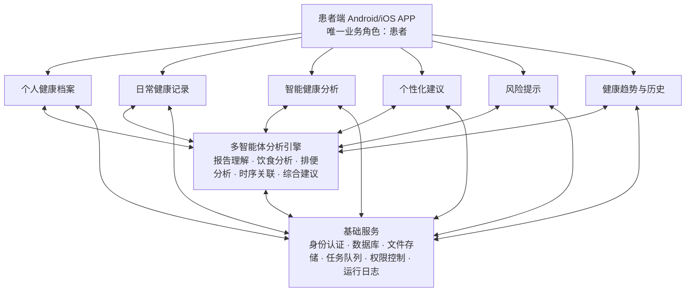
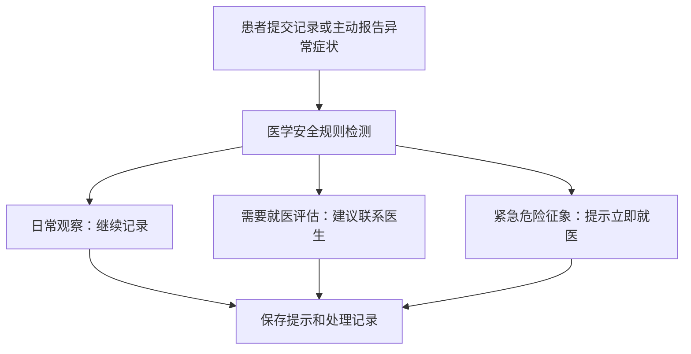
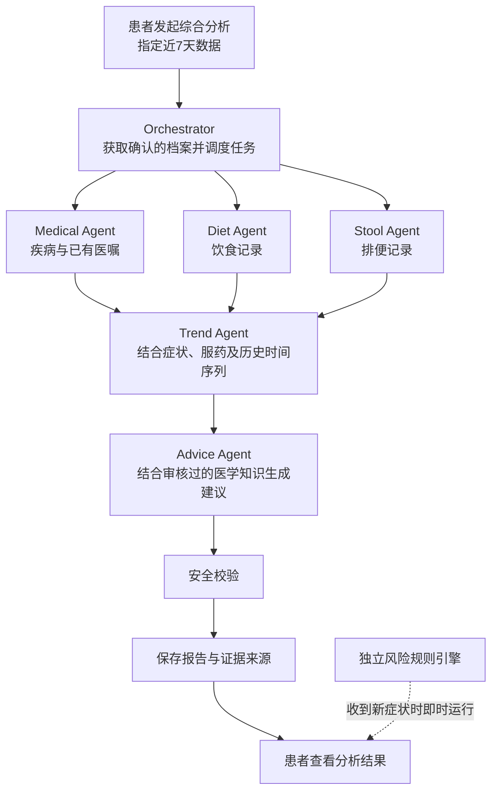

# GutCare Agent：消化道疾病多模态智能健康管理与随访系统

> **2026“仓颉杯”智能编程大赛 · 综合系统赛道 · 系统设计方案**  
> **方案定位：** 单一业务角色（患者）、多患者账户、完整健康管理闭环、多模态分析与多智能体协同  

---

## 一、项目总体定位

### 1.1 项目名称

**GutCare Agent——基于多模态数据融合与多智能体协同的消化道疾病智能健康管理系统**

### 1.2 项目目标

面向已经确诊消化道疾病、需要进行院外健康管理的患者，构建集**医疗档案管理、日常健康记录、智能分析、个性化建议和异常症状预警**于一体的软件系统。

系统融合四类信息：

1. **医疗信息：** 病历、诊断报告、医生建议、用药方案。
2. **生活信息：** 饮食、运动、服药情况。
3. **症状信息：** 粪便状态、排便情况、腹痛、腹胀等。
4. **历史信息：** 不同时期健康记录及变化趋势。

利用多模态模型与多智能体协作，结合患者具体疾病背景和长期生活记录，生成**有依据、可追溯、可持续更新**的健康管理建议。

### 1.3 产品边界

| 维度 | 设计决策 |
|---|---|
| 参赛赛道 | 综合系统赛道 |
| 业务用户角色 | **仅患者** |
| 账户体系 | 支持多个患者注册，每个账户管理各自数据 |
| 使用平台 | Android/iOS 移动端 APP（uni-app 单代码库）；本期不交付患者 Web 端 |
| 核心技术 | 多模态分析、多智能体协同、长期数据关联、医学知识检索 |
| 核心场景 | 消化道慢性疾病的院外随访与生活管理 |
| 首期支持范围 | 已确诊 IBS（肠易激综合征）的成人患者为主要验证对象 |
| 医疗定位 | 健康信息管理与辅助建议，不提供独立疾病诊断或处方决策 |

产品架构可面向多种消化道疾病设计，但首期不应宣称所有疾病均能获得同等可靠的个性化建议。建议先提供通用记录与档案管理，将 IBS 相关的饮食—症状关联分析作为第一期重点验证场景，后续逐步扩展疾病知识、规则和测试。

### 1.4 综合系统赛道的建设目标

比赛通知强调综合系统应具备较完整的业务逻辑、功能模块与数据流程，以及异常处理、安全保障和运行维护能力。其中**系统完整性与运行稳定性（25分）**和**架构设计与工程质量（25分）**合计50分。

据此确立三个目标：

- **业务完整：** 患者从建档、上传数据到收到随访反馈形成闭环。
- **智能深入：** 多智能体承担真实的数据理解、跨来源关联和建议生成任务。
- **工程可靠：** 数据可靠保存，任务可追踪，异常可恢复，安全边界清楚。

---

## 二、系统功能架构

采用 **6个业务模块 + 1个多智能体分析引擎 + 1套系统基础服务**。



这些模块共享患者档案和历史记录，通过统一后端协调，不是相互孤立的多个 AI 页面。

---

## 三、详细功能设计

### 3.1 患者健康档案管理模块

作为系统数据基础。

| 子功能 | 具体设计 | 智能技术 |
|---|---|---|
| 患者建档 | 记录基本资料、已确诊疾病、疾病管理目标 | 常规业务逻辑 |
| 病历上传 | 支持 PDF、图片等格式 | OCR、文档解析 |
| 诊断报告理解 | 提取诊断名称、检查结果、医生建议 | 医疗文本信息抽取 |
| 用药方案管理 | 保存医生开具的药物及服用计划 | 信息抽取、结构化处理 |
| 档案更新 | 支持新增报告、修改信息、保留历史版本 | 数据版本管理 |

**重点：动态患者档案。** 系统不仅保存报告原件，还对诊断、医嘱、用药信息进行结构化提取，并由患者核对确认，供后续分析使用。

示例：

| 项目 | 内容（模拟） |
|---|---|
| 已确诊疾病 | 肠易激综合征（IBS） |
| 报告来源 | 患者上传的医院诊断报告 |
| 医生建议 | 记录饮食与症状变化 |
| 当前用药 | 依据处方信息填写并确认 |
| 档案状态 | 已由患者核对 |

OCR 或模型抽取结果必须支持修正，避免错误诊断、药品名称未经确认即进入后续智能分析。

### 3.2 日常健康记录模块

| 子模块 | 患者输入 | 后端处理 |
|---|---|---|
| 饮食记录 | 饮食图片、食品名称、用餐时间、份量（可选） | 食物识别、结构化饮食日志 |
| 排便记录 | 粪便图片、时间、次数、形态 | 辅助识别 Bristol 类型，保存用户确认结果 |
| 症状记录 | 腹痛、腹胀、腹泻、便秘、恶心等 | 记录严重程度、持续时间与变化 |
| 服药打卡 | 服药时间、是否服用、漏服情况 | 对照确认的处方计划统计依从性 |
| 运动记录 | 运动类型、时长、主观感受 | 统计活动习惯及其变化 |

**症状记录应当作为独立核心子模块。** 只有饮食、粪便图片，不足以支撑可靠的个性化分析；伴随症状、持续时间等信息也需要采集。

粪便照片用于辅助估计外观，不能据此诊断疾病或排除出血；患者应当能手动记录和修改分类结果。

### 3.3 智能健康分析模块

| 分析方式 | 触发条件 | 分析内容 |
|---|---|---|
| 单条记录分析 | 上传饮食或粪便记录 | 结构化识别当前记录 |
| 综合健康分析 | 患者主动发起 | 联合诊断、饮食、排便、症状和服药信息 |
| 周期健康分析 | 查看周期报告或任务定时触发 | 近期趋势、变化与随访建议 |

优先开发**综合健康分析**，使多个 Agent 形成实质性的任务协作，并作为决赛实机演示的主要亮点。

### 3.4 个性化健康建议模块

输出分成四个部分：

1. **饮食建议：** 结合已确诊疾病、已有医嘱及近期记录，提示值得观察或与专业人员讨论的饮食习惯。
2. **生活方式建议：** 结合运动及症状记录提供一般性的生活管理提示。
3. **服药提醒：** 展示处方计划与打卡情况，不自动改变药物或剂量。
4. **依据与解释：** 标注建议所引用的诊断记录、生活日志、审核过的医学知识；信息不足时明确说明。

对于 IBS 等疾病，应重视患者间差异，不向所有患者套用统一的限制性饮食方案。

### 3.5 异常症状与风险提示模块

采用 **“医学规则引擎优先，大模型辅助解释”** 的安全架构。



医学风险分级规则应由合格专业人员审核。对黑色柏油样便、明显消化道出血表现等危险征象，系统应提供清晰的就医提示。**紧急提示不应等待耗时的智能体分析完成。**

初赛重点是异常信息收集、规则检测、分级提示、通知保存、患者查看与确认，不宣称能够预测重大疾病。

### 3.6 历史健康趋势模块

建议提供：

- 每周、每月排便次数和 Bristol 类型分布。
- 腹痛、腹胀等症状的时间趋势。
- 服药打卡完成情况。
- 饮食与症状记录的时间关联展示。

展示时明确区分**观察到的时间关联**与**已经证明的因果关系**。

---

## 四、多智能体系统详细设计

### 4.1 智能体划分

采用 **1个调度智能体 + 5个业务智能体**，另设独立安全规则模块。

| 智能体 | 核心职责 | 主要输出 |
|---|---|---|
| Orchestrator（调度） | 分配任务、协调执行、管理失败重试 | 执行状态与任务结果 |
| Medical Agent | 解析医院报告与已有医嘱 | 结构化医疗档案 |
| Diet Agent | 分析饮食图片和饮食记录 | 食物类别、饮食摘要 |
| Stool Agent | 辅助分析粪便图片与排便记录 | 形态估计、排便特征 |
| Trend Agent | 联合历史饮食、症状、服药等 | 时间变化及关联性发现 |
| Advice Agent | 根据患者档案和医学知识生成建议 | 有依据的生活管理建议 |

**Safety Engine（医疗安全规则引擎）**不完全交由大模型控制，负责及时识别明确的危险征象及校验输出内容。

### 4.2 多智能体协作流程



设计原则是**围绕结构化患者数据协作**，不是让多个 Agent 仅进行自然语言聊天。新症状录入时，风险规则也要独立执行。

### 4.3 Agent 间的数据协议

建议统一使用结构化数据传输，包含任务信息、时间区间、发现、证据来源、不确定性、执行状态、模型版本等。示例：

```json
{
  "task_id": "analysis_001",
  "patient_id": "patient_001",
  "analysis_type": "diet_symptom_trend",
  "time_range": "last_7_days",
  "observations": [
    {
      "finding": "部分餐次后记录了腹胀",
      "source_ids": ["meal_003", "symptom_008"],
      "confidence": "medium"
    }
  ],
  "needs_confirmation": false
}
```

实际系统还应保留输入数据版本、处理时间、错误代码、模型版本、输出校验结果等字段，便于复现和定位问题。

### 4.4 医学知识库设计

采用 **RAG（检索增强生成）+ 结构化医学安全规则**。

| 知识类型 | 作用 |
|---|---|
| 疾病患者教育资料 | 提供疾病背景与日常管理知识 |
| 饮食、生活方式指南 | 辅助形成有依据的健康建议 |
| 医疗风险规则 | 支持异常症状分级提示 |
| 患者已有诊断和医嘱 | 用于患者个性化约束与建议匹配 |

区分两类信息：

- **个人数据：** 特定患者发生过什么、其医生说过什么，保存在患者私有数据库。
- **医学知识：** 经审核的通用信息，保存在可更新的知识库。

无法检索到足够证据时，应当标注信息不足，不能靠大模型编造结论。

---

## 五、核心创新：长期、多模态、跨来源健康信息融合

### 5.1 主要创新点

1. **纵向随访而非一次性问答。** 依托长期患者档案，持续更新分析结果。
2. **多模态、多智能体的实质性协同。** 整合报告文本、饮食图片、粪便图片、症状记录和时间序列数据。
3. **证据驱动、可追溯的个性化建议。** 输出结论必须保留对应的患者记录、医嘱或知识依据。
4. **工程化医疗安全约束。** 规则优先分流、数据校验、模型失败降级以及任务恢复。

### 5.2 典型业务案例（模拟数据）

患者已确诊 IBS，已有医生建议为“记录饮食与排便变化”。最近记录如下：

| 日期 | 饮食信息 | 排便与症状 |
|---|---|---|
| 周一 | 高脂餐 | 腹胀 |
| 周二 | 普通饮食 | 无明显不适 |
| 周三 | 高脂餐 | 腹胀、稀便 |

分析过程：

1. Diet Agent 提取餐次和食物特征。
2. Stool Agent 整理排便类型及变化。
3. Trend Agent 对齐用餐、排便和症状时间，标记部分时间关联。
4. Advice Agent 结合已确认的诊断、医嘱和医学知识，生成观察建议。

可能的安全输出示例：

> 近期部分餐次与腹胀记录存在时间关联，但样本较少，尚不能判断因果关系。建议继续记录饮食、症状发生时间及排便状态；如果症状持续或加重，应咨询医生。

**说明：** 本案例为模拟数据，不构成临床结论，也不能作为模型有效性的测试证据。

---

## 六、软件技术架构与数据设计

### 6.1 技术路线概览

采用**模块化单体业务后端 + 独立异步智能分析任务**，在比赛周期内避免过早引入复杂微服务。

| 层次 | 技术 | 主要作用 |
|---|---|---|
| 前端 | Vue 3 + TypeScript | 患者操作界面 |
| 业务后端 | Python FastAPI | 认证、数据管理、API 服务 |
| 关系数据库 | PostgreSQL | 患者档案与结构化记录 |
| 文件存储 | MinIO Community（锁定源码 commit 构建） | 报告与图片 |
| 异步任务 | Redis + RQ/Celery | 耗时的分析任务 |
| Agent 编排 | Python 工作流或 LangGraph | 调度与任务状态控制 |
| 模型服务 | 支持文本与视觉的大模型 | 报告、饮食及粪便信息理解 |
| 医学知识检索 | PostgreSQL/pgvector 或小型检索服务 | 检索审核过的医学资料 |
| 部署 | Docker Compose | 可复现部署环境 |

本表为总体概览；可执行版本和精确边界以 `技术方案.md` 及已接受 ADR 为准。

比赛通知允许自主技术路线，鼓励使用仓颉编程语言。若需要争取相关额外加分，可评估将实际运行的规则匹配或事件处理模块采用仓颉实现并与主系统集成，但不应牺牲稳定性只为加入展示代码。

### 6.2 核心数据库实体

| 实体 | 关键内容 |
|---|---|
| Patient | 患者账户、基本资料 |
| MedicalDocument | 原始报告、上传时间、解析状态 |
| MedicalProfile | 患者确认后的诊断和医嘱 |
| MedicationPlan | 用药计划及其来源 |
| DietRecord | 食物信息、用餐时间、图片 |
| StoolRecord | 排便时间、形态、图片、确认结果 |
| SymptomRecord | 症状类型、程度、持续时间 |
| MedicationCheckin | 服药打卡信息 |
| ActivityRecord | 运动信息 |
| AnalysisTask | 分析任务状态与执行记录 |
| AnalysisResult | 分析结果、证据、模型版本 |
| HealthAdvice | 建议文本、依据与反馈 |
| RiskAlert | 风险提示、触发规则、确认状态 |

每条记录必须关联当前患者账户；模型推断值和用户确认值应分别保存，防止把未经确认的模型结果当作医疗事实。

### 6.3 工程可靠性设计

**账户和数据安全：**

- 所有查询基于已认证患者身份做权限校验。
- 不允许仅凭文件 ID 越权访问其他患者报告或图片。
- 提供删除个人记录的能力。
- 不将诊断、药品信息或图片内容直接暴露在普通运行日志中。

**异步任务可靠性：**

- 明确待处理、处理中、待确认、已完成、失败等状态。
- 支持超时、有限重试和结果保存。
- 避免重复请求产生重复报告或风险通知。

**模型可靠性：**

- 模型输出必须经过约定的数据结构校验。
- 模糊或不适宜的图片允许返回“无法可靠识别”。
- 错误报告字段支持用户修改确认。
- 模型服务不可用时仍可以保存和查看患者数据。

**医疗安全：**

- 危险征象识别采用审核过的规则并优先提示。
- 不自动诊断新疾病，不自动建议改变处方。
- 信息不足时明确说明不确定性。

**隐私与数据合规：**

- 参赛演示优先使用合成病例或获得授权的匿名化测试资料。
- 涉及真实医疗健康信息时，明确授权、访问控制和数据保留/删除机制。
- 调用第三方模型前评估数据传输范围、授权及供应商政策。

---

## 七、系统测试与智能效果评估

| 测试类别 | 测试内容 | 可展示的结果 |
|---|---|---|
| 功能测试 | 上传、查看、修改、删除、打卡 | 用例通过率 |
| 集成测试 | 上传后触发分析并保存结果 | 端到端执行记录 |
| 数据隔离测试 | 不同患者是否能查看对方数据 | 权限测试结果 |
| 异常测试 | 错误文件、模糊图片、模型超时 | 错误处理与恢复记录 |
| 智能分析测试 | 报告抽取、饮食识别、排便类型估计 | 与人工核查或标注比较 |
| 多智能体对比 | 单模型与分工协作模型对比 | 证据完整率、冲突率、耗时 |
| 医疗安全测试 | 危险征象与药物调整请求 | 规则触发、输出安全性 |

### 7.1 多智能体消融/对比实验

- **Baseline：** 一个大模型直接处理相同的患者信息并生成建议。
- **Proposed：** 分别解析报告、饮食和排便，做时序关联，然后生成带来源的建议。
- **对齐条件：** 尽量使用相同基础模型、病例集和医学知识资源。
- **评估维度：** 报告信息提取准确性、证据完整率、建议与医嘱冲突率、幻觉/不支持结论发生率、推理耗时。

需采用真实运行的结果与人工核查，不应提前假定多智能体一定更优，也不得伪造测试数据。

---

## 八、初赛开发范围与时间规划

根据比赛通知，初赛作品提交截止日期是**2026年10月23日**，决赛日期为**2026年11月7日**。

| 阶段 | 日期 | 主要工作 |
|---|---|---|
| 第一阶段：业务与数据基础 | 10月13—15日 | 定义实体和 API、登录、健康档案、饮食/排便/症状记录、数据库 |
| 第二阶段：智能分析引擎 | 10月16—18日 | 报告提取、饮食/排便分析、Agent 编排、结构化结果存储 |
| 第三阶段：闭环和安全 | 10月19—20日 | 综合建议、规则提示、任务状态、历史结果、失败处理 |
| 第四阶段：集成与提交 | 10月21—23日 | 联调、测试、系统文档、仓库历史、演示视频、部署验证 |

**初赛最小完整范围（优先）：**

患者账户 → 报告上传与确认 → 饮食和排便/症状记录 → Agent 综合分析 → 个性化建议 → 风险提示 → 历史保存。

运动管理、精细图表、丰富统计等可在核心链路稳定后完善，但初赛提交版本必须已经可运行、可测试、可验证。

### 8.1 决赛实机演示建议

控制在约8—10分钟，展示以下流程：

1. 患者登录，上传模拟诊断报告并确认信息抽取结果。
2. 上传饮食、粪便记录，补充症状和服药打卡。
3. 发起综合分析，展示 Agent 执行状态和中间结果。
4. 查看带证据来源的建议和历史健康趋势。
5. 提交包含危险征象的模拟记录，展示安全提示。
6. 切换另一患者账户，验证数据隔离；展示模型失败时的降级处理。

---

## 九、项目创新点与综合系统评分的对应关系

| 综合系统赛道评分维度 | 重点展示内容 |
|---|---|
| 系统完整性与运行稳定性（25分） | 单一业务角色下的完整随访流程、多患者独立账户、异常处理 |
| 架构设计与工程质量（25分） | 分层架构、结构化协议、异步任务、数据安全和恢复机制 |
| 智能技术应用深度（20分） | 多模态理解、跨来源时序关联、多智能体协作、证据追溯 |
| 创新性与应用价值（15分） | 从单次健康问答转向持续、个性化的消化道慢病生活管理 |
| 测试、部署、材料与答辩（15分） | 可复现部署、测试报告、对比实验、文档和演示 |

比赛通知还明确要求综合系统赛道提交包含版本控制历史的**源代码仓库地址**、**项目说明**、**系统设计文档**、**可运行程序与部署文档**、**演示视频**、**第三方模型/API/数据集使用说明**。因此从开发初期就应规范记录 Git 提交，不要最后再补造历史。

仓颉编程语言相关技术在符合要求的情况下有最多5分额外加分，总分不超过100分；实际加分以官方评审为准。

---

## 十、最终建设建议

建议围绕三个核心能力安排资源：

### 核心一：持续更新的患者健康档案

将医院报告、既有医嘱与日常记录关联，而不是只提供文件上传和存储。

### 核心二：跨模态、多智能体联合分析

统一患者时间线，让医疗信息、饮食、排便与症状记录相互关联，输出有证据支持且保留不确定性的建议。

### 核心三：完整可靠的业务闭环

实现患者输入、任务运行、建议输出、安全校验、历史保存、异常恢复的真实闭环。

**总体策略：以患者健康管理为产品主线，以跨来源智能分析为技术亮点，以软件工程完整性为综合系统赛道的基础。**

后续实施时应优先细化四项内容：**前端页面清单、数据库 ER 关系、各 Agent 输入输出接口、端到端数据流**。明确接口与数据契约后再拆分团队开发任务。

---

## 附：方案依据与使用说明

- **赛事依据：** 用户提供的《2026“仓颉杯”智能编程大赛通知.pdf》（赛事主题、赛道要求、时间节点、评分标准、提交材料等）。如官方平台后续发布补充通知，应以最新官方规定为准。
- **方案性质：** 本文是依据团队当前设想形成的系统设计建议，不代表已完成功能或已经验证临床有效性。
- **医疗边界：** 健康管理建议和规则示例仅作产品设计说明，实际使用前需由相关专业人员审查临床内容；不得代替医生诊疗。
- **模拟案例：** 本文的患者信息、饮食和症状数据均为说明用途，不得用于宣称真实医学效果。
